# Transcript: 202630_w06_stacksandqueues.mp4

- Source: `C:\Users\hiros\study stuff for cursor\Algo\202630_w06_stacksandqueues.mp4`
- Duration: 00:08:53
- Segments: 157, screenshots: 12
- Whisper model: `large-v3` (auto-generated; may contain recognition errors)

## [00:00:00]

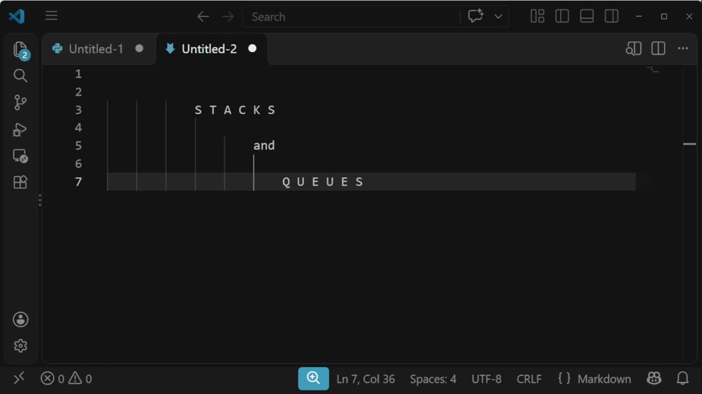

`[00:00:00]` In this video, I'm going to discuss two data structures, stacks, and queues. `[00:00:05]` Unlike other data structures that we have covered in this course, `[00:00:08]` which add complexity and therefore add new features, `[00:00:12]` these two data structures are noteworthy in the other direction. `[00:00:15]` They're noteworthy because of how uncomplex they are. `[00:00:19]` Each is basically like less than a list. `[00:00:23]` A list minus some features, sort of. `[00:00:25]` That's sort of not right, but it's sort of right. `[00:00:26]` So, like, if a Python list is a bicycle or maybe an e-bike, `[00:00:31]` these are just like a single wheel that you can, like, balance on. `[00:00:34]` But surprisingly, like a single wheel, they're actually still useful. `[00:00:38]` And we're going to use them for things. `[00:00:41]` So let me just get into it.

## [00:00:45]

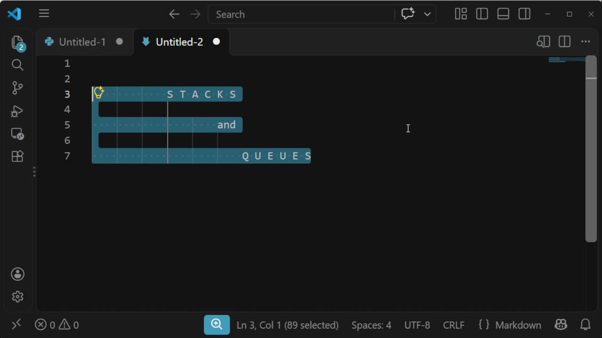

`[00:00:46]` And I don't have any cool diagrams for this one, so you just have to deal with words. `[00:00:52]` So a stack can only do a few things. `[00:00:56]` You can put something into it. `[00:00:59]` You can... `[00:01:00]` Hmm. `[00:01:02]` I just have to move my mic stand. `[00:01:04]` You can get something out. `[00:01:08]` And when you get something out, it both removes it, but it also gives it to you, right? `[00:01:12]` It's not just lost. `[00:01:13]` You can have it. `[00:01:17]` And you need to have some way of knowing if it's empty. `[00:01:20]` Different things do it different ways. `[00:01:22]` Maybe you can just call this thing and you get an exception if it's empty. `[00:01:25]` Maybe there's a separate method. `[00:01:26]` I don't know. `[00:01:26]` Different, right? `[00:01:27]` And that's it. `[00:01:28]` That's it. `[00:01:29]` Sometimes people add something like peek at the top.

## [00:01:30]

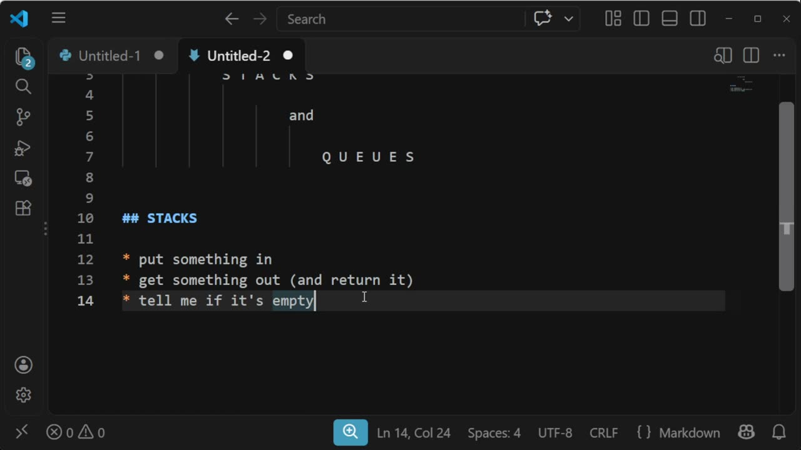

`[00:01:35]` Sometimes a few stacks will let you ask for... `[00:01:40]` The size. `[00:01:42]` But mostly not. `[00:01:44]` Mostly it's just these four. `[00:01:47]` Different implementations will have different names, but there's some classic names. `[00:01:56]` This is called push. `[00:01:58]` And this is called pop. `[00:02:03]` And if a computing science person talks about push and pop, they almost certainly are talking about a stack. `[00:02:08]` Like this is really, really overwhelmingly common. `[00:02:12]` And what's this called? `[00:02:13]` I don't know. `[00:02:14]` Maybe it's called...

## [00:02:15]

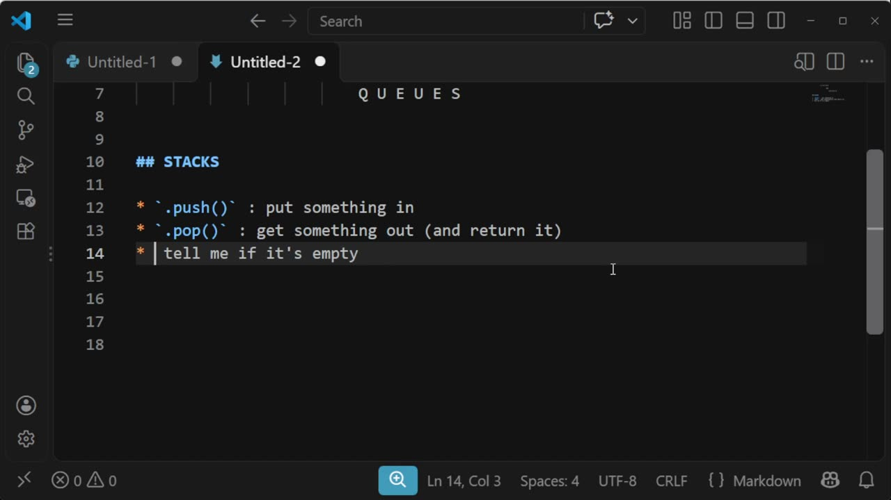

`[00:02:16]` You know. `[00:02:27]` It needs to have some kind of name. `[00:02:29]` And so, as mentioned, you can only look at what's in there by taking something out. `[00:02:36]` And you can only decrease what's in there. `[00:02:40]` Like you can only take something out if you're going to get it back. `[00:02:42]` Of course, you can get it back and then throw it away. `[00:02:44]` It's up to you. `[00:02:45]` Okay. `[00:02:46]` And so it's as simple as this. `[00:02:47]` But the main catch is every time you ask for something, there's a commercial of this, right? `[00:02:58]` Every time you pop, you can't stop.

## [00:03:00]

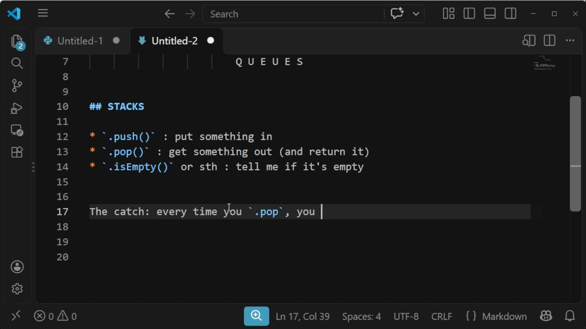

`[00:03:00]` Every time you pop... `[00:03:03]` What you get is the most recent thing that was pushed, right? `[00:03:17]` So if you go... `[00:03:19]` If you put A and then B and then C in there, and then you go pop, what you get out is the C comes out, right? `[00:03:26]` And if you then pop again, the B comes out. `[00:03:30]` And if you then push in D, and then you push in E, then you push in F, and then you ask for something out, `[00:03:36]` the B came out after the C. `[00:03:42]` And then I hit pop again, then I'm going to get the F out, right?

## [00:03:45]

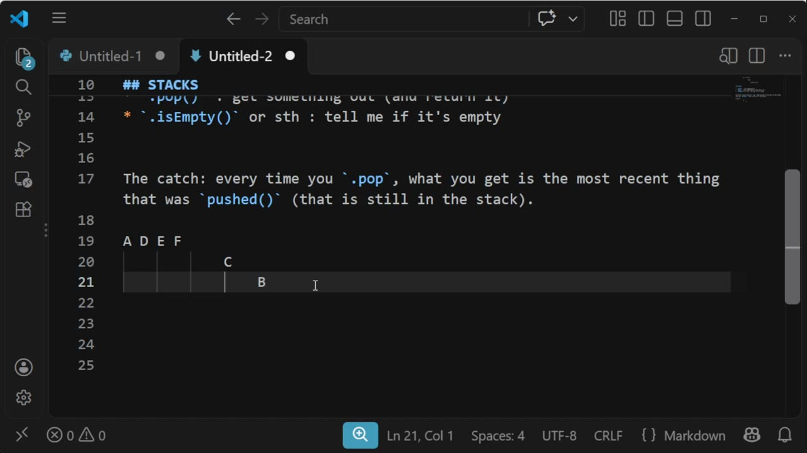

`[00:03:52]` And that's it. `[00:03:54]` And you might have noticed that this pop is familiar. `[00:03:57]` And in fact, in JavaScript, both pop and push are present. `[00:04:01]` And that is not a coincidence, right? `[00:04:03]` I don't know why in Python lists, they didn't call it push, but they didn't. `[00:04:11]` Now, I've been talking about it like it's a list. `[00:04:13]` I don't want you to get the wrong impression. `[00:04:15]` This is a data structure. `[00:04:16]` It's allowed to be different on the inside. `[00:04:17]` It's not what you expect. `[00:04:18]` It might be a list. `[00:04:19]` It might not be a list. `[00:04:21]` Don't think it's got to be a list. `[00:04:24]` But I admit, in the case of a stack, it probably is a list underneath. `[00:04:28]` And if we need a stack, we're just going to go ahead and use a list.

## [00:04:30]

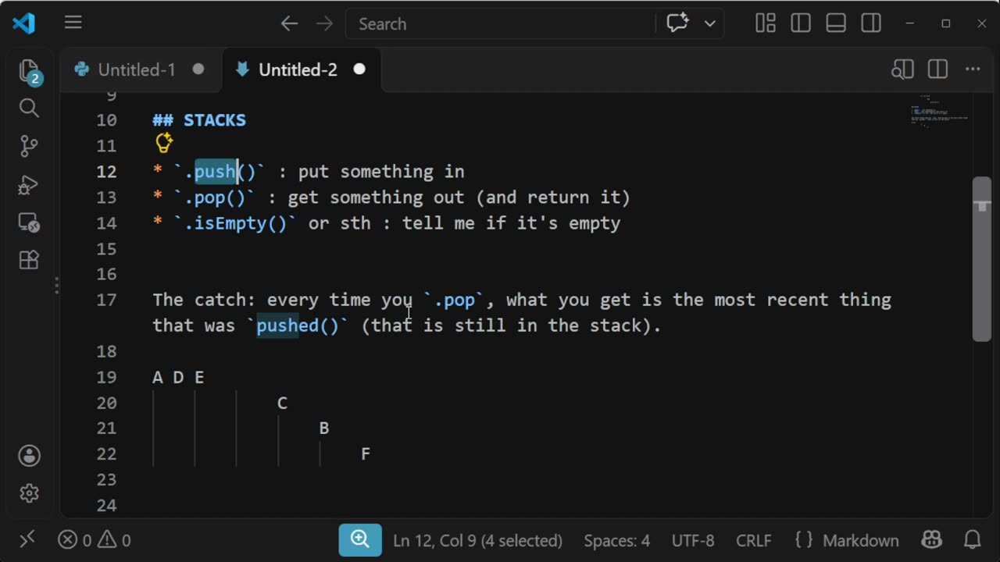

`[00:04:31]` We're going to use append and pop, and we've got a working stack. `[00:04:36]` Okay. `[00:04:37]` And this catch is also known as last in, first out. `[00:04:46]` And that's LIFO, right? `[00:04:48]` And so you should know that this means. `[00:04:50]` A thing that's a stack. `[00:04:51]` It's what, it's what a stack does. `[00:04:53]` Sorry. `[00:04:53]` Let me say that differently. `[00:04:55]` This is the behavior of a stack, but sometimes people will just call a stack, a LIFO or like meh, right? `[00:05:04]` It's like, uh, when somebody's speedy and you just call them speedy, like it's their name. `[00:05:10]` Oh, by the way, and the metaphor here that this is based on is a stack of plates in a cafeteria, right? `[00:05:14]` So like they're really heavy plates.

## [00:05:15]

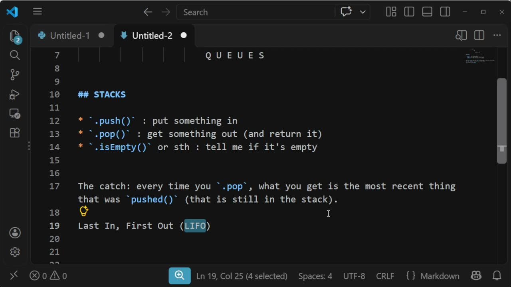

`[00:05:15]` They're so heavy. `[00:05:16]` You can only pick up one at a time. `[00:05:18]` And so you can put a plate on top and it pushes the whole stack down on a spring, maybe, or you can take the top plate off, but you can't like sneak in the middle. `[00:05:24]` Because they're too heavy. `[00:05:25]` You can't, you can't make that work. `[00:05:27]` This is not a very good metaphor because a real stack of plates, you'd be able to count the size. `[00:05:32]` Um, and usually stacks, you can't do that. `[00:05:34]` Although sometimes you can. `[00:05:37]` Okay. `[00:05:38]` And one more thing is, um, right. `[00:05:50]` We talk about the call stack sometimes and yes, the call stack is a stack in this sense. `[00:05:54]` The call stack can be pushed and popped. `[00:05:57]` And, uh, that's about it for stacks.

## [00:06:00]

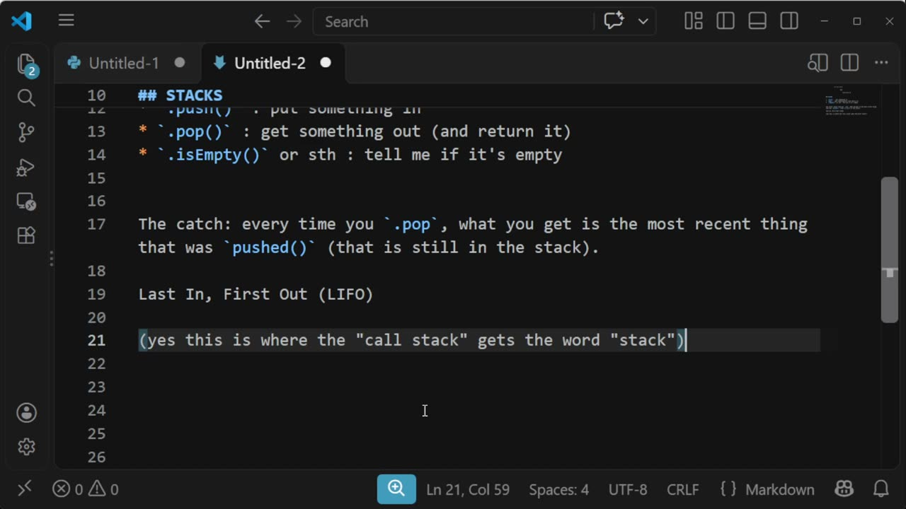

`[00:06:01]` Zoom, zoom, got to know all this about a stack. `[00:06:05]` It's not very much. `[00:06:05]` No, you got to know this. `[00:06:07]` Okay. `[00:06:07]` And then we're halfway done. `[00:06:09]` One more. `[00:06:12]` A queue also has the same three things. `[00:06:25]` I'm just going to, um, change those names for a second. `[00:06:29]` A queue is the same three things. `[00:06:42]` Whenever you ask something out, you get the thing that's been in there the longest.

## [00:06:45]

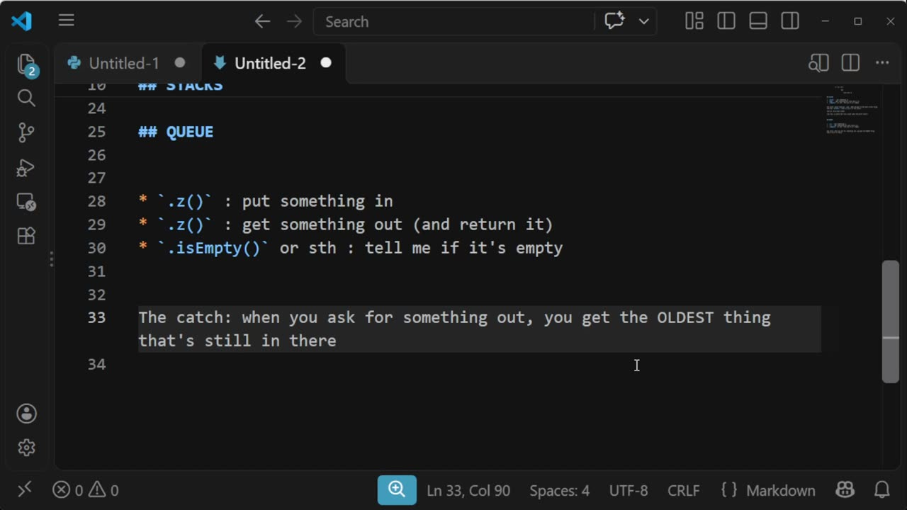

`[00:06:46]` Right. `[00:06:47]` Um, queues occur in real life. `[00:06:49]` Like when you're lining up for, you know, a movie ticket or get seated in a restaurant or whatever. `[00:06:56]` Um, that's called a queue if it works this way. `[00:06:58]` And that's where we get the word from. `[00:07:00]` Um, stacks have these super standard. `[00:07:05]` Everybody knows them. `[00:07:06]` Names queues don't have super normal names, super standard names, but I'll give you one example. `[00:07:12]` Maybe we call them insert, remove. `[00:07:15]` I'll give you a different example in class. `[00:07:18]` Um, but I want to talk about in class, um, you could use, why do I keep doing that? `[00:07:26]` You could use a list here again, like a stack. `[00:07:29]` You don't know what, how it really works underneath.

## [00:07:30]

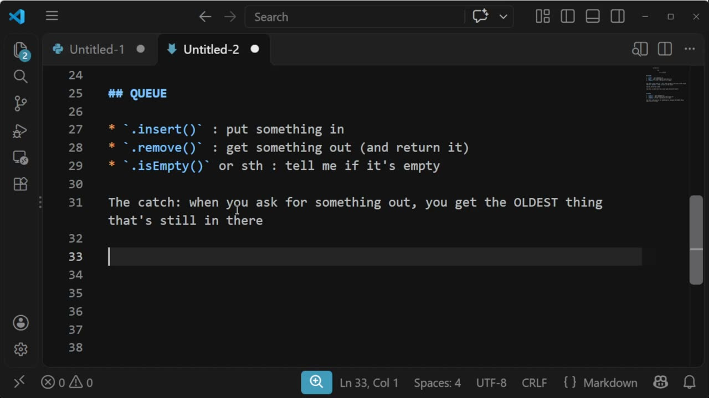

`[00:07:31]` But if we try to build one ourselves, what are you gonna do? `[00:07:33]` You can use this. `[00:07:33]` Oh, I should do an example first, right? `[00:07:35]` So I put a, and then I put B and then I put C and then I put D and then I ask for something out. `[00:07:38]` And what I get out is a, and then I put E in and then I ask something out and what I get is B and I ask something out. `[00:07:49]` What I get is C, right? `[00:07:51]` That's pretty, I don't know. `[00:07:52]` This is so simple that I don't know. `[00:07:55]` I'm afraid, I'm afraid I'm going to over, like overcomplicate it by talking. `[00:08:00]` That's something I've done before. `[00:08:01]` I know, I know you're surprised. `[00:08:04]` Okay. `[00:08:04]` And. `[00:08:05]` Okay. `[00:08:05]` And, uh, you could use a list for this, but there are some performance concerns and I encourage you to think about that for yourself, right? `[00:08:13]` If you were going to use a list, how would you, you know, what would you do to make insert work?

## [00:08:15]

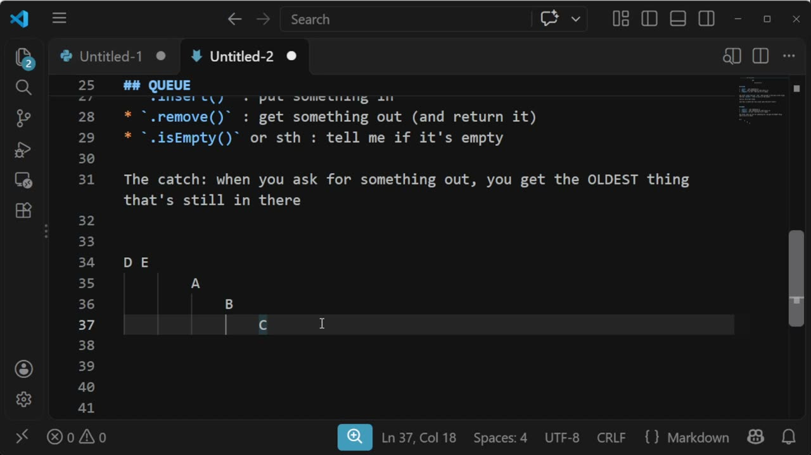

`[00:08:19]` What would you do to make remove work? `[00:08:21]` And what would the costs be? `[00:08:22]` And why are we sad about that? `[00:08:25]` Right. `[00:08:25]` And actually, by the way, there's more than one way. `[00:08:27]` So see if you can figure out two options and see if one of them is better than the other. `[00:08:31]` Okay. `[00:08:32]` So again, much like stacks, you should know that you. `[00:08:35]` You can put something in, you should know, you get something out and you should know what happens if you put things and take them out again, and you should know how to spell it. `[00:08:42]` And that's it. `[00:08:42]` You should know about these things. `[00:08:43]` We are going to need to know these things in class. `[00:08:47]` Um, this is not just torment for the sake of torment. `[00:08:52]` That's all.
