# Transcript: 202630_w06_trees.mp4

- Source: `C:\Users\hiros\study stuff for cursor\Algo\202630_w06_trees.mp4`
- Duration: 00:28:58
- Segments: 335, screenshots: 43
- Whisper model: `large-v3` (auto-generated; may contain recognition errors)

## [00:00:00]

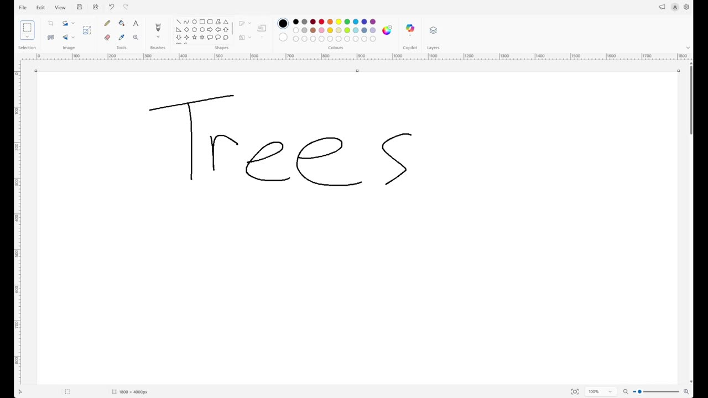

`[00:00:00]` Hello, in this video I'm introducing Trees, a data structure for representing hierarchical `[00:00:04]` relationships. We'll look at what makes a tree a tree, we'll learn the terminology we're going to `[00:00:09]` use, and then briefly we'll look at implementation. I'm just going to take a moment to talk about why `[00:00:14]` we care about trees because there are some different reasons and I think it helps to `[00:00:17]` have a little bit of overview. I have four reasons. Reason number one, trees are a natural `[00:00:26]` fit for hierarchical data. If you work for a company, you have a boss and your boss has a boss `[00:00:31]` and so on. If you want to understand spoken language, most linguistic theories think that `[00:00:39]` human language is hierarchical. The evolutionary tree of life is called a tree for a reason,

## [00:00:45]

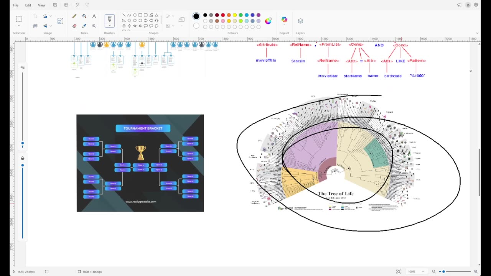

`[00:00:46]` it's hierarchical. Often tournaments are organized into hierarchical single elimination brackets, `[00:00:52]` i.e. trees. So trees can be good `[00:00:56]` for hierarchical relationships. If you work for a company, you have a boss and your boss has a `[00:00:56]` for representing stuff that comes from outside of computing. I think this reason is overrated. `[00:01:01]` I'm not going to go into why, but anyway, this is an argument. Okay. Reason number two, trees can

## [00:01:09]

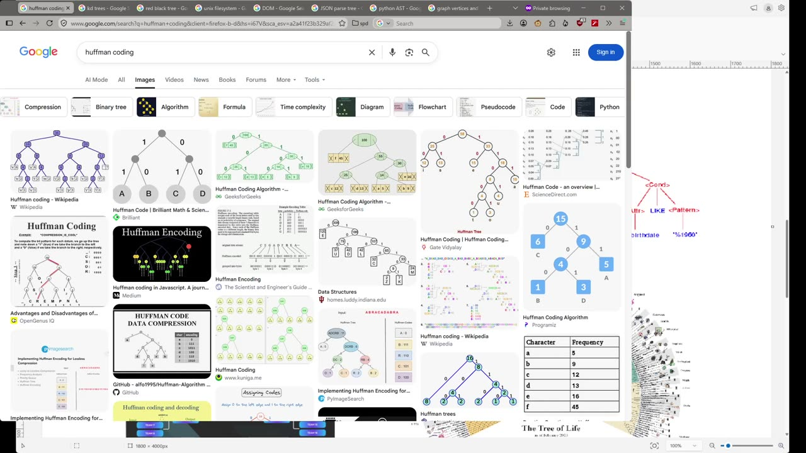

`[00:01:12]` be used as ingredients in more complicated data structures. So we got compression algorithms. I `[00:01:17]` got an example of some spatial partitioning algorithms. We got some self-balancing BSTs. `[00:01:24]` We got all sorts of stuff, right? If you're going to go on to do more computing science `[00:01:28]` theory, a whole bunch of this stuff comes up. People want to teach you this stuff. Maybe you `[00:01:33]` are interested in this stuff. And most of these use binary trees. These are binary trees. These `[00:01:38]` are binary trees. These are binary trees. Most of these fancy algorithms use binary trees and `[00:01:45]` binary trees are mostly used for fancy algorithms. But I'm assuming that most of you watching this `[00:01:50]` video are not expecting to go to a whole bunch of computing science theory. So I'm not putting a lot

## [00:01:54]

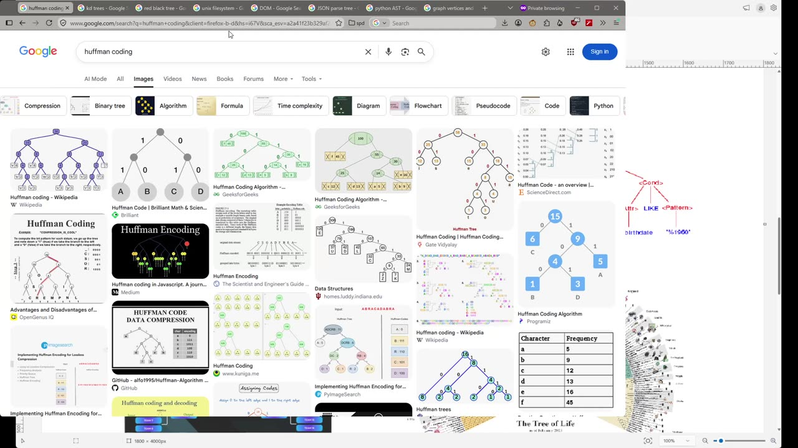

`[00:01:56]` of emphasis on this kind of tree. `[00:01:58]` As such, we will not be discussing binary trees in any detail. And so you should be aware of that. `[00:02:04]` If you have exposure to binary trees from other courses or something, you might need to pay extra `[00:02:09]` attention because we're not doing binary trees. So don't get mixed up. Okay. Reason number three, `[00:02:16]` and I think this is the big one for the audience of this video. Reason number three is that, `[00:02:22]` uh, you know, theory or not, the people who came before you to make technology, `[00:02:28]` the computer scientists, the software developers, the it organizers, the, you know, the people who `[00:02:33]` make operating systems, these people like trees. So they use trees for a lot of things because `[00:02:39]` trees make sense to them. And so when you work in technology, you're going to see a lot of trees.

## [00:02:39]

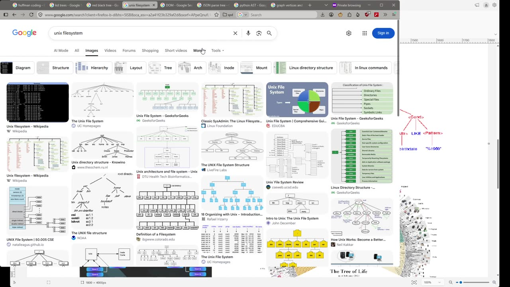

`[00:02:46]` Uh, you know, a file system is a tree. Um, not everything on this page is about HTML,

## [00:02:49]

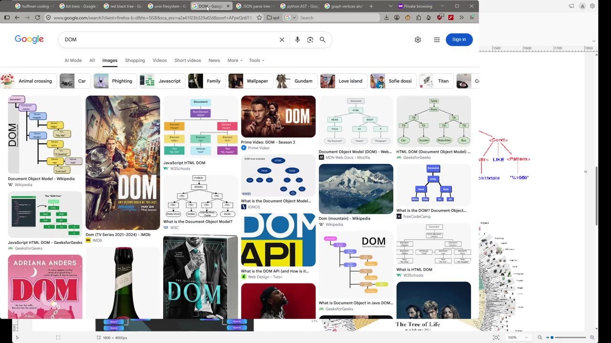

`[00:02:52]` but the HTML results, they're all trees, right? Because the HTML DOM is a tree.

## [00:02:57]

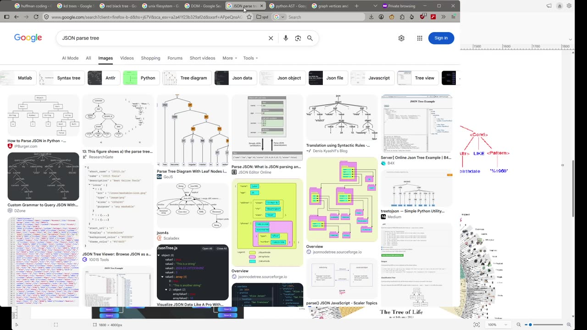

`[00:02:58]` Um, lots of serialization formats like JSON or XML. Those are trees. Um, uh, the great majority of `[00:03:06]` serialization formats, actually, um, programming languages are sort of trees under the hood and `[00:03:12]` so on. So if you work in tech, it's good to be comfortable with trees so that if something comes `[00:03:17]` up, uh, you're just like, Oh yeah, yeah, it's a tree, whatever, no big deal. And the fourth reason `[00:03:22]` is that, and this is again, a kind of an, if you go on in computing science, but this is when it's `[00:03:26]` maybe a bit more practical than the thing I said at the beginning. So if you go on and you're `[00:03:28]` learning, um, you might want to learn about graphs and graphs are not the same as trees, `[00:03:34]` but they have a lot of the same concepts and trees are kind of all stepping stone to learning about `[00:03:38]` that. So there's four reasons that you would care about trees. Uh, I would argue the one about file

## [00:03:42]

`[00:03:44]` systems and HTML and stuff. Um, that's probably the most practical reason. Oh, um, or, oh, right. `[00:03:51]` Here's something I didn't think of. Uh, just a quick search network administration, uh, network `[00:03:58]` system. Uh, I think they're, they're often organized as trees or thinking about whether or not they're `[00:04:04]` currently a tree is a big deal. Blah, blah, blah, blah, blah. Okay. Lots of reasons for caring

## [00:04:06]

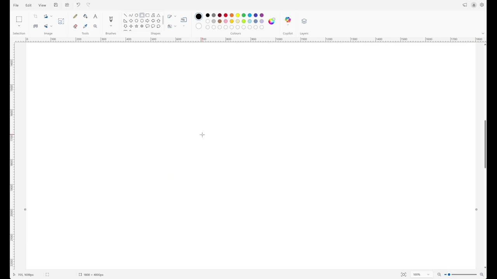

`[00:04:09]` about trees. Okay. So let's get into some more details. So a tree is a container for putting `[00:04:15]` stuff in. Um, it's a little bit like a list or a dictionary. Let's stop for a second and restate `[00:04:21]` some obvious facts about lists and dictionaries. Lists are sequences. There are a bunch of things `[00:04:28]` in a line. Um, `[00:04:30]` They intrinsically have, unlike what I just drew here, `[00:04:33]` they have a first and a last, they have an order. `[00:04:38]` That's really essential to what lists are, `[00:04:40]` is that they're sequences. `[00:04:43]` Dictionaries are not sequences, `[00:04:48]` and instead they're just organized around keys `[00:04:51]` and their respective values.

## [00:04:51]

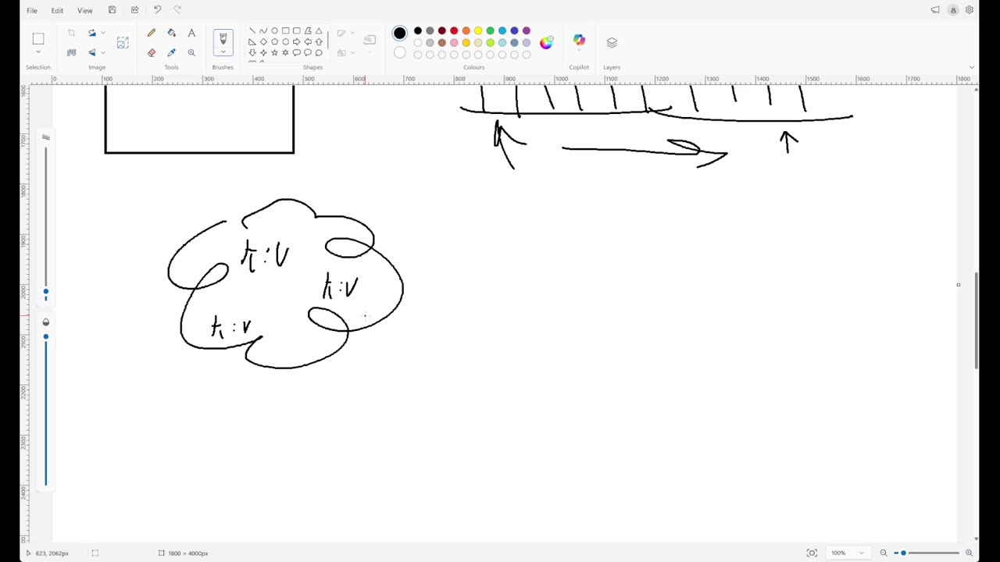

`[00:04:53]` That's kind of the essential organizing principle `[00:04:56]` of dictionaries. `[00:04:57]` I guess we also had linked lists, `[00:05:01]` and linked lists are not the same as lists, `[00:05:04]` but they are still sequence-like. `[00:05:06]` They really emphasize being in a line, having an order. `[00:05:11]` So that's three containers we already know about. `[00:05:13]` And I guess tuples are like lists, `[00:05:16]` and sets are kind of like dictionaries, sort of. `[00:05:19]` I don't want to dwell on that right now. `[00:05:22]` Okay, so all of these data structures have, `[00:05:25]` well, it's right in the name, data and structure. `[00:05:27]` Trees also have structure, but it's not in a line.

## [00:05:36]

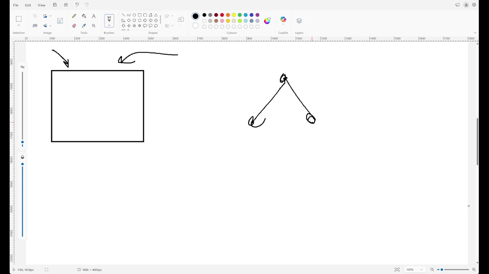

`[00:05:43]` I said I wasn't going to do binary trees, `[00:05:44]` but that was a binary tree here. `[00:05:45]` I'll fix it now, it's not a binary tree. `[00:05:46]` If you know, you know, and if you don't know, `[00:05:48]` that doesn't matter. `[00:05:53]` Trees are a, the structure of a tree is hierarchical, `[00:05:57]` as I said a few times already. `[00:05:59]` They're a little bit like a linked list though, right? `[00:06:01]` So a linked list has a bunch of, `[00:06:06]` this is a really terrible diagram, `[00:06:07]` but hopefully you know what I'm doing here. `[00:06:09]` A linked list has a bunch of nodes connected up, `[00:06:14]` and a tree also has a bunch of nodes connected up. `[00:06:19]` Okay, let me just delete all these scribbles `[00:06:21]` and draw a better tree that we can talk about.

## [00:06:21]

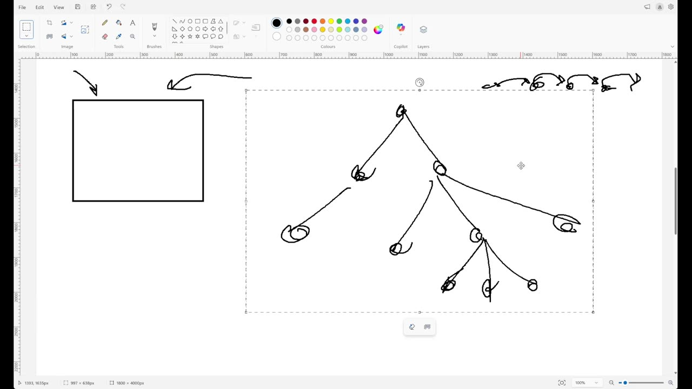

`[00:06:24]` Delete scribbles. `[00:06:31]` Okay, this is probably far too much tree, `[00:06:33]` but you know, just connect these things up. `[00:06:47]` Okay, we got a tree. `[00:06:51]` So the funny thing about computer scientists, `[00:06:52]` apparently computer scientists don't know `[00:06:55]` about how trees grow in nature. `[00:06:57]` And so they start the tree at the top, `[00:06:59]` and they grow down, right? `[00:07:02]` I don't know, go touch, well, not touch grass, `[00:07:04]` touch trees more, I guess. `[00:07:05]` But anyway, that's how we do it.

## [00:07:06]

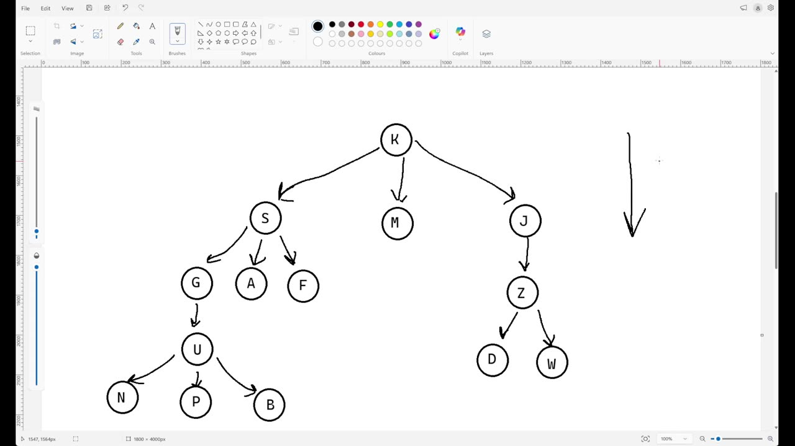

`[00:07:07]` It's weird, but it's how we do it, `[00:07:08]` is we start our trees at the top and we grow down. `[00:07:10]` So this tree has, let me see, `[00:07:11]` one, two, three, four, five, six, seven, eight, `[00:07:12]` nine, 10, 11, 12, 13, 14. `[00:07:14]` I think this is 14 nodes, unless I miscounted. `[00:07:20]` So we've got the word nodes. `[00:07:23]` Sometimes nodes are instead called vertices. `[00:07:34]` If you care about the name of the connection, `[00:07:36]` you don't have to go into the code. `[00:07:37]` So if we wanted to do some simulations `[00:07:39]` between the nodes, which you generally don't, `[00:07:41]` but sometimes you do, right? `[00:07:44]` These things here, those are called edges `[00:07:48]` or sometimes other things, but I like edges.

## [00:07:51]

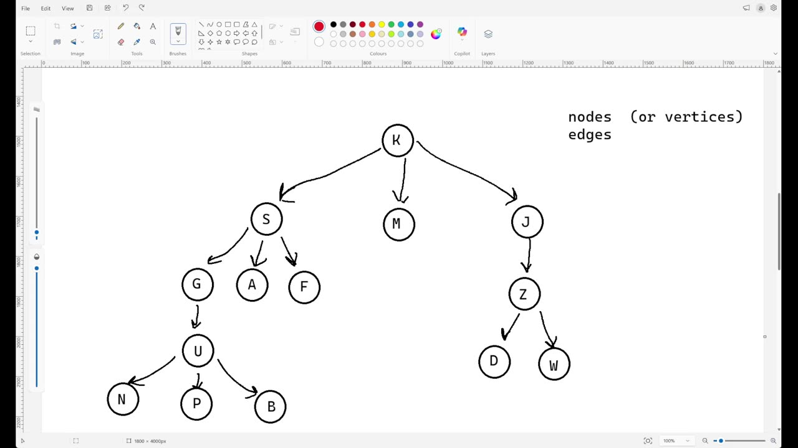

`[00:07:53]` Let's see. `[00:07:56]` Okay, and the node that is at the top is a special node. `[00:08:00]` And that is called, `[00:08:04]` that is called the root. `[00:08:06]` And again, if you'd ever looked at a real tree, `[00:08:07]` you would know, the root goes at the bottom, but, `[00:08:08]` but we put the root at the top. `[00:08:13]` So linked lists also have, you know, like sequences, `[00:08:16]` linked lists have this concept of order `[00:08:19]` of earlier and later. `[00:08:20]` And in fact, linked list nodes have the idea of a next, `[00:08:23]` and we store that with a reference. `[00:08:25]` And sometimes linked lists also have a previous, `[00:08:27]` and we store that with a reference too. `[00:08:29]` Trees, well, they're kind of similar `[00:08:31]` and they're kind of different. `[00:08:32]` And so we've got these connections between them. `[00:08:36]` They can go one directional or they can go both directions.

## [00:08:36]

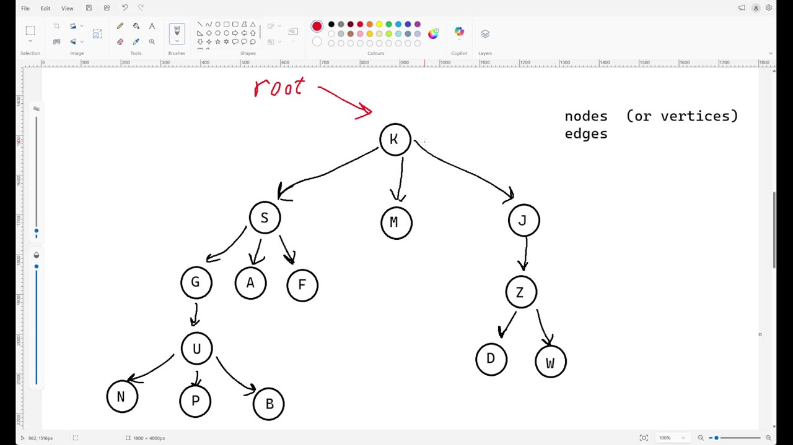

`[00:08:39]` For a minute, we'll pretend they go both directions, `[00:08:42]` even though we often won't care. `[00:08:43]` So if they go both directions, `[00:08:45]` then this direction is called parent, `[00:08:53]` and this direction is called child. `[00:09:02]` And these are not absolute, you know, `[00:09:05]` names for particular parts of the tree. `[00:09:06]` These are relative names for the relationship, right? `[00:09:09]` So in this relationship here, S is closer to the root. `[00:09:14]` So S is the parent. `[00:09:17]` A is further from the root. `[00:09:18]` So A is the child, right? `[00:09:20]` I'm just going to write a little, where'd my cursor go?

## [00:09:21]

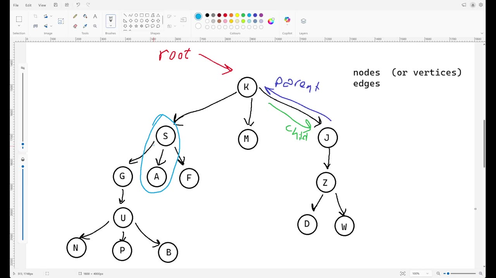

`[00:09:23]` Little P here for parent, `[00:09:25]` little C here for child in this relationship. `[00:09:29]` Or in this relationship, oh, it says up. `[00:09:33]` That's a funny little, anyway, in this relationship, `[00:09:36]` U is the parent and P is the child. `[00:09:41]` And of course, most nodes are a parent and a child, `[00:09:44]` so in this relationship, G is the parent `[00:09:49]` and U is the child, right? `[00:09:51]` U is a child, but it's also a parent. `[00:09:55]` You need to get very comfortable with that terminology. `[00:09:59]` Be very clear about that, right? `[00:10:03]` And every single node has a parent, one parent,

## [00:10:06]

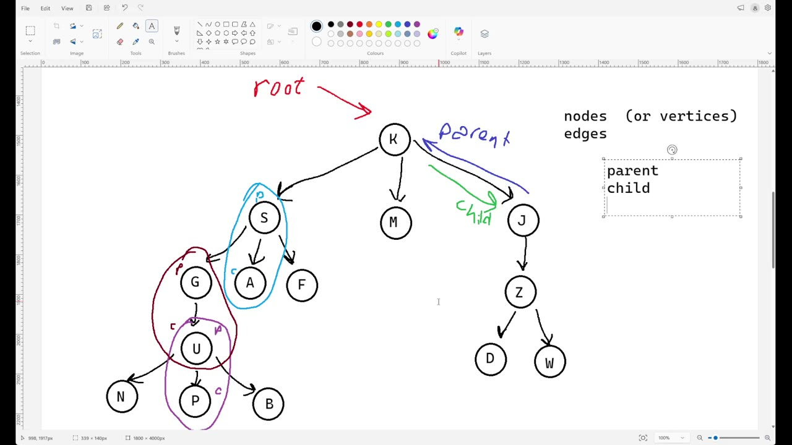

`[00:10:07]` not two, not like real biology, one parent. `[00:10:10]` Actually, I lied, did you notice? `[00:10:13]` There is one node here that does not have a parent. `[00:10:15]` That node is special. `[00:10:16]` That node is the root, right? `[00:10:17]` So that's part of what makes the root, right? `[00:10:18]` The root is that it doesn't have a parent. `[00:10:23]` Every other node must have a parent. `[00:10:25]` But going the other direction, `[00:10:28]` some nodes have children, some nodes don't, right? `[00:10:30]` So M has no children, D has no children, W, right? `[00:10:34]` We've got a whole bunch of these nodes with no children. `[00:10:39]` Did I get them all? `[00:10:40]` I think I got them all. `[00:10:43]` Nodes that have no children are called leaves. `[00:10:49]` Singular leaf, of course, right?

## [00:10:51]

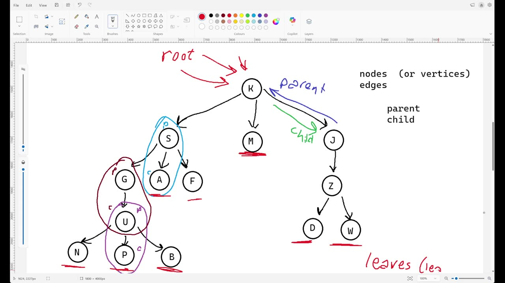

`[00:10:54]` And you know, that makes sense in the tree analogy `[00:10:56]` because leaf and root are kind of, `[00:10:59]` you know, opposite-ish. `[00:11:04]` In any given little family, oh, sorry. `[00:11:07]` If two nodes have the same parent, they are siblings, right? `[00:11:20]` That's pretty straightforward. `[00:11:23]` Okay. `[00:11:25]` Usually we understand children of a node to have some order. `[00:11:30]` This isn't always true, `[00:11:32]` but I think it's practical to assume `[00:11:34]` that it's usually true, right? `[00:11:36]` So we usually assume that nodes have, you know, two children.

## [00:11:36]

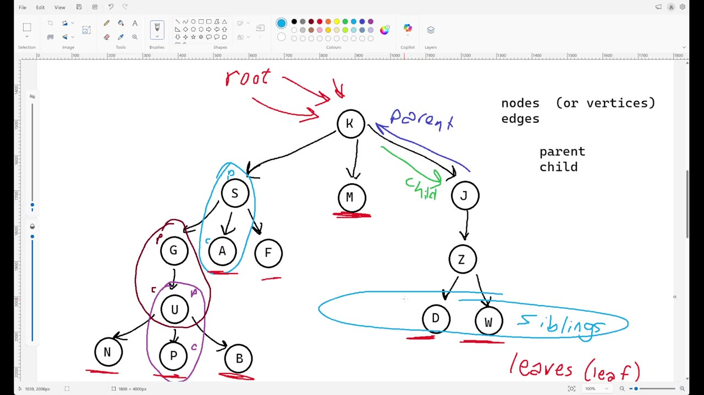

`[00:11:39]` They have some, maybe we should change pen colors for that. `[00:11:43]` That nodes at some level, sorry, not at some level, `[00:11:47]` nodes that are siblings have an order, right? `[00:11:52]` And so we can talk about the first child, the last child, `[00:11:55]` the next child, ideas like that. `[00:12:00]` Something to notice about this structure, `[00:12:02]` and this is kind of important, `[00:12:03]` is that if I have any two nodes, say this one and this one, `[00:12:10]` there's only one way to get between them. `[00:12:15]` Or if I have... `[00:12:16]` of this one and this one. There's only one way to get between them. Any pair of nodes in the same

## [00:12:21]

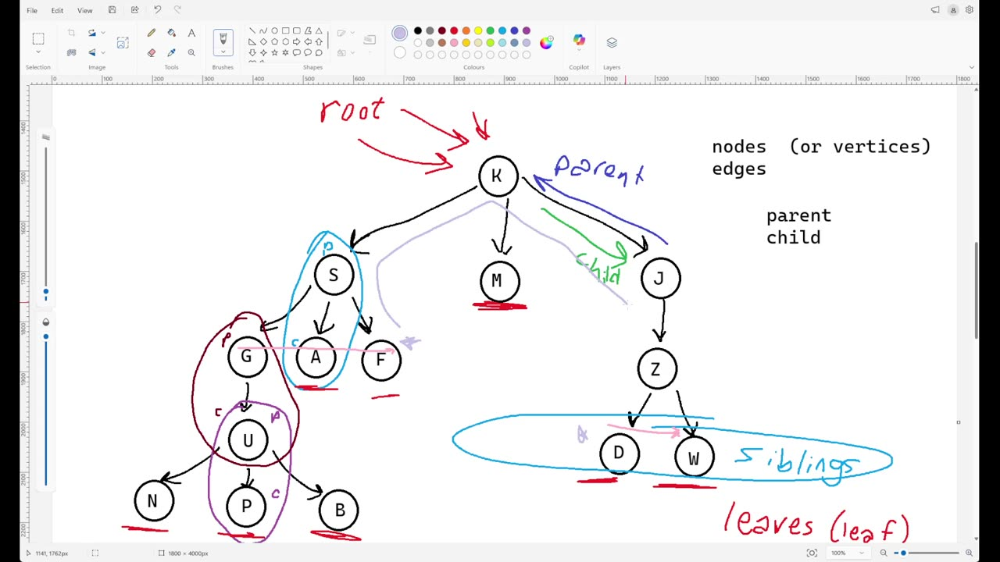

`[00:12:24]` tree, there's one way to get between them. If there's no way to get between them, that would `[00:12:29]` mean that it wasn't a tree because, you know, like I can't get from here to here. That means this `[00:12:40]` whole thing I've drawn here isn't one tree. I mean, I guess you could say it's two trees, but it's not `[00:12:44]` one tree. And that's kind of a consequence of the thing that I said where every node must have a `[00:12:49]` parent except for a single unique root, right? This thing I've drawn with two trees, there's `[00:12:55]` basically two roots. So that's why it's not a tree. Okay. So any two nodes must have a single `[00:13:02]` path, not zero paths, but also not two paths. If there were two ways to get there, right? If you

## [00:13:06]

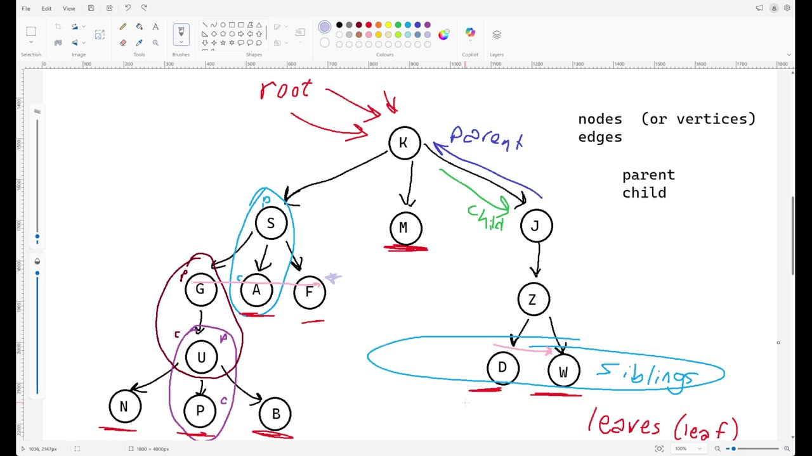

`[00:13:10]` could get there this way, but you also could get there by going, I don't know, like up here, down `[00:13:19]` here, and there was a little bloop over here. `[00:13:21]` That would mean there was a little bloop over there. And that would require one of these nodes `[00:13:26]` to have two parents. And we know that that can't happen. Every node must have one parent. `[00:13:34]` And so this situation where there's like more than one way to, well, I guess, I guess if there `[00:13:41]` was two ways to go this way, I could follow one of them there and one of them back and then make `[00:13:46]` a cycle. This is called a cycle when you can go around and around and around and around and around. `[00:13:51]` Okay. Delete all that crap. That's not part of the tree. Okay. So what do we have there? We have

## [00:13:51]

`[00:13:57]` every node to node combination. There's one way to get there. You're not allowed to be disconnected `[00:14:18]` and you're not allowed to have a cycle. Let's write that somewhere else because I'm running `[00:14:27]` out of space. Okay. So our terminology list so far, we got nodes, we got edges. Maybe I try to

## [00:14:36]

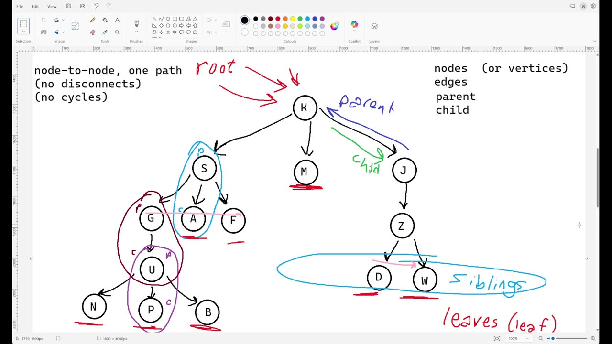

`[00:14:41]` avoid saying vertices, but I'm not going to say vertices. I'm going to say vertices. I'm going to `[00:14:42]` if I start talking about edges, then I end up saying vertices. So I try to avoid this, `[00:14:46]` but it does happen. Nodes, vertices, edges, parent, child. We've got siblings. We've got `[00:14:53]` root. Really important. We got leaves. Really important. And we've got this idea that every `[00:15:00]` pair of nodes has one path between them. No disconnections and no cycles. Excuse me. `[00:15:06]` It's good to know the word cycle. And we know that usually we consider that children, `[00:15:12]` to have an order. And so you might just kind of assume that, that children have an order, `[00:15:16]` a left child, a right child, a first child, a last child, stuff like that. Okay. Let's see. What else?

## [00:15:21]

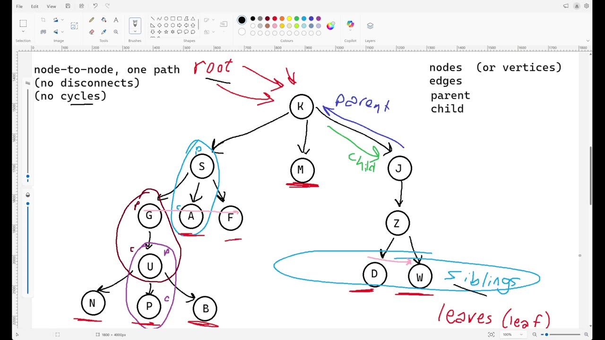

`[00:15:24]` This, I don't know if I said this already. This video has got a whole bunch of terminology and `[00:15:28]` you need to memorize all this terminology so that you can talk about trees. So you can understand `[00:15:31]` me when I talk about trees so that I can use the special terminology on exam questions. And you `[00:15:37]` know what I'm asking about all that stuff. So we've got a big list of stuff you got to learn. `[00:15:41]` Just 20 or so words. `[00:15:42]` You got to memorize. We've got ancestor and descendant. So let's pause for a second and `[00:15:50]` think about what the word ancestor means in real life. An ancestor in real life is your parent `[00:15:55]` or your parent's parent or your parent's parent's parent or your parent's parent's parent's parent's `[00:16:01]` parent's parent's parent's parent's parent or whatever, right? An ancestor is anybody before you

## [00:16:06]

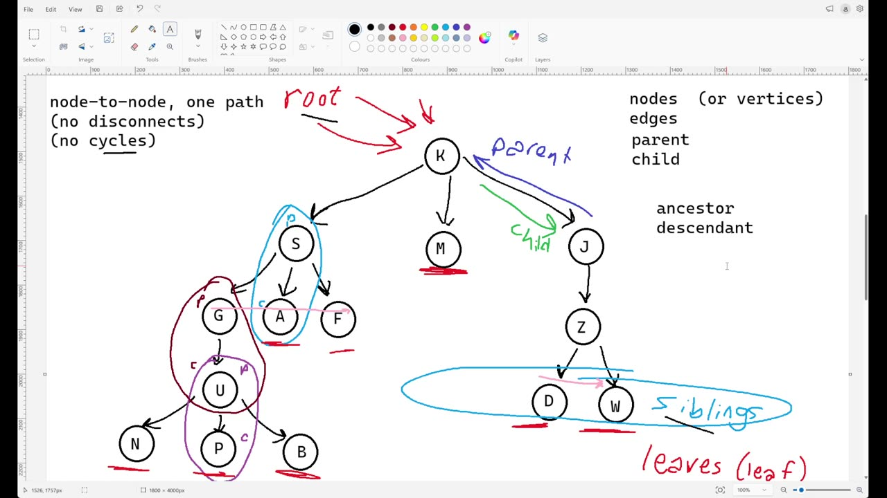

`[00:16:07]` in your family history. And in trees, it's basically the same. `[00:16:13]` Um, `[00:16:14]` so let's see, let's take an example. I need a new pen color. How about this orange? `[00:16:20]` Um, what are B's ancestors? Well, B's ancestors are U and G and S and K. Actually though, `[00:16:29]` it's a little more complicated because sometimes the definition will include the note itself, `[00:16:33]` right? So, you know, if I ask you on an exam, you could answer either unless I specify, `[00:16:39]` right? If, um, if you're reading, `[00:16:44]` uh, algorithms like descriptions of algorithms, like, like, you know, in the future, you want to `[00:16:49]` learn how to do an algorithm to do something and talks about ancestors, you got to pay attention

## [00:16:51]

`[00:16:53]` to whether they mean including or not including the note itself. And that's a little confusing. `[00:16:58]` That sucks, but it's just that some algorithms work better one way and some algorithms work `[00:17:02]` better the other way. So there's some variation there. Um, okay. Right. So either we would say `[00:17:08]` B's ancestors are U G S K, or we would say B's ancestors are B U G S K. `[00:17:14]` Either of those could be fair, depending on the context. And again, if I don't tell you which one `[00:17:17]` on a question you can answer either, it doesn't matter. And descendant, descendant is just the `[00:17:23]` opposite of ancestor, right? So K's descendants are either including K itself or not including K, `[00:17:31]` but then definitely including S definitely including G definitely including U. Oh, `[00:17:35]` sorry. That that's, I said that badly. Uh, sorry. I mean, the thing I said is true,

## [00:17:36]

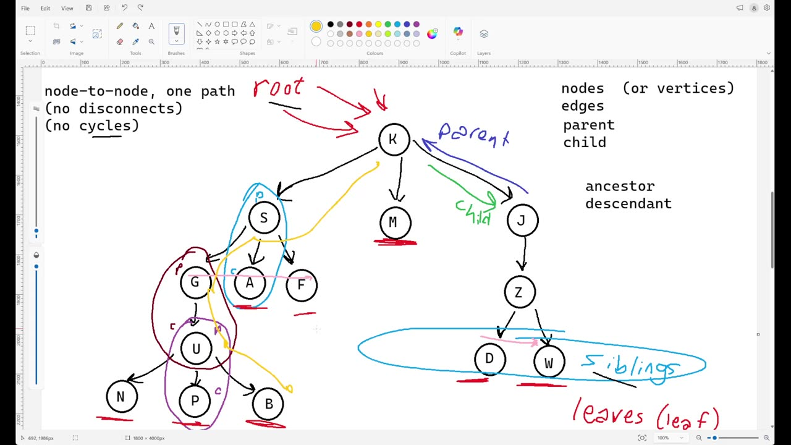

`[00:17:40]` but actually K's descendants are all of the nodes, right? `[00:17:45]` Because M's ancestor includes K, therefore K's descendants includes M and J's ancestor includes `[00:17:51]` K and K's descendant includes J and so on. So in the case of K, it's like everything, `[00:17:58]` either everything, including K or everything except K, but maybe a simpler case would be, `[00:18:03]` what about Zed's descendants? So Zed's descendants are either D and W or Zed and D and W, `[00:18:09]` depending on context. Okay. We've got ancestor and descendant added now. `[00:18:17]` Okay. Another word we would use is what about part of a tree? And the main part of a tree we

## [00:18:21]

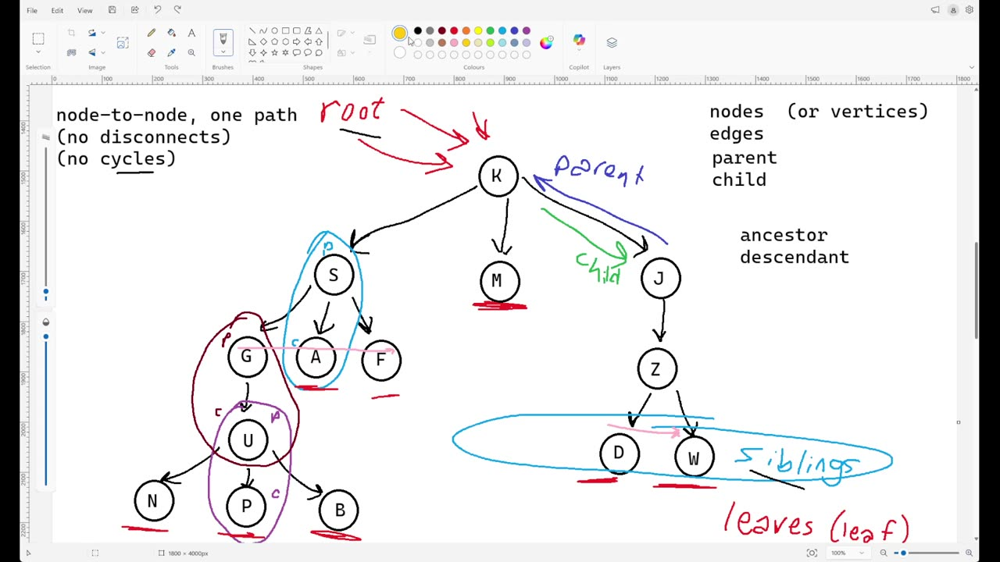

`[00:18:25]` would care about is a thing called a subtree. So we pick some node and that node and all of `[00:18:32]` its descendants together, doesn't matter which definition of descendant I used because of the `[00:18:38]` way I said that, that's a subtree sub. And we might say this is the subtree at J or the subtree `[00:18:52]` of J. Like we would, we would, we would, we would, we would, we would, we would, we would, we would, `[00:18:53]` we would use the sort of root of the subtree as the label for the whole subtree. `[00:18:59]` I don't know how much that's going to come up in class, but it might. `[00:19:04]` Okay. So there's a bunch of words that are for parts. And now we've got some words for

## [00:19:06]

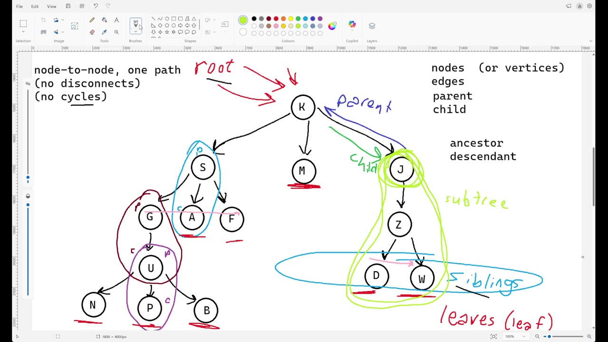

`[00:19:10]` measurements you can take. Okay. So a list has a length. The dictionary has a size. `[00:19:18]` A tree also has, I want black. I said, the fuck's going black. `[00:19:32]` There's a size. The size is the number of nodes. `[00:19:36]` We're going to ignore the possibility of trees of size zero. That's pretty common, `[00:19:41]` but sometimes you do have trees of size zero, but it makes things complicated in a way that I think `[00:19:48]` isn't really very helpful to what we're trying to do here. So for this class, we're not going to

## [00:19:51]

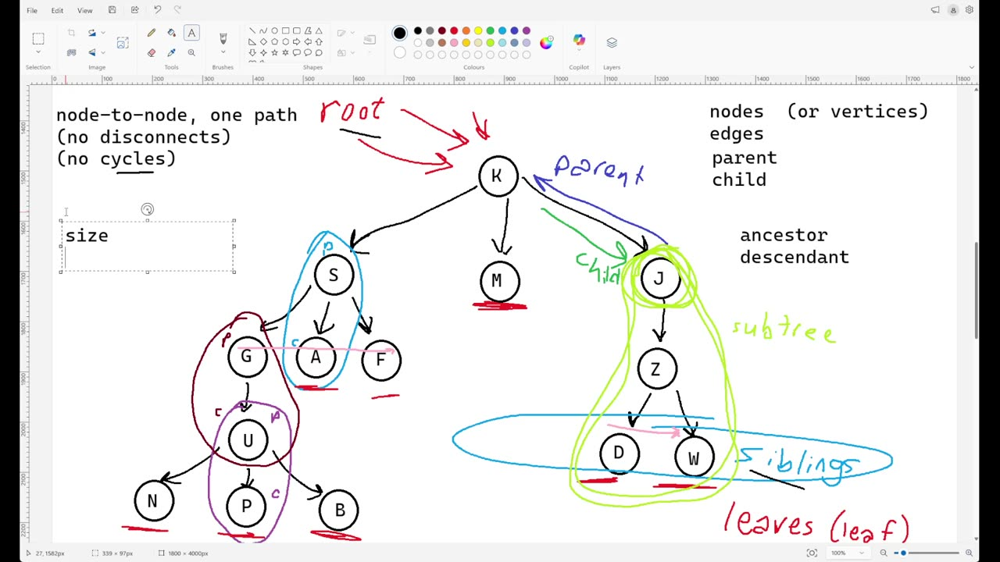

`[00:19:52]` worry about dealing with that. We're not going to worry about trees with zero nodes. Therefore, `[00:20:00]` we're only going to do trees that have at least one node. We're not going to worry about trees with `[00:20:01]` and therefore those trees will always have a root. We have size. Okay. If I have a connection `[00:20:13]` between two, I don't know where that word went, but I'll put it back in a second. If I have a `[00:20:17]` connection between two nodes, like I was drawing here before, that's called a path. And a path can `[00:20:27]` have a length. That's the number of edges you have to travel, right? So if you go zero steps, `[00:20:34]` your path has length zero. If you go like this, your path has length one. This path has length two

## [00:20:36]

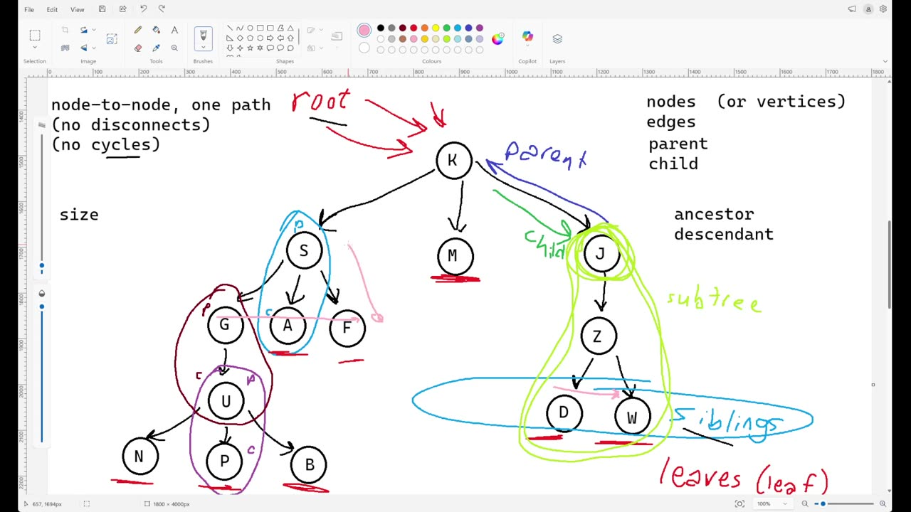

`[00:20:40]` and so on. So that might come up. Oh, I thought the word, am I hallucinating? I thought the word `[00:20:46]` size disappeared, but it didn't disappear. I'm sorry for, I guess it's just very early in the `[00:20:49]` morning for me. I'm sorry. Okay. And wrapping up our list of words, we've got height and depth, `[00:21:01]` and these are a bit complicated because, well, you'll see. Okay. So height and depth. So let's `[00:21:07]` look at this node J. The depth of a node is the number of steps to the root. Okay. So we have

## [00:21:21]

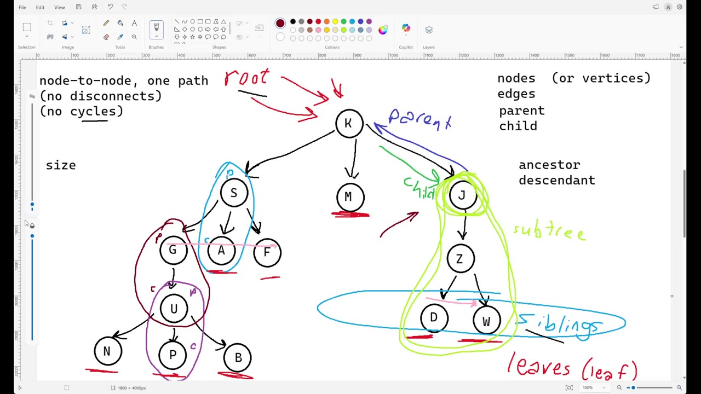

`[00:21:22]` depth. I better just use the text tool. We've got the depth of a node. We've got the, `[00:21:33]` where am I going to put this? This is a mess. I guess I'm just going to put it over top of size. `[00:21:40]` I don't like this. Okay. Hang on. Okay. We've got the depth of a node, `[00:21:46]` the height of a node, the depth of the tree and the height of the whole tree. `[00:21:50]` Right. So the depth is the length of the path to the root. Okay. So that means the root has `[00:22:05]` depth zero, right? So if you think about depth as like, how far do you go? How far have you gone

## [00:22:06]

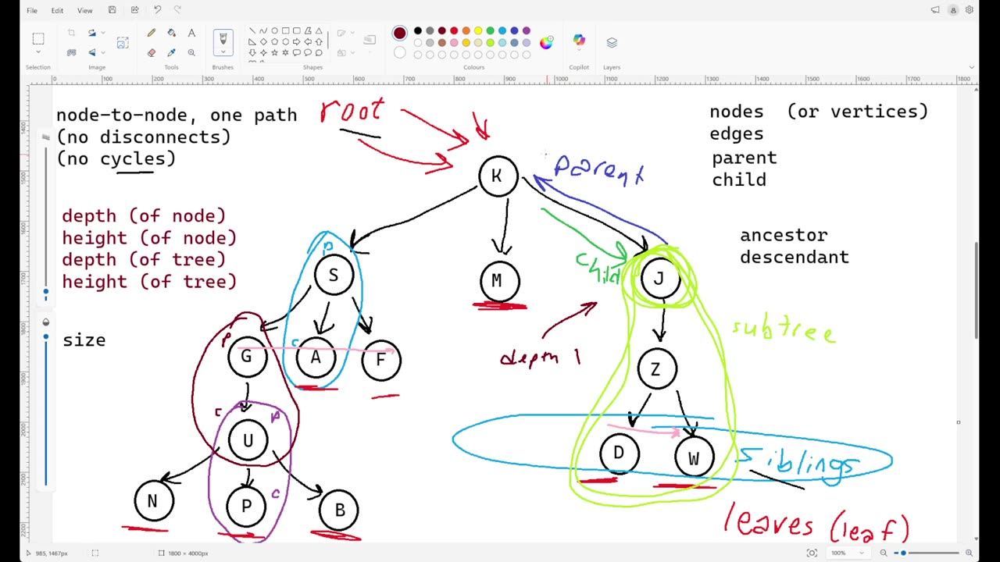

`[00:22:09]` down? Right. And the height is counting the other way. The height is the maximum of, `[00:22:22]` all of like the longest path to any descendant. Right. So in the case of J, it's simple because `[00:22:28]` it's, it doesn't matter which way you go. It's two. Okay. So the depth of a node is the path `[00:22:39]` length up to the root. The height is the path length down to the furthest descendant. So S here `[00:22:46]` also has a depth of one, but its height is, well, the furthest away thing is one of these things.

## [00:22:51]

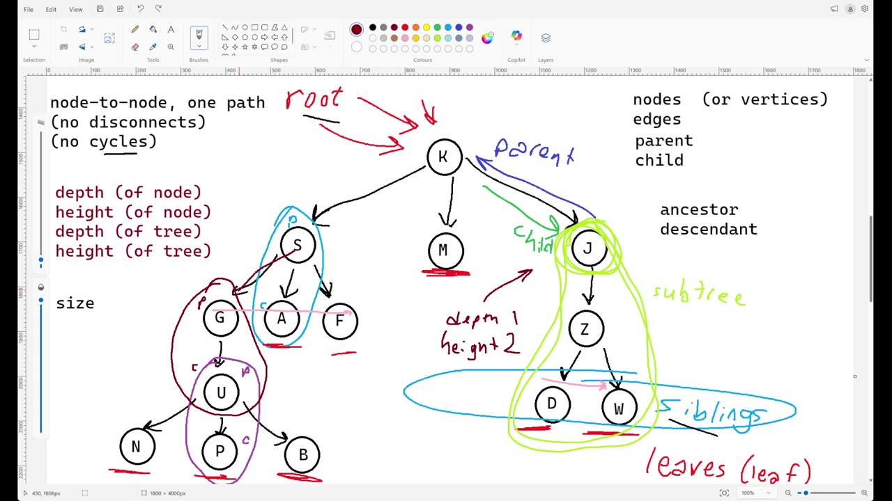

`[00:22:53]` So that's one, two, three. `[00:22:56]` Right. So that's D one H three. Okay. And then what about the tree? Well, the depth of the tree `[00:23:04]` is the maximum depth of any node. The height of the tree is the maximum height of every, of any `[00:23:09]` node. And so those definitions are actually the same. Like it doesn't matter which one you do, `[00:23:14]` they work out the same. You can think about that if you want to. And so this tree has height one, `[00:23:20]` two, three, four, the whole tree has height four. And that's because the root, `[00:23:26]` has height four or the whole tree has depth four. And that's because some of the nodes have `[00:23:30]` depth four. Okay. Big, long list of stuff to learn. Nodes, edges, parent, child, ancestor,

## [00:23:36]

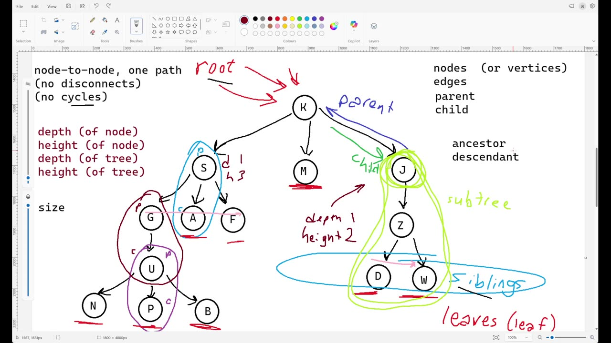

`[00:23:37]` descendant, siblings, subtree, root, leaves, cycles, depth of node, height of node, depth `[00:23:48]` of tree, height of tree, size of tree. Sorry about that, but you can do it. And that's the `[00:23:59]` definitions. Let's just real quick, go to an implementation. I found it for OBS. Where is,

## [00:24:03]

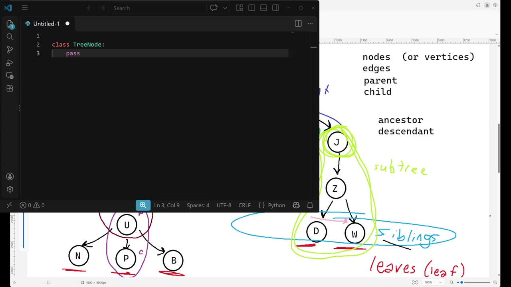

`[00:24:08]` okay, there it is. Okay. So maybe you saw this in class, maybe you didn't. `[00:24:22]` Each tree node needs, well, it needs to hold some actual data, right? So a list `[00:24:28]` exists so it can hold data. A dictionary exists so it can hold some values and some keys. `[00:24:34]` Our trees have to hold data. So a list exists so it can hold data. A dictionary exists so it can hold `[00:24:35]` hold some data. And so you don't have to do it this way, but we're going to, we're going to pass `[00:24:41]` in the vowel, uh, constructor time. And so in the initializer, I'm going to set the value here. So `[00:24:46]` that's what, that's what it's actually here for. And in my examples, I will mostly use simple

## [00:24:48]

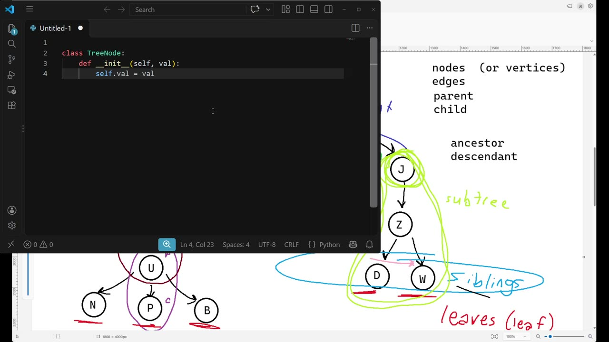

`[00:24:53]` things like letters or numbers, but you could put anything in there, just like you could put `[00:24:55]` anything into a list. And then, um, our tree nodes can have children. They can have any number of `[00:25:05]` children. They can have zero children. They can have one child. They can have two children. They `[00:25:08]` can have 17 children. And a good way of storing variable numbers of children is a list. I'm just `[00:25:14]` going to again, remind you that if you think in terms of binary trees, you need to relearn because `[00:25:18]` that's not what we're doing. Um, you would do this part differently with binary trees. `[00:25:24]` And then, uh, sometimes we bother to keep a parent reference. Sometimes we don't, um, this is not `[00:25:32]` going to be incredibly useful in this class, but we're going to use it just a little bit.

## [00:25:33]

`[00:25:35]` And I'm going to put it here anyway. So, um, we're going to start with that being none. `[00:25:41]` Of course, only the parent, sorry. Wow. That was goofy. Only the root has no parent. So only the `[00:25:47]` root will stay with none here. Um, but, uh, it's hard to pre-initialize it correctly. Um, and then `[00:25:57]` actually, so this is kind of sufficient, but actually just to make it, um, a little easier `[00:26:09]` than, I'm just gonna do that that way. I think that works. I actually haven't tried this.

## [00:26:18]

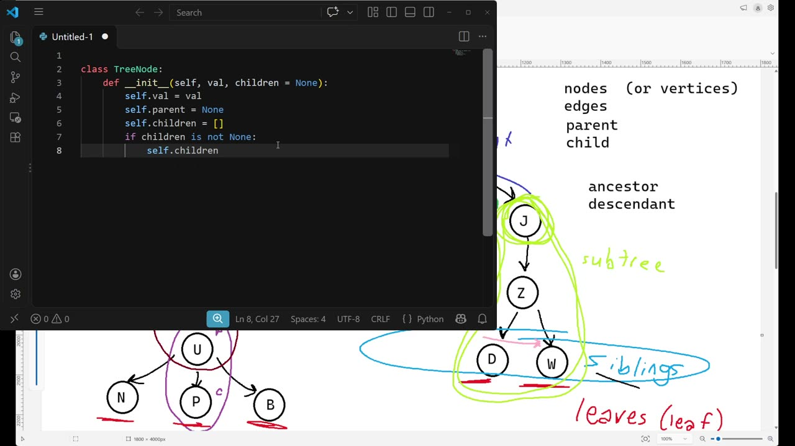

`[00:26:31]` I mean, I haven't tried this this year. And so then I'm going to be able to do stuff like this. `[00:26:37]` Um, no, I don't want to do it that way. Sorry. Sorry for being confusing. Okay. There. So that'll

## [00:27:03]

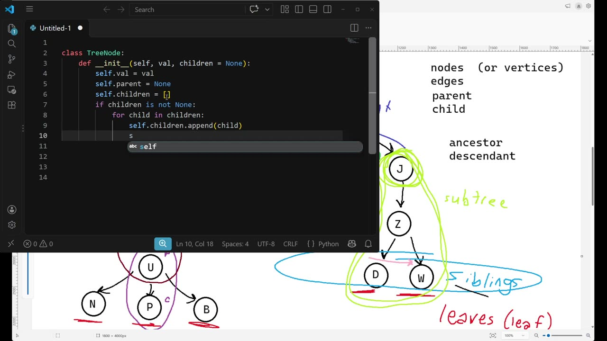

`[00:27:08]` wire them up correctly. Okay. And then we could do something like this. Let's make the one from `[00:27:21]` the, um, let's just put that in there. Okay. So my root is like, um, you know,

## [00:27:23]

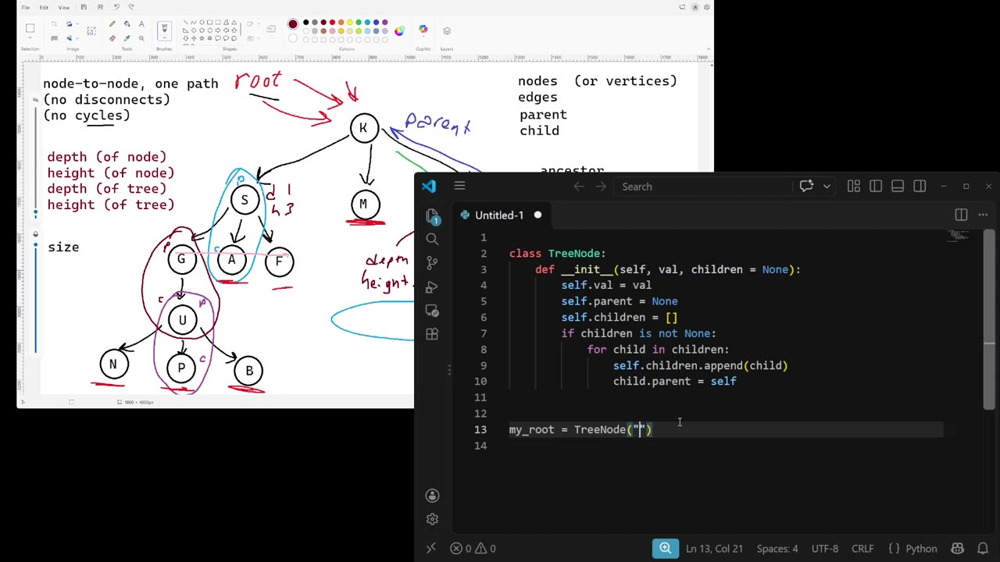

`[00:27:30]` there it's got the value of K, right? But actually I want to be able to `[00:27:35]` build the whole tree. So then I can go, whoops, that's a string and I'm not going to bother `[00:27:57]` finishing this. Right. I'm going to do a little bit more though. Okay. And I don't know how well

## [00:28:08]

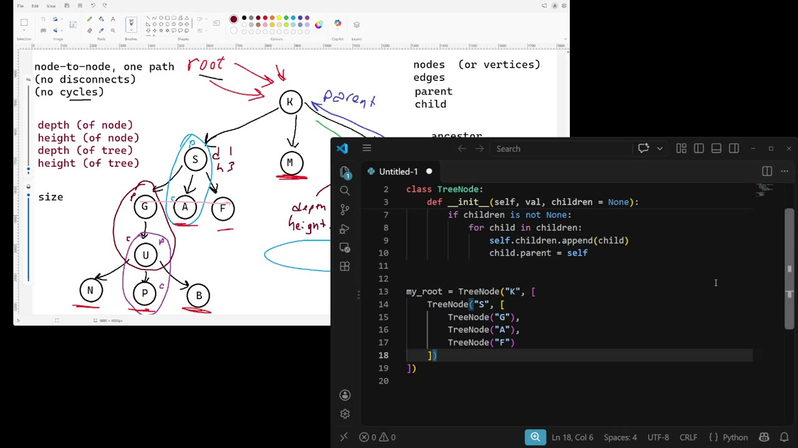

`[00:28:12]` you can see it, but actually, um, the visual layout here is actually kind of like a rotated `[00:28:19]` version of the picture we normally draw. So anyway, this, um, `[00:28:24]` being able to do this nonsense here is why I've done this stuff up here. `[00:28:30]` Um, and maybe that'll make it easier to do labs and stuff. Anyway. Okay. So that's our `[00:28:34]` little tree implementation. I mean, this is just the beginning, right? So, um, as we go along, `[00:28:41]` we will add more methods to our tree node. We'll have some simple methods for warmup and we will `[00:28:48]` have more interesting algorithmic methods, uh, after that.

## [00:28:53]

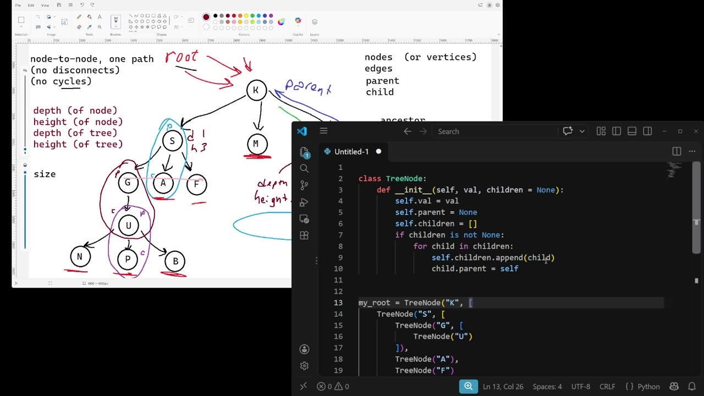

`[00:28:54]` Okay. And that's our introduction to trees.
