# Transcript: 202630_w06_treetraversals.mp4

- Source: `C:\Users\hiros\study stuff for cursor\Algo\202630_w06_treetraversals.mp4`
- Duration: 00:17:16
- Segments: 327, screenshots: 24
- Whisper model: `large-v3` (auto-generated; may contain recognition errors)

## [00:00:00]

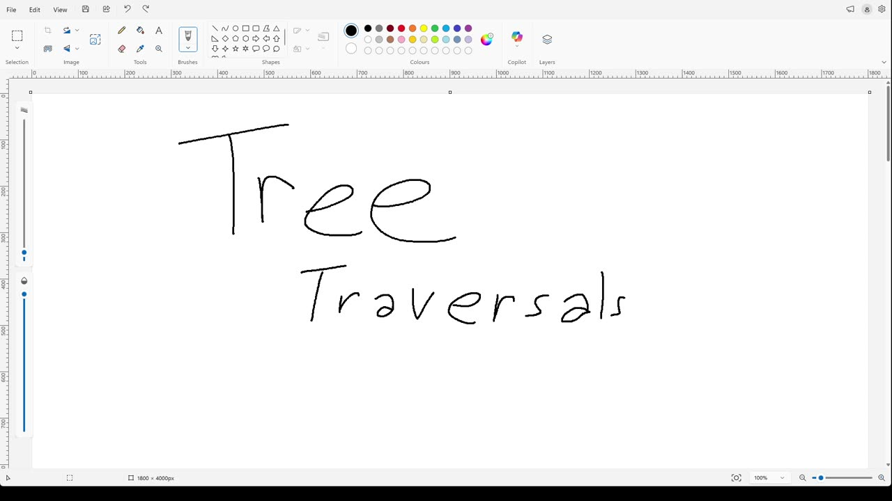

`[00:00:00]` In this video, I'll be talking about tree traversals, or actually more specifically `[00:00:04]` about traversal orders. The thing about data structures is that we want to get the data in `[00:00:11]` them. And sometimes we want to get all the data in them, maybe to print everything out, or maybe `[00:00:16]` to linear search for one value or multiple values, maybe add up all the numbers, like do some kind `[00:00:23]` of sum or average or something like that. Or maybe to just kind of go through it and give `[00:00:28]` every employee with a high performance rating and salary increase, or I don't know, all sorts `[00:00:33]` of reasons, right? And with a list or a tuple, we can use a for loop. I should write for loop here `[00:00:44]` to give you something to look at. With a list or a tuple, we can use a for loop. Technically, this

## [00:00:45]

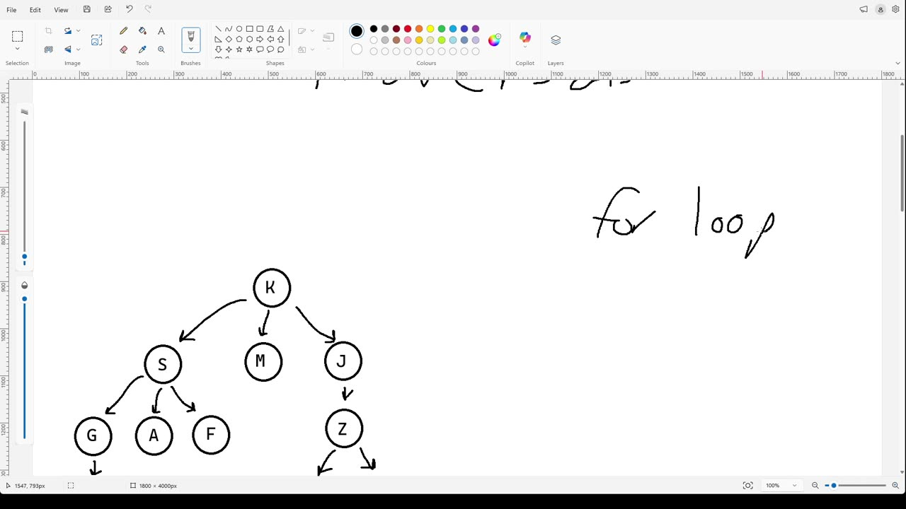

`[00:00:48]` also works for a dictionary, although that's a whole can of worms we're not going to think about `[00:00:52]` right now. With a linked list, we need to build a little bit more machinery, but we can still make `[00:00:58]` a thing like a loop. `[00:00:59]` That just loops through the whole thing one step at a time in a line, right? In each of these cases, `[00:01:05]` we basically go through the data in a line. Again, the dictionary is a bit of a complicated `[00:01:11]` variation, but a tree is very much not a line. And so we are going to want to be able to go `[00:01:23]` through everything in a tree, maybe to print everything out, or maybe to modify the salary `[00:01:29]` of every high-performing employer, who knows why.

## [00:01:30]

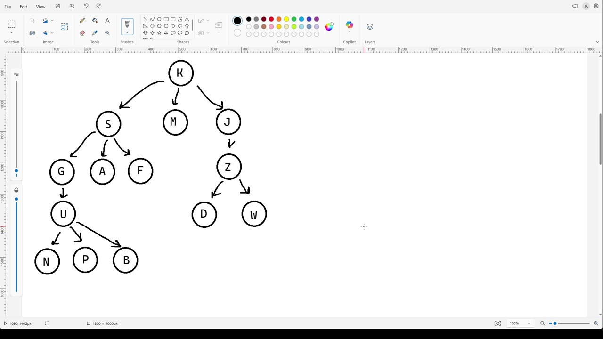

`[00:01:31]` But it's going to be a little bit trickier. A for loop is definitely not, or a while loop is definitely `[00:01:37]` not enough. So, partly the algorithm itself is trickier, and we will deal with that in the future, `[00:01:45]` not in this video. But before we get to the algorithm, it's also tricky because it's not `[00:01:50]` super obvious what order is the right order to visit things. So that's what this video is about, `[00:01:58]` is several common traversal patterns, and then we're going to go through them one step at a time. `[00:02:00]` So, let's get started. `[00:02:01]` So, we're going to look at a few. So, I'm just going to have this tree here as my example.

## [00:02:15]

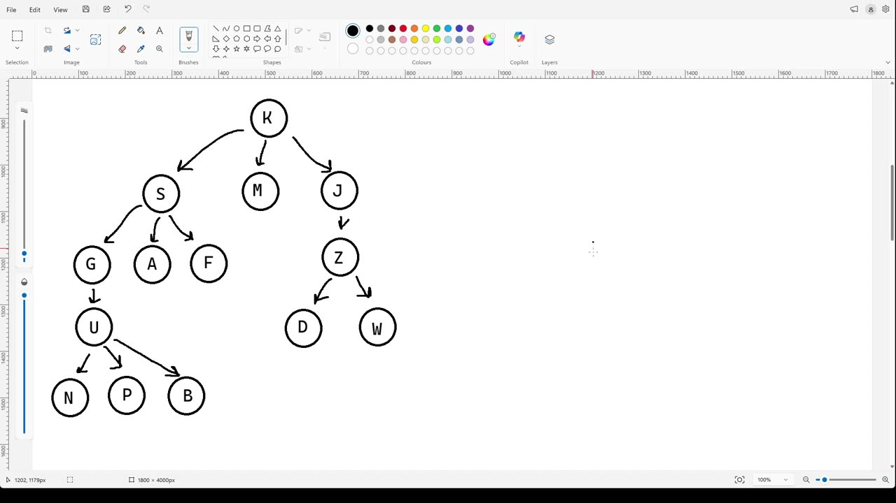

`[00:02:19]` I'm going to draw all over it. So, first, I will just make a copy. Okay. So, as we traverse `[00:02:29]` through a tree, oh, sorry, by the way, traverse, you know, you can see that that word is related `[00:02:34]` to travel. So, as we traverse through a tree, we're going to look at a few. So, I'm going to `[00:02:34]` It just means to go across, right? Like, that's what that word means in English. So, this is a `[00:02:39]` plan for going across a tree, kind of. Okay. So, as we traverse, and we're going to assume we start `[00:02:46]` at the root, although we could start, we could do, we could start somewhere else and just do the `[00:02:51]` subtree, but like, okay, I don't care. We're going to assume we start at the root. Okay. So, `[00:02:56]` as we traverse, when we're at some node, we're going to have a choice, right? Do we do the

## [00:03:00]

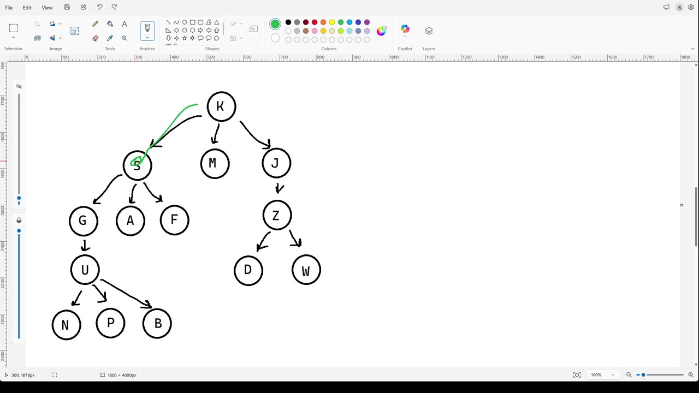

`[00:03:04]` children? `[00:03:04]` Do we do the children first, and then the siblings later? Or do we do the siblings first, and the `[00:03:13]` children later? Does that make sense? I mean, there's more to it than that. But also, obviously, `[00:03:20]` some nodes don't have any siblings. So, in this case, it's a no-brainer. And some nodes don't `[00:03:28]` have any children. So, in this case, it's a no-brainer. But nonetheless, we are often going `[00:03:32]` to have to make those `[00:03:33]` choices. And we're going to sort of make some kind of consistent choice. `[00:03:42]` And so, this results in our first kind of split in, we've got traversals here.

## [00:03:45]

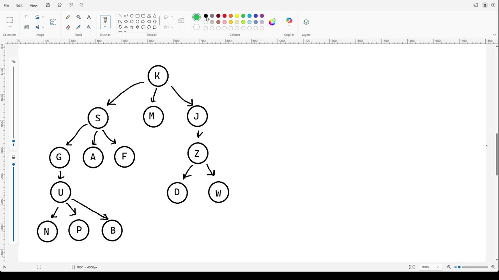

`[00:03:51]` This is our first kind of split in our plan. We can either go, mostly go down. `[00:03:58]` So, we can first explore the depths of the tree. Or we can first explore, `[00:04:10]` like, the tree's breadth before later going down. You get the glory of my writing at its `[00:04:19]` finest. Every time I record one of these videos, I think I should try to understand how to use my `[00:04:23]` tablet. But I always don't know how to use it. Okay. So, first, we're going to do depth first.

## [00:04:30]

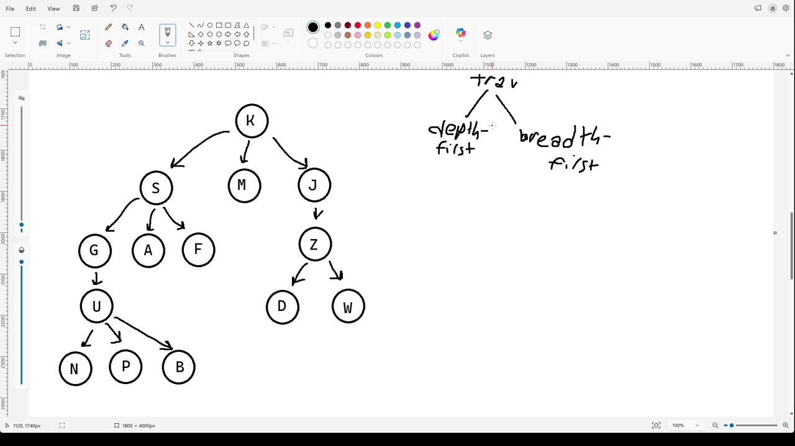

`[00:04:32]` I guess I should say, we're going to do depth first first, in depth. Sorry, I'll stop trying `[00:04:37]` to be funny. So, let's look at this tree, right? Every time I hit the button, I'm going to be able to `[00:04:42]` hit the button. I'm going to hit the button. I'm going to hit the button. I'm going to hit the button. `[00:04:43]` If I can go deeper, I will. So, I can go deeper. So, I can go deeper. So, I can go deeper. `[00:04:53]` Right? And now, I'm at a leaf. I can't go any deeper. So, I've got to go back up. `[00:04:59]` But now, I can go deeper again. So, I will. And now, I'm at a leaf. I can't go deeper. So, `[00:05:05]` I got to go back up. But I can go deeper now. So, I will. Now, I got to go up. Got to go up. `[00:05:11]` Got to go up. Oh, now, I can go deeper. So, I will. `[00:05:14]` Every time I have the option to go deeper, I take that option, right?

## [00:05:15]

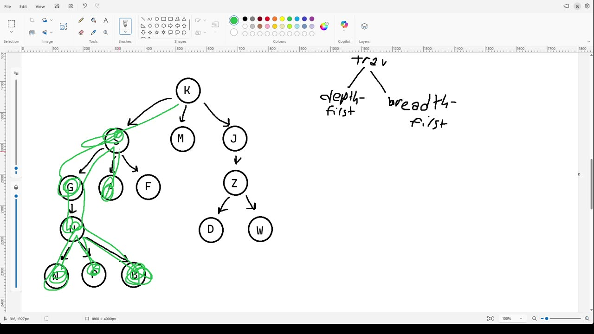

`[00:05:21]` So even right here, uh, I go deeper, but then I got to go up, then I go deeper and actually, `[00:05:27]` sorry, I, I, uh, I got to start at the beginning cause I, cause I would do like that. `[00:05:45]` Okay. `[00:05:47]` I'm going to draw that a little bit tidier this time for a reason. `[00:05:52]` I'm just going to go down and down and down and down, and now I can go up. `[00:05:58]` So I'm going to go up and now I got to go down. `[00:05:59]` Now I can go up.

## [00:06:00]

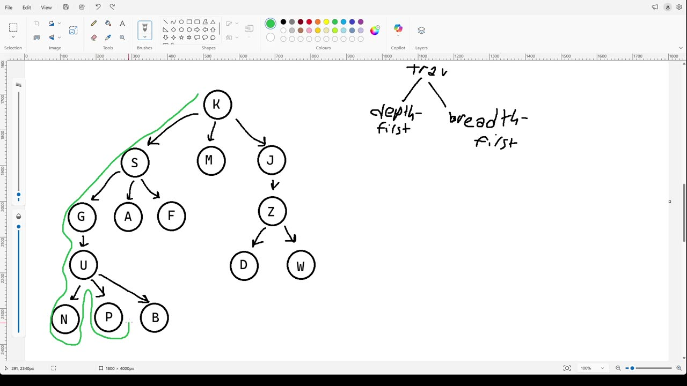

`[00:06:06]` Oh God, what happened? `[00:06:07]` Sorry. `[00:06:26]` Okay. `[00:06:27]` And this sort of squid looking thing I've drawn in green, this is the central spirit `[00:06:31]` of depth first search or DFS for short. `[00:06:40]` Um, but on its own, it's not exactly a traversal order because there's something it's missing.

## [00:06:45]

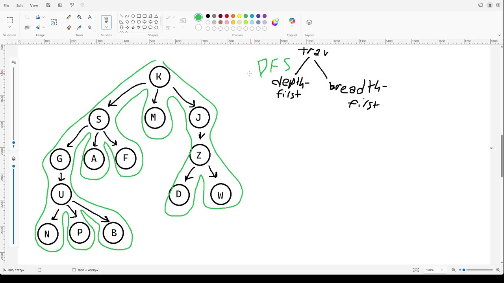

`[00:06:45]` Right. `[00:06:46]` And part of what's missing is that we are visiting nodes several times, right? `[00:06:50]` Like let's count how many times I visit S once, twice, three times, four times, right? `[00:07:01]` And you don't want to be visiting the same node multiple times, right? `[00:07:04]` Like if, if you, if I wrote a for loop for you to loop across your list and just some `[00:07:09]` of the nodes, some of the values in the list got output multiple times, you'd be like, `[00:07:13]` what the heck? `[00:07:14]` Right. `[00:07:15]` So we actually only want to visit each node. `[00:07:18]` Well, it depends what you mean by visit, but we're going to, `[00:07:21]` the green line is going to go to each, to many nodes multiple times, but we only kind `[00:07:27]` of want to like really pay attention to the fact that we're visiting the node once per

## [00:07:30]

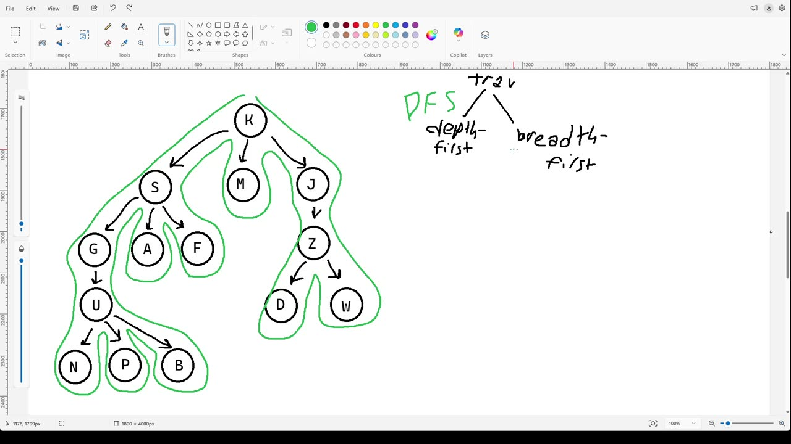

`[00:07:32]` node. `[00:07:33]` Right. `[00:07:34]` And so our first version of depth first search is the first time we hit each node. `[00:07:42]` That's when we kind of do the thing at the node. `[00:07:45]` So I'll go to blue now. `[00:07:46]` Right. `[00:07:46]` So the first thing we have is the root. `[00:07:50]` And then the first time we hit. `[00:07:51]` S we do S whatever do means, right? `[00:07:54]` And again, remember our traversal could do all sorts of things. `[00:07:56]` It could just print things out. `[00:07:57]` It could be looking for something. `[00:07:59]` It could be modifying things, whatever it is we're doing. `[00:08:02]` We do it when we first arrive at the node in this version, I'm showing you right now. `[00:08:07]` So, so now here and now here and now here, and you can see that we just went depth first `[00:08:13]` and then we kind of go back up to you, but we've already done you.

## [00:08:15]

`[00:08:17]` So we don't do it again. `[00:08:17]` Then we come down to P. `[00:08:19]` This is number six. `[00:08:21]` Go back. `[00:08:21]` Up to you down to B. `[00:08:22]` This is number seven. `[00:08:23]` Go back to you. `[00:08:24]` We already did it. `[00:08:25]` Go back to G. `[00:08:26]` We already did go back to S. `[00:08:27]` We already did it. `[00:08:27]` And so then eight is going to be here. `[00:08:29]` Go back up and down. `[00:08:30]` Nine is here. `[00:08:31]` Go up, up, down 10, 10, 11, 12, 13, 14. `[00:08:42]` And in some sense, we might say we go back up to the root here, but we already did the root at the beginning. `[00:08:47]` So just like everything else, we're not somehow tagging the root on at the end. `[00:08:51]` Right? `[00:08:52]` And so this is one way we could do it. `[00:08:54]` And this is maybe the simplest or the most obvious, but there's a option that's almost as simple, which is what if instead of doing it when we first arrive, what if we do it the last time we're there, right?

## [00:09:00]

`[00:09:08]` So our line still starts at the root, but we don't kind of do it first. `[00:09:13]` We go to S. `[00:09:14]` Are we going to come back here later? `[00:09:15]` Yes. `[00:09:16]` Are we going to come back here later? `[00:09:17]` Yes. `[00:09:18]` Are we going to come back here later? `[00:09:19]` Yes. `[00:09:20]` As we leave N. `[00:09:21]` We do this one for the first, like it's the last time we're going to be at N. `[00:09:25]` So that's the first one we do. `[00:09:27]` Then we go to P, you know, first U and then P. `[00:09:30]` And this is the last time we're going to be at P. `[00:09:32]` So we do the second. `[00:09:33]` Go back to U and then B. `[00:09:34]` This is the last time we're going to be at B. `[00:09:35]` So we do this one. `[00:09:36]` We're now at U. `[00:09:37]` We're never going to be here again. `[00:09:39]` So we do U fourth. `[00:09:40]` Oh, look, there's a kind of a coincidence there. `[00:09:42]` U is number four in both of these setups.

## [00:09:45]

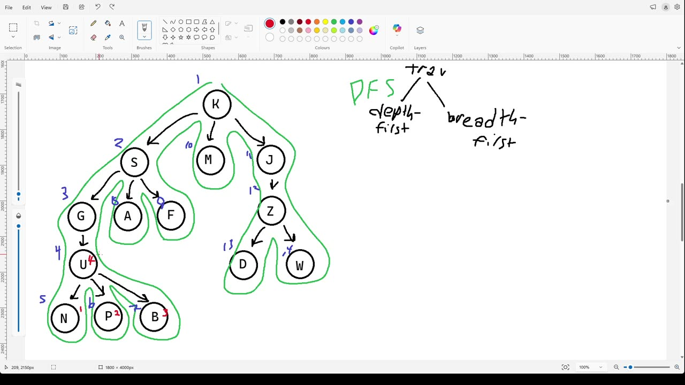

`[00:09:45]` Now we're at G. `[00:09:46]` We're never going to come back to G. `[00:09:47]` So we do it. `[00:09:48]` Now we're at S. `[00:09:49]` Back down to A. `[00:09:50]` Last chance. `[00:09:51]` Up to S. `[00:09:52]` Down to F. `[00:09:53]` Last chance. `[00:09:54]` Up to S. `[00:09:55]` So this is our fourth time at S. `[00:09:56]` It's our last time at S. `[00:09:58]` So now we do S. `[00:10:00]` Back up to K. `[00:10:01]` Back down to M. `[00:10:02]` Back up to K. `[00:10:03]` J. `[00:10:04]` Z. `[00:10:05]` D. `[00:10:06]` I'm at 10. `[00:10:07]` Back up to Z. `[00:10:08]` Down to W. `[00:10:09]` I'm at 11. `[00:10:10]` Back up to Z. `[00:10:11]` This is the last time I'm ever going to be at Z. `[00:10:13]` Last time I'm ever going to be at J. `[00:10:16]` And last time I'm ever going to be at K. `[00:10:19]` And that's it. `[00:10:20]` And whether I'm drawing inside or outside is just like to make the diagram not suck. `[00:10:23]` It doesn't mean anything whether it's inside or outside. `[00:10:26]` Okay. `[00:10:27]` And so this is two kinds of depth first search.

## [00:10:30]

`[00:10:32]` And we need names for these. `[00:10:34]` The blue one is where we do the node pre its children, before its children. `[00:10:45]` The red one, we do the node after its children and all its descendants. `[00:10:49]` But it's enough to say after its children. `[00:10:51]` The rest of it just kind of works out. `[00:10:52]` So this is because the node is after its children. `[00:10:55]` And the red one is post order. `[00:10:57]` Okay. `[00:11:02]` And this is a big difference you should know about. `[00:11:07]` And then there is actually another little variation. `[00:11:11]` Which is the way I was doing this. `[00:11:13]` I always went.

## [00:11:15]

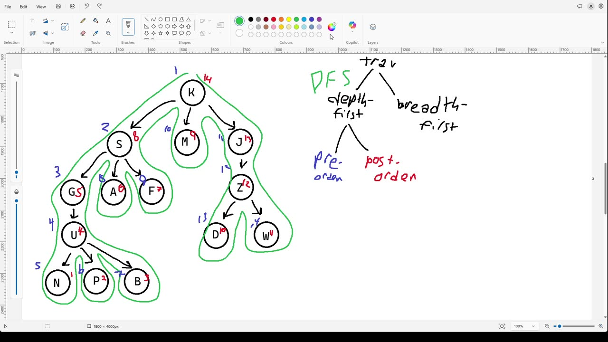

`[00:11:15]` I need another color. `[00:11:16]` What am I going to use next? `[00:11:17]` Pink. `[00:11:18]` I always went left to right. `[00:11:20]` So S is before M is before J in both the blue and the red. `[00:11:26]` But I mean, I could go the other order. `[00:11:28]` Right. `[00:11:29]` So I could still do pre-order. `[00:11:32]` Let's make this a different blue. `[00:11:35]` So I'm still going to do pre-order. `[00:11:37]` But I'm going to go right to left. `[00:11:38]` So first time here. `[00:11:40]` And then I go down here. `[00:11:43]` This is two. `[00:11:44]` Down here. `[00:11:45]` This is three. `[00:11:46]` Down here. `[00:11:47]` This is four. `[00:11:48]` Up and down here. `[00:11:49]` Five. `[00:11:50]` Do, do, do, do, do. `[00:11:51]` Six. `[00:11:52]` Do, do, do, do, do. `[00:11:53]` Seven. `[00:11:54]` Eight. `[00:11:55]` Nine. `[00:11:56]` Do, do, do, do. `[00:11:57]` Ten. `[00:11:58]` Eleven. `[00:11:59]` Twelve.

## [00:12:00]

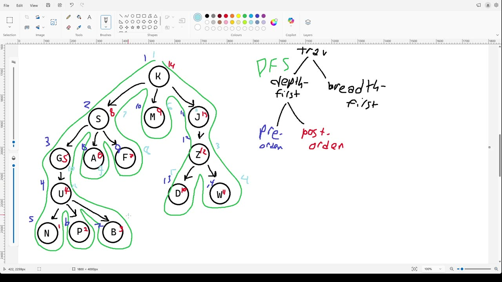

`[00:12:00]` Thirteen. `[00:12:01]` Fourteen. `[00:12:02]` This is not very common. `[00:12:03]` But it, you might see it. `[00:12:04]` This is, maybe we call this reverse pre-order. `[00:12:05]` And so that means that under pre-order, there's kind of two kinds of pre-order. `[00:12:06]` Right. `[00:12:07]` Forward pre-order. `[00:12:08]` And same thing again over here. `[00:12:09]` Our post-order could have, you know, two different pre-orders. `[00:12:10]` Right. `[00:12:11]` Forward. `[00:12:12]` Pre-order. `[00:12:16]` Right. `[00:12:17]` Forward. `[00:12:18]` Pre-order. `[00:12:19]` Right. `[00:12:20]` Forward. `[00:12:21]` Pre-order. `[00:12:23]` Right. `[00:12:24]` Forward. `[00:12:29]` Pre-order. `[00:12:30]` Right. `[00:12:31]` Forward. `[00:12:32]` Pre-order. `[00:12:33]` Right. `[00:12:34]` Forward. `[00:12:35]` Forward. `[00:12:36]` Right. `[00:12:37]` Reverse post-order or forward post-order. `[00:12:40]` And you should usually assume it's forward. `[00:12:41]` You should usually assume it's left to right. `[00:12:43]` You should usually assume that in the list of children, the zero child goes before the

## [00:12:45]

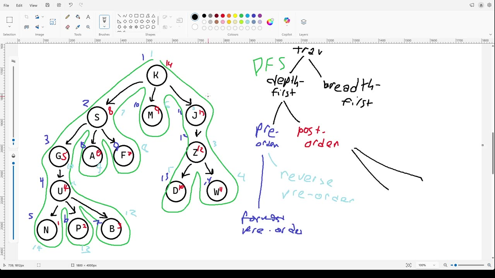

`[00:12:48]` one child goes before the two child. `[00:12:51]` But occasionally you'll see it the other way. `[00:12:52]` And there's a particular reason this comes up later. `[00:12:54]` Like this is, this is mostly hypothetical, but there is one place you want to be able `[00:12:58]` to talk about this. `[00:12:59]` So that's kind of why I'm bothering to introduce it here. `[00:13:01]` So technically we've got four types of DFS, but really, really, you definitely need to `[00:13:06]` know the difference between pre-order and post-order. `[00:13:09]` We've got forward. `[00:13:10]` I guess I'll do that in red because it is the red one. `[00:13:24]` And it's a funny little side effect, by the way, that my drawing here of the different `[00:13:26]` kinds of traversal is itself a tree. `[00:13:28]` And that's because I'm a computing science dude and I like trees.

## [00:13:30]

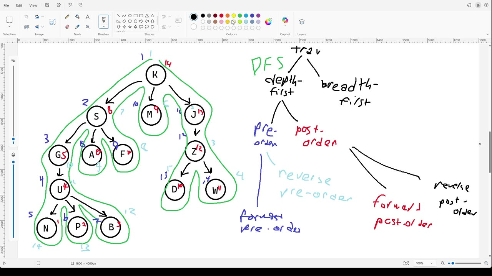

`[00:13:33]` Okay. `[00:13:36]` So that is your four versions of DFS. `[00:13:41]` I guess I should write BFS in a different color because I'm going to do it in a different `[00:13:45]` color. `[00:13:50]` Okay. `[00:13:51]` We've got our four versions of DFS. `[00:13:52]` Okay. `[00:13:53]` But there is one other option. `[00:13:56]` And for what we're doing in this video, which is just, you know, putting out the ordering, `[00:14:01]` the numbers, this is the easy one. `[00:14:05]` I'm just gonna paste out the tree again. `[00:14:09]` I'm going to mark that we're doing BFS here. `[00:14:13]` BFS is the easy one until we get to algorithms.

## [00:14:15]

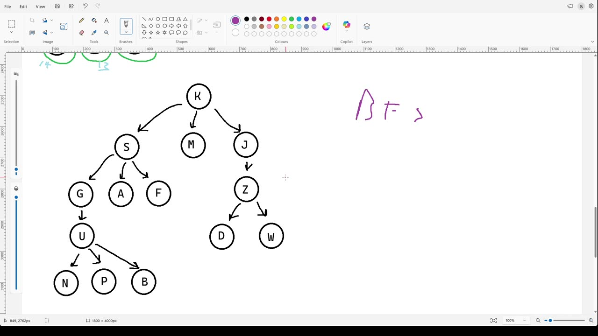

`[00:14:16]` BFS is just, we always go across if we can. `[00:14:19]` So we start here and then we're going to go here because we can't go across, we have to `[00:14:25]` go here and then we're going to go across and then we can't go across anymore. `[00:14:30]` So we go down. `[00:14:31]` And again, there's kind of arguably like forward BFS and reverse BFS, but I've never heard `[00:14:38]` anybody talk about reverse BFS. `[00:14:40]` So I'm not going to talk about it. `[00:14:41]` I don't care. `[00:14:42]` We don't have to worry. `[00:14:43]` But like technically, I guess, I guess it would make sense, but like whatever. `[00:14:48]` And so, uh, let's see what's next. `[00:14:50]` So I go all the way to the left, five, six, seven, eight. `[00:14:54]` Right. `[00:14:55]` Nine, 10, 11, come on, I can keep my rating a little bit in that 12, 13, 14.

## [00:15:00]

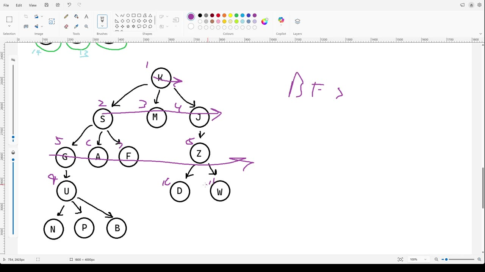

`[00:15:09]` And it's really that easy. `[00:15:10]` You just do all the nodes at a single depth from left to right. `[00:15:16]` And I want you to notice by the way, that, um, if I'm a little goofy and I draw this `[00:15:22]` like this, excuse me, I need my pen. `[00:15:29]` It's still note 11. `[00:15:30]` The drawing is not what determines what number it is, right? `[00:15:33]` What determines what number is, is how many steps it is from the root. `[00:15:37]` And I didn't increase the number of steps here. `[00:15:39]` It's still three. `[00:15:40]` It's three. `[00:15:41]` Now it's three now. `[00:15:44]` So it keeps the same ordering.

## [00:15:45]

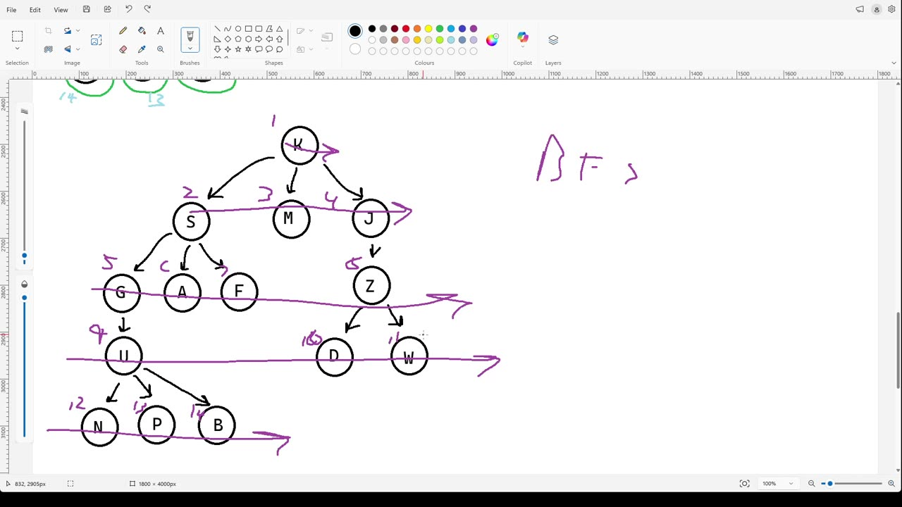

`[00:15:47]` And that like all that is true of every traversal. `[00:15:49]` We don't care about whether we drew some of them in a funny way. `[00:15:52]` We care about what their connections are. `[00:15:56]` And so that's it for BFS. `[00:15:57]` You just go across every level. `[00:15:58]` You do all the siblings before. `[00:15:59]` Actually, not just the siblings, right? `[00:16:00]` You do the cousins and the like great cut. `[00:16:04]` Like you just all the way across at every level. `[00:16:07]` And that's basically it for tourist orders. `[00:16:09]` We've got two kinds of traversals. `[00:16:11]` We've got DFS traversal orders often just called traversals, right? `[00:16:20]` We've got two kinds of traversal orders. `[00:16:21]` We've got DFS, depth first search and BFS breadth first search. `[00:16:25]` We still call them search. `[00:16:26]` Even when we're not doing search, right? `[00:16:28]` Like I don't know why it's just history.

## [00:16:30]

`[00:16:30]` And in DFS, we've got this split. `[00:16:32]` And technically under each one, we've got this split. `[00:16:36]` And we could do that under BFS forward and back, but we don't bother. `[00:16:39]` We just are going to talk about forward. `[00:16:41]` Oh, and one more side quest. `[00:16:42]` If you've covered this stuff before and you see that I'm doing pre and post-order, you `[00:16:46]` might think there's another option, right? `[00:16:49]` Jeremy, why is there no in-order? `[00:16:51]` And I am not talking about in-order in this class and that's not an accident. `[00:16:56]` And if you already know about that word, then I give you a challenge to figure out why I'm `[00:17:00]` ignoring in-order in this class. `[00:17:02]` There's a huge hint on that in another video. `[00:17:07]` But if you don't know what I'm talking about right now, don't worry about that. `[00:17:09]` That's not, that's only for the people who already know that. `[00:17:13]` And that's it on Curse Loaders.

## [00:17:15]

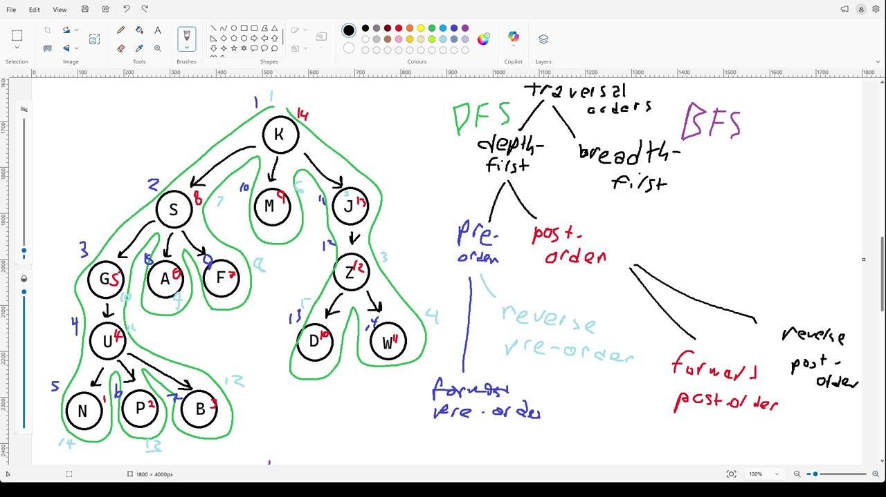
