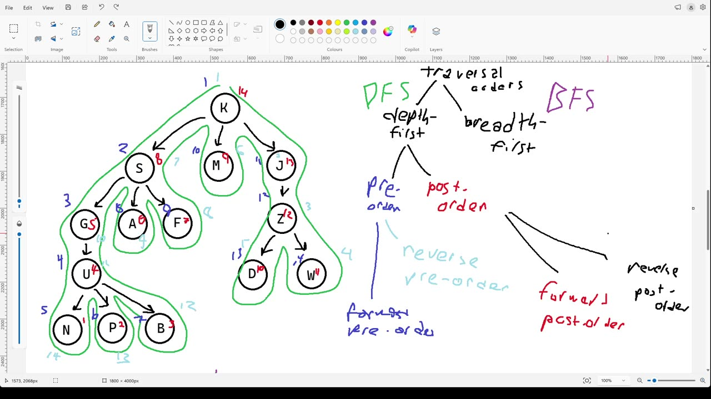
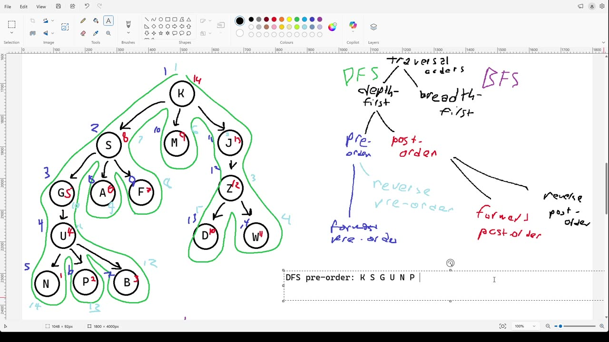
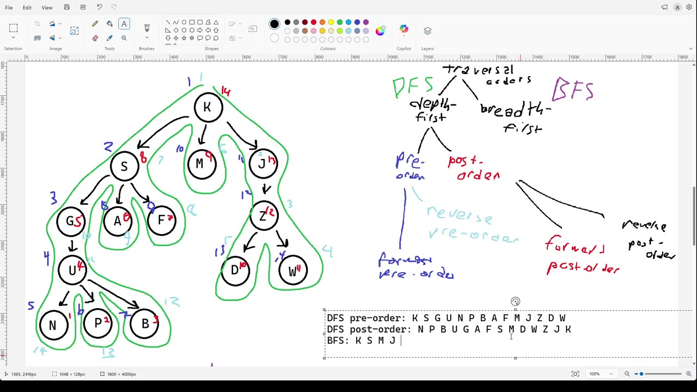
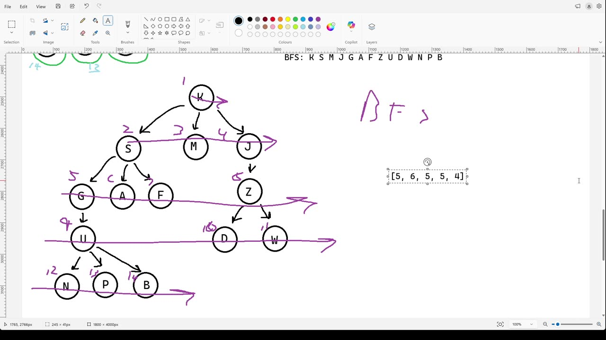

# Transcript: 202630_w06_treetraversals_addendum.mp4

- Source: `C:\Users\hiros\study stuff for cursor\Algo\202630_w06_treetraversals_addendum.mp4`
- Duration: 00:03:31
- Segments: 31, screenshots: 5
- Whisper model: `large-v3` (auto-generated; may contain recognition errors)

## [00:00:00]

`[00:00:00]` This is a short addendum to the video about tree traversal orders. This is something I realized `[00:00:04]` that I forgot to put in that video. In that video, we talked about a number of tree traversal orders, `[00:00:11]` five of them, and I hope that the orders themselves were clear. But what I didn't cover was this. `[00:00:18]` It's a very obvious and easy quiz question or exam question for me to ask you, please give me `[00:00:24]` the such and such traversal order on this tree, you know, and give you a tree. And I want to `[00:00:29]` clarify how you should answer that. You just simply write out in order, a list of the nodes `[00:00:37]` in the order that they would be processed, right list of all those that be processed in the order `[00:00:41]` they'd be processed. And to do that, you need some way of representing the nodes. And, you know,

## [00:00:45]

`[00:00:47]` if there isn't some instructions, you would probably just use the data that is in those nodes. `[00:00:53]` That's just a way of sort of communicating that you know the right order. So in this particular `[00:00:59]` tree, `[00:01:00]` I guess I got to shrink, shrink that down a bit. Okay, so on this particular tree, if I asked you `[00:01:07]` for, let me see. Well, I asked you for the DFS preorder. It's a bit large. And I asked you for `[00:01:20]` the DFS preorder. And I don't tell you, you know, forward or reverse. So you go forward, because `[00:01:24]` that's the default. You're just going to write these things out, you're going to go K, S, G, U, `[00:01:29]` N, P, B, A, F, M, J, Z, D, W. I sure hope I got that right. And I've asked you for the DFS post

## [00:01:30]

`[00:01:40]` order. And again, I didn't tell you if it was supposed to be forward or reverse. So you assume `[00:01:43]` it's forward. And then you would just go, okay, well, post order means I do the descendant for `[00:01:52]` the parent. So okay, let's see. N, P, B, U, G, A, F, S, M, D, W, Z, J, K. It looks like I missed. `[00:02:05]` Hope that's right. And BFS. And again, we're assuming we're going forward. This is, of course, `[00:02:12]` the really easy one. K, S, G, U, N, P, A, F, S, G, U, N, P, A, F, S, G, U, N, P, A, F, S, G, U, `[00:02:13]` S, M, J, G, A, F, Z, U, D, W, N, P, B. And that's all, you know, maybe put some commas in there or

## [00:02:15]

`[00:02:23]` don't. Make sure your writing is clear enough. Make sure your writing is clear enough. And one `[00:02:31]` other little detail. In this example tree, I used all unique letters so that we wouldn't be confused `[00:02:37]` talking about it. But what would you do if the same data was in multiple places in the tree? `[00:02:42]` Well, I want you to think about what happened if I gave you a list, a list, and I asked you to read `[00:02:59]` out the things in this list. And you said five, six, four, because you removed the duplicates.

## [00:03:00]

`[00:03:04]` Like that's not reading out the list. That's not what that is, right? So it's not the responsibility `[00:03:12]` of a traversal to do something about duplicates. You just process the nodes in a particular order. `[00:03:18]` And if the person calling your traversal wants to remove duplicates, they can figure that out. `[00:03:27]` That's a separate, a separate problem. Okay. That's it for this video.
