# Transcript: 202630_w07_recursionintro.mp4

- Source: `C:\Users\hiros\BCIT-study-material\Algorithms\202630_w07_recursionintro.mp4`
- Duration: 00:17:44
- Segments: 179, screenshots: 26
- Whisper model: `large-v3` (auto-generated; may contain recognition errors)

## [00:00:00]

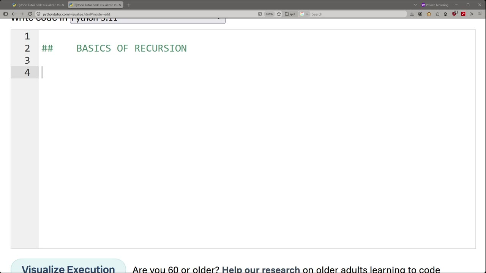

`[00:00:00]` In this video, I will walk through the fundamental basics of recursion. `[00:00:04]` Our goal here is not to learn a lot about how to best use recursion, `[00:00:08]` but just to get a strong grasp of the simple core principles. `[00:00:13]` At a point in the future, we will look into how to best use recursion, `[00:00:17]` how to design good solutions, but this video is much more just the core stuff. `[00:00:26]` So what is recursion? You know what recursion is. `[00:00:28]` It's when, why is this double indented? What's going on? `[00:00:31]` Let's simplify this. This is from another video, but `[00:00:39]` you know that recursion is when a function calls itself.

## [00:00:45]

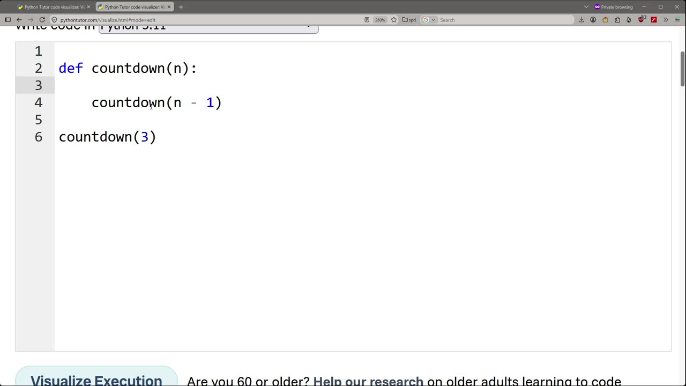

`[00:00:46]` This, by the way, is not good recursion. It's just to show you that it's calling itself. `[00:00:50]` Recursion is just when a function calls itself. That's the basic idea. There's nothing magical. `[00:00:56]` Little tangent here. If you Google for recursion, it asks you if you meant recursion, `[00:01:00]` which is a joke, right? That's because if I click there, I just end up back here. `[00:01:04]` And the Wikipedia page on recursion is full of funny self-references like this.

## [00:01:07]

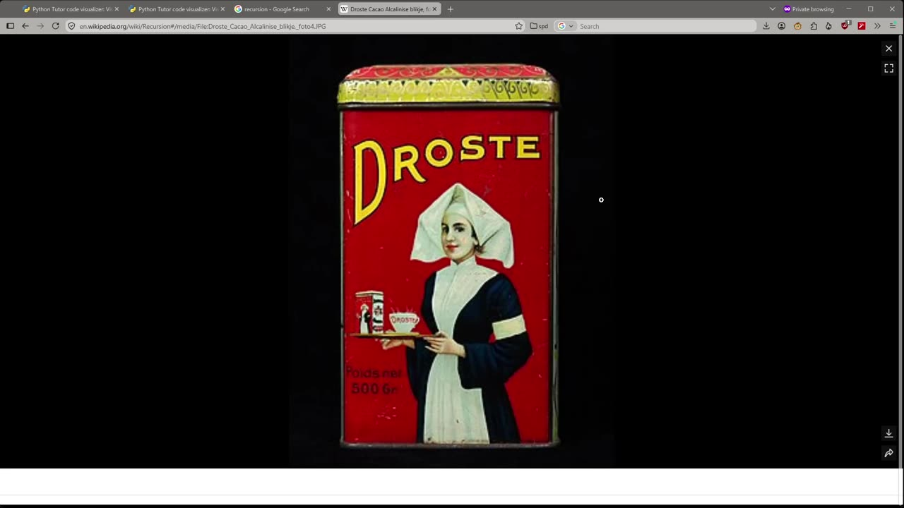

`[00:01:08]` This is Drost advertising that has got a picture of the Drost tin on the Drost tin `[00:01:13]` and other fun things. What else is in here? Oh, this thing is really cute. You should go read that.

## [00:01:14]

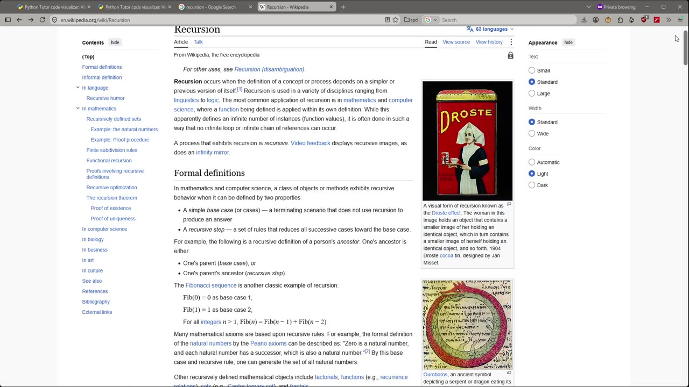

`[00:01:20]` Okay, but back to the programming. So function calls itself. Let's just flesh this out a bit, `[00:01:27]` right? So we're going to walk through this execution. We're going to see what happens. `[00:01:36]` We're going to pay attention to what the variables do. We're going to see when it calls itself. `[00:01:41]` All that stuff. Okay, so we define the function. That's easy. Now we start running. So of course, `[00:01:49]` we're going to get a stack frame and it has n as the parameter. And then it's going to `[00:01:56]` make this message string because that's clearly what line three does.

## [00:01:59]

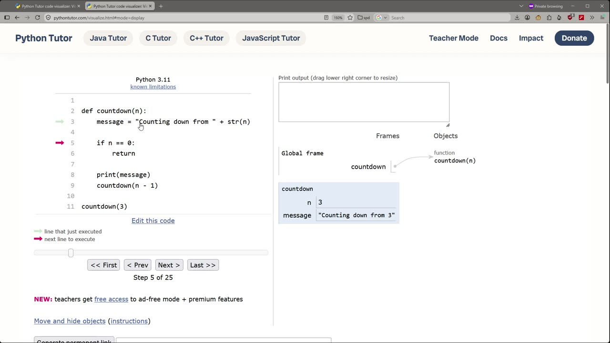

`[00:02:00]` And then it's going to check, is n equal to zero? And n is not equal to zero, so it doesn't return. `[00:02:07]` It prints the message and then it calls itself with a different value of n. And so now it's in `[00:02:14]` another stack frame. It figures out the message. It checks if it's zero or not. It's not zero. `[00:02:21]` So it prints and calls itself. It calls up with a different value. So now we've got a different `[00:02:26]` value of n. N is not zero, so it prints. I have to kind of scroll a bit here. And then we click `[00:02:38]` next. It calls itself with a different value. This time the value is zero. It calculates the message,

## [00:02:44]

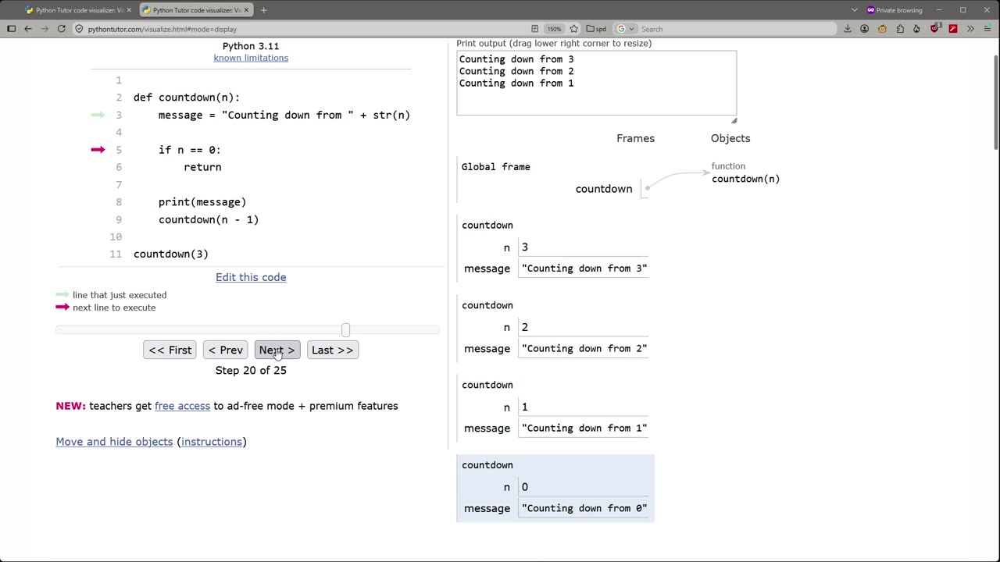

`[00:02:44]` but it's not zero. So it's not zero. So it's not zero. So it's not zero. So it's not zero. So it's not zero. `[00:02:46]` N is zero. So is it going to print? No, because first it returns. And as you can see, by the way, `[00:02:53]` what does it return? It returns none, but that's off topic. So it returns to there. And now we're `[00:02:58]` in this one. We just finished the countdown. So what happens at the end of a function? It falls `[00:03:03]` off the bottom. It falls off the bottom. It returns. So it returns. Now we're in this stack `[00:03:09]` frame. It falls off the bottom. It returns. It falls off the bottom. It returns. And then we're `[00:03:14]` at the end of this and the code is done. `[00:03:16]` Okay. So as you can see, as you saw in other contexts, every call, sorry, every frame `[00:03:27]` caused by different calls has its own variables. That's one of the important facts about scope

## [00:03:29]

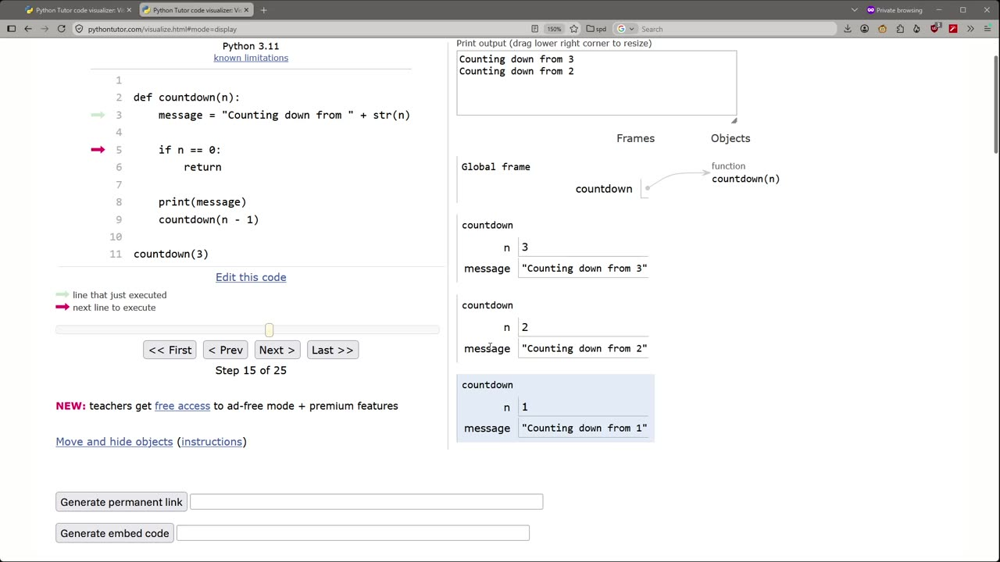

`[00:03:34]` here. And eventually we reach this N equals zero situation and the calls start returning. `[00:03:41]` So we need to know two terms here. We need to know recursive case and `[00:03:46]` base case. And as you know, the recursive case is a situation where the function calls itself. `[00:03:54]` And a base case is a situation where the function does not call itself. And every correct recursive `[00:04:00]` solution needs at least one of each. I'm going to make it real Markdown, even though I'm not `[00:04:13]` going to use it as Markdown. I just feel more secure. So I emphasize the, at least one,

## [00:04:14]

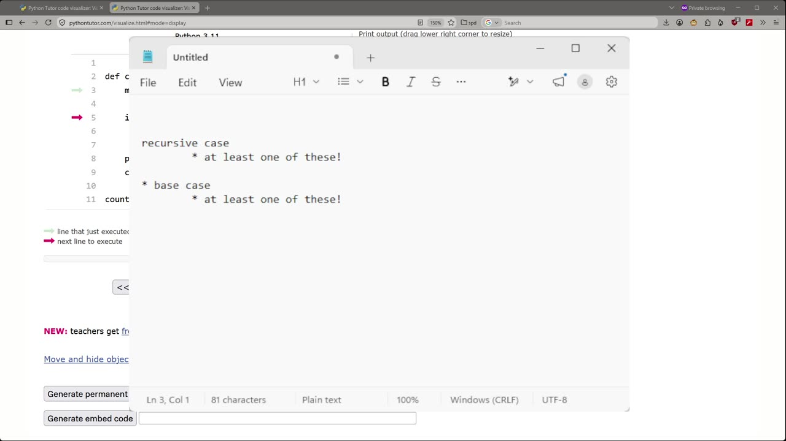

`[00:04:21]` because sometimes it's more than one and that can be fine. We're going to come back to that. `[00:04:24]` Okay. So a little digression. Why are we learning this? And I say this because, `[00:04:29]` you know, I want you to understand, `[00:04:31]` the correct perspective. We're learning this because recursion is genuinely useful. I'm a `[00:04:35]` big fan of recursion in context. There are some problems that are much easier to figure out `[00:04:40]` how to solve those problems when you know how to do recursion. That's the reason we learned this `[00:04:45]` stuff, right? But I should warn you that most of what we're doing this week are problems where `[00:04:51]` recursion is not the right solution. We're just doing them for practice, right? Almost all of `[00:04:56]` these, or maybe actually all of these are better solved with loops. So we're not,

## [00:04:59]

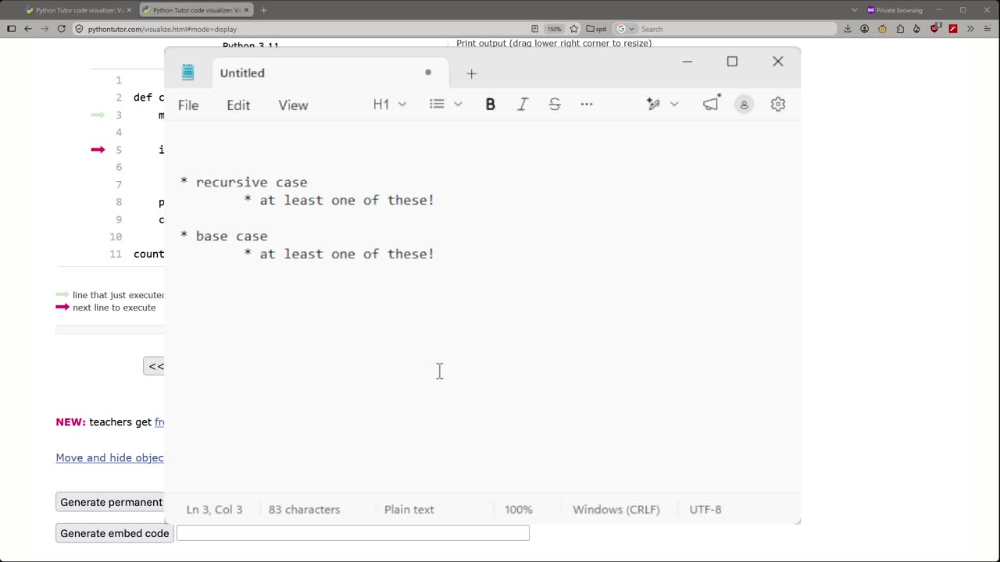

`[00:05:01]` learning recursion to solve these problems. We're learning recursion to solve, `[00:05:05]` you know, slightly harder problems in the future. Okay. So this is just like warmup week. `[00:05:11]` These problems are not good recursion problems. I'm sorry. There aren't any good, `[00:05:15]` really easy recursion problems, unless you really, really, really like math. And there's some, like `[00:05:20]` a few that are good and easy, but like, I don't know. I feel like that's not the thing that most `[00:05:26]` of you want is what if we just had more math? I feel like that's not the play. `[00:05:31]` Um, okay. So how do we make recursion work? Um, it's not necessarily clear whether you should `[00:05:39]` do the recursive side first or the base case first. It varies, but I, we're going to sort

## [00:05:44]

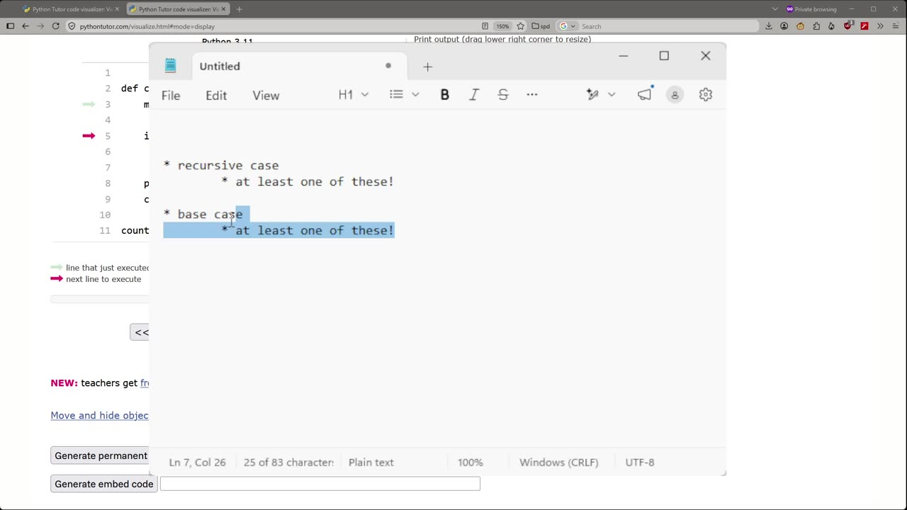

`[00:05:45]` of assume you're starting with the base case. Um, if I'm actually trying to solve a hard problem `[00:05:49]` with this, um, like a riddle, like a tricky riddle, I'll probably start with one. And if `[00:05:54]` that doesn't work, I'll try the other one. And then, but they've got to fit together eventually. `[00:05:57]` So, okay. So a base case is, `[00:06:01]` um, and I want to emphasize here, and I'll, I'll say this again later, `[00:06:13]` that case means situation. So we see this word in things like, um, if you're doing testing,

## [00:06:29]

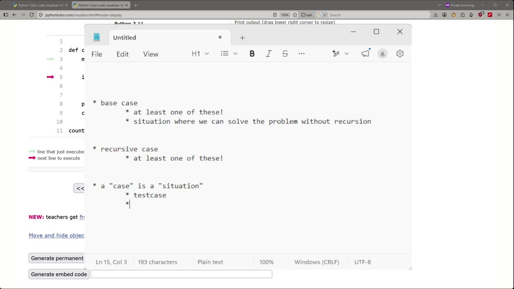

`[00:06:29]` you think about test cases, um, blah, all these damn things. Where does this show up? `[00:06:36]` We've got, uh, well, in algorithms, we think about edge cases, or sometimes people call them `[00:06:42]` corner cases. We've got, uh, well, we've got, uh, well, we've got, uh, well, we've got, `[00:06:44]` we've got, um, you know, about in some languages, not Python, we have a switch case statement. Um, `[00:06:51]` we've got, uh, of course in algorithms, we've got best case complexity and worst case complexity or, `[00:06:58]` or time or whatever. Um, if you're in something like business, you have, you know, case studies `[00:07:04]` in all of these, the word case means situation. This is a situation we're testing. This is a `[00:07:09]` situation that's on the edge. We're going to switch between various situations, the best `[00:07:13]` situation, the worst situation, the worst situation, the worst situation, the worst situation,

## [00:07:14]

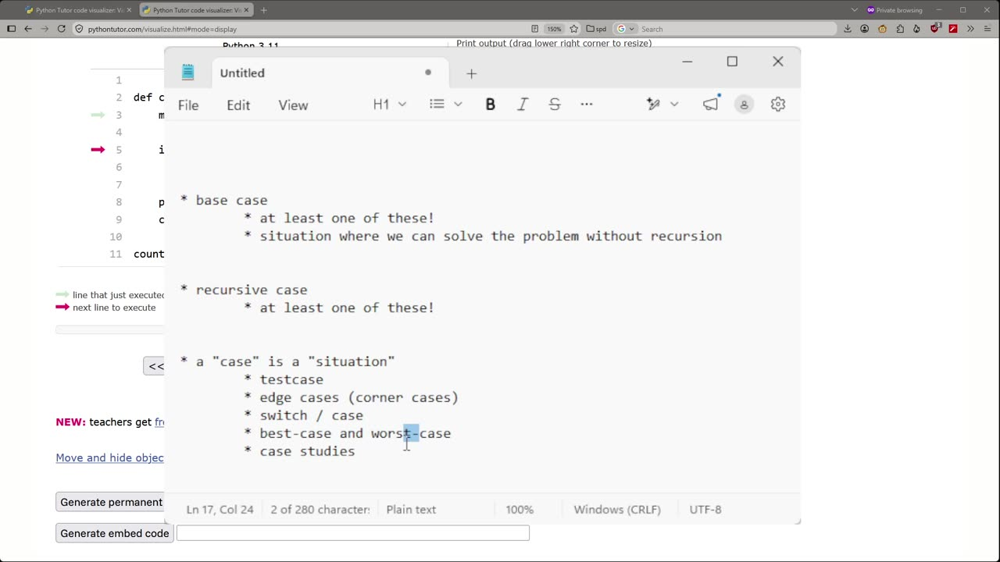

`[00:07:14]` studies of different situations. So the reason I'm saying it, well, I'll come back to it, but `[00:07:18]` anyway, uh, a case is a situation. So a base case is a situation that we can solve the problem `[00:07:26]` without recursion. Ideally, uh, and hopefully every time for you folks, it's ideally so simple `[00:07:39]` that it's almost kind of duh. And you'll see what I mean in a bit. I don't necessarily mean that `[00:07:44]` finding it is easy, but if somebody else finds it and they say, is this right or not? Like, `[00:07:48]` like, is this true or false? You're going to be like, `[00:07:50]` obviously it's true. And often the question you ask yourself is something like, um,

## [00:07:59]

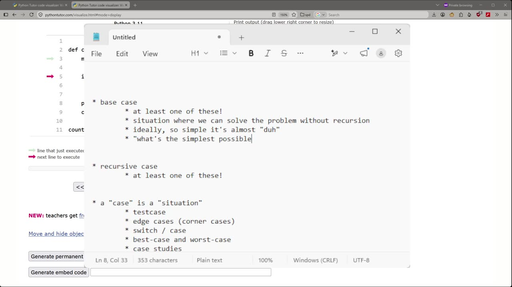

`[00:08:00]` this isn't always going to work, but it often works. Or what's the problem or the version of `[00:08:15]` the problem where we can solve without doing any work, like any more work than we've already done. `[00:08:20]` Um, so what it looks like depends on the problem. Um, and even these things are not predictable. `[00:08:29]` Maybe it's if you're processing lists of different sizes, `[00:08:34]` maybe the base case is an empty list because that's really easy to process, right? Maybe `[00:08:39]` you're processing numbers. Uh, and so maybe the easiest number to handle is zero. Um, and then

## [00:08:44]

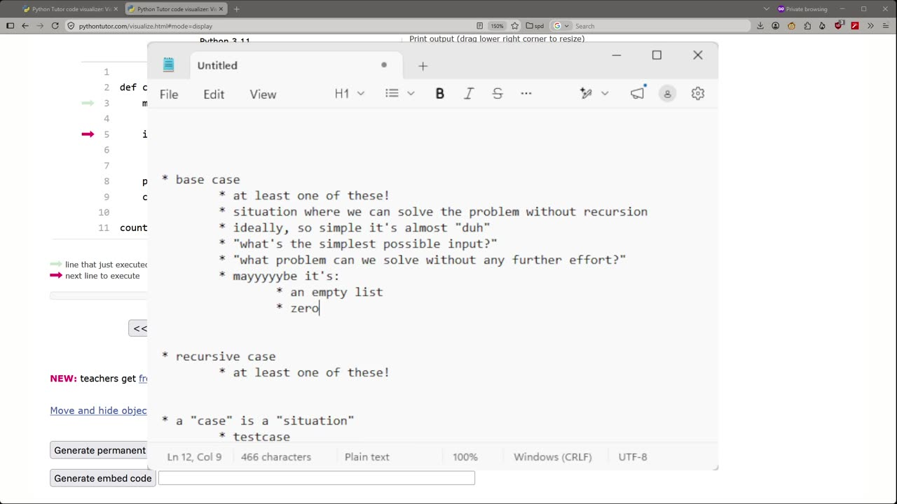

`[00:08:50]` we can imagine, you know, things outside of programming. Like if you're trying to get from `[00:08:54]` somewhere to somewhere else, maybe the base case is if you're already there, because if you're `[00:08:57]` already there, how do you get there? You do nothing. It's easy. Right. Or, you know, like `[00:09:03]` there isn't one universal, lots of other things. `[00:09:08]` No universal pattern, but to be honest, things like an empty list or a zero are going to come `[00:09:15]` up in this class. Um, it doesn't work for everything. Um, okay. And so if you have a `[00:09:24]` base case and you might need more than one, but you're probably going to try to start by trying `[00:09:28]` to have one, you're going to need a way to, and this is a must make progress towards the base

## [00:09:29]

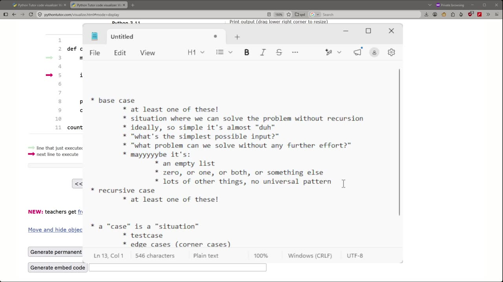

`[00:09:40]` case, right? If your recursive case does not make progress towards the base case, `[00:09:45]` you do not have a valid recursive solution. It must make progress. What does progress mean? `[00:09:52]` Well, if the base case is an empty list, then progress means the list is smaller, `[00:09:57]` maybe one point smaller, maybe a lot smaller depends. If the base case is zero, then progress `[00:10:04]` means a number that's closer to zero. If that includes negative numbers, it might mean, `[00:10:08]` you know, numbers that are greater. Like you went from negative four to negative two, `[00:10:12]` but a lot of the time you're only doing with positive numbers. And so that's really easy,

## [00:10:14]

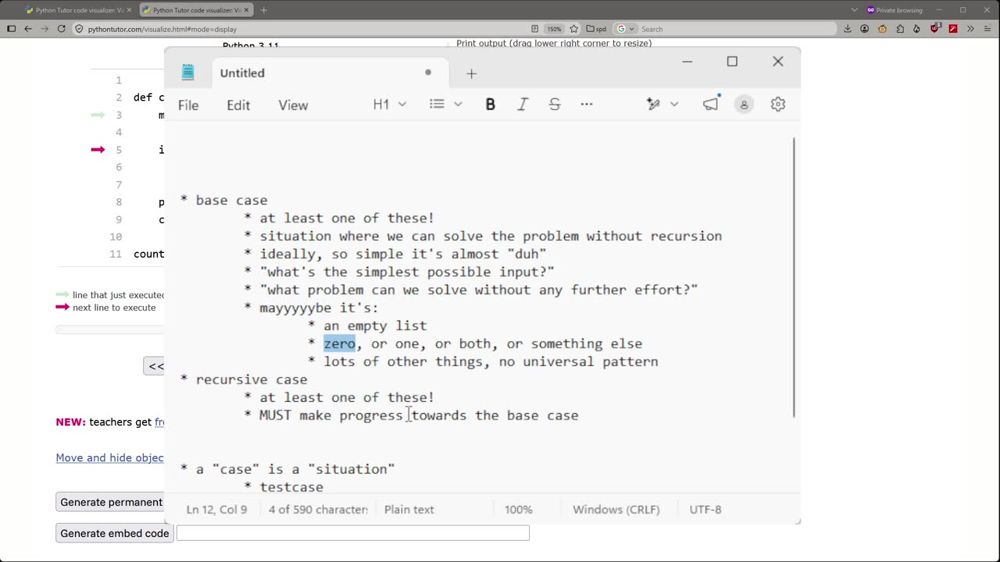

`[00:10:15]` right? Um, `[00:10:16]` subtract something and go. Um, and we're hoping that it's a version we can give to ourselves to `[00:10:28]` solve. Um, and so, and if we don't do that, we get this, um, I think that's what it's called `[00:10:44]` stack size exceeded. Okay. So let's go back here and keep working on new examples. So our `[00:10:58]` countdown function, when it returns, it doesn't do anything. It just calls the function. And when

## [00:10:59]

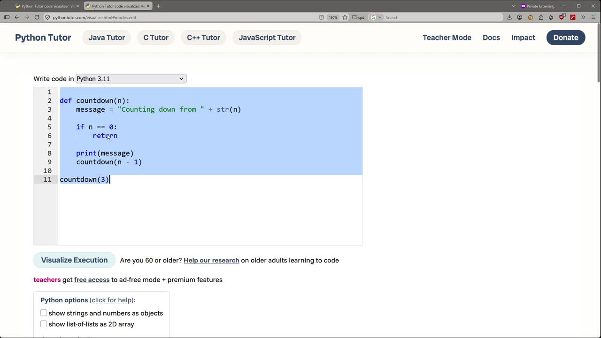

`[00:11:03]` it's done, it calls the function. And when it's done, it calls the function. And when it's done, `[00:11:03]` it's done, it's done. But a recursive call can give us a result just like any other function call. `[00:11:08]` And so let's look at an example of that. So what's the base case? What is the situation `[00:11:15]` that causes us to stop? Right. And so reversing an empty string is pretty easy, `[00:11:22]` right? If the string is empty, it's easy to reverse very, very easy. So you're done already. `[00:11:28]` So that's our base case. And this is the code that handles the base case. `[00:11:33]` And so that means the recursive case must be a string with more than zero letters. `[00:11:42]` And so we're going to ask it to reverse everything except the first letter. And I hope you can agree

## [00:11:44]

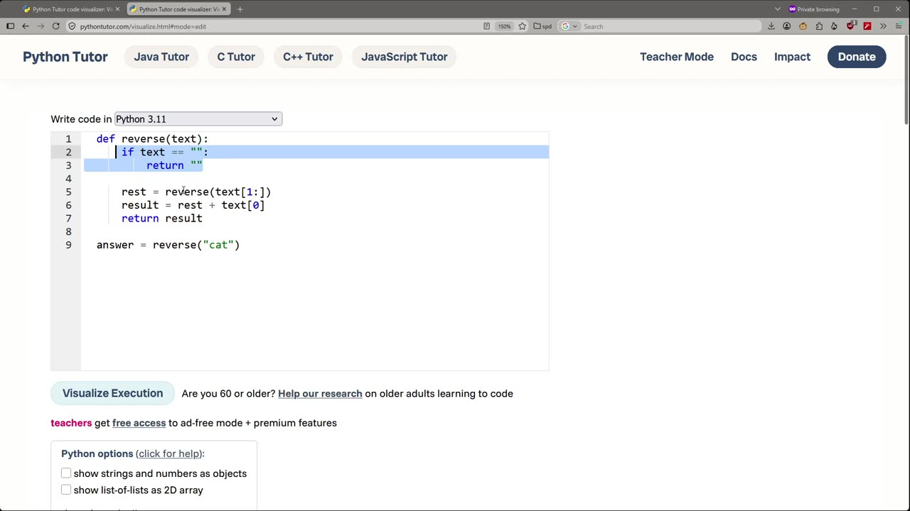

`[00:11:48]` that everything except the first letter is smaller than everything. I mean, if you were an empty `[00:11:57]` string, this would crash, but we already checked the empty string. So it must be a string of length `[00:12:01]` one or greater. And so if you're, if you are length one, then this section is an empty string. `[00:12:05]` If your string is length six, this string is length five and so on. So that's good. We're `[00:12:11]` making progress towards the base case. Really a big deal. Okay. Let's trace it and see what `[00:12:16]` happens. Well, let's just finish reading it first. We're going to reverse the rest of the string. `[00:12:20]` Then we take that rest and we're going to put the first letter to the right of it and return that.

## [00:12:29]

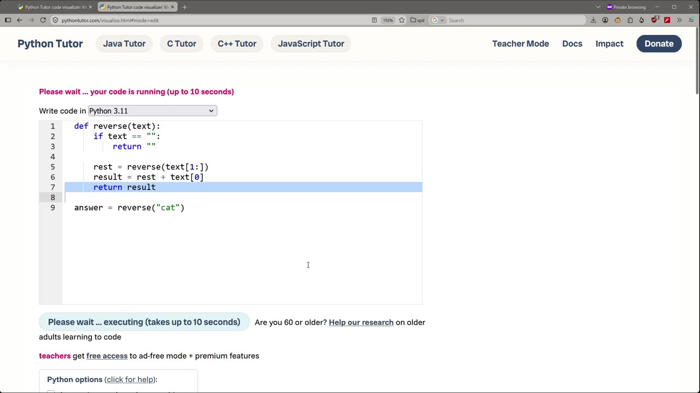

`[00:12:33]` Ew. Sorry. The format I have my notes in keeps inserting false tabs. Let's try that again. Same `[00:12:41]` code, one less integer. `[00:12:42]` Okay. We define the function. That's boring. And then we call it. And again, notice that we get `[00:12:48]` a stack frame and the parameter gets the value we gave it. Okay. We pass the, if nothing happens, `[00:12:54]` and now we're going to call reverse with all of the string, except the first letter. `[00:12:59]` Boom. All of the string, except the first letter. And then we're going to check if it's empty. `[00:13:03]` It's not empty. So we're going to do another thing. We call it with all, except the first letter. `[00:13:07]` We check if it's empty. It's not empty. So we call it with all the string, except the first letter. `[00:13:12]` Right. And now we are calling it on the string and that is the base case. So when we hit this

## [00:13:14]

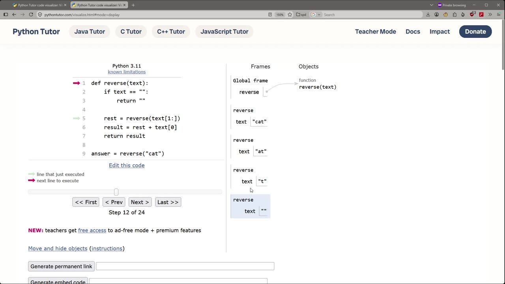

`[00:13:19]` code, this line two, it's going to return the empty string. Great. And so what happens next? `[00:13:32]` What happens next is that this return value is going to go back to where we were. `[00:13:36]` It goes into rest. And then we have rest plus the zeroth letter of text. And the zeroth letter `[00:13:41]` of text here, of course, is T. So we return T, like empty string plus T is T. `[00:13:46]` So we bring that back here. And the zeroth letter of text here is A. So we're going to put that to `[00:13:55]` the right of rest and that'll be TA. And we're going to return that. And the zeroth letter of

## [00:13:59]

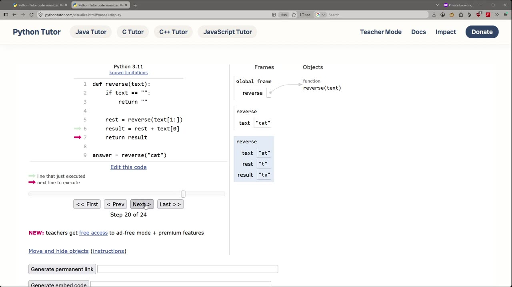

`[00:14:03]` text is C. And so we're going to put that to the right of rest and return that. And we have `[00:14:13]` a reversed cat. Okay. And so partly this is just like watch the machine run. It's not that `[00:14:23]` complicated. Notice how the base case eventually turns out. So we're going to put that to the right `[00:14:26]` of rest. Notice that when we're getting closer, if I just rewind a bunch, right, we're just getting `[00:14:32]` closer by one step at a time, making new stack frames each time. Right. But a thing that you `[00:14:38]` want to notice in this example that wasn't present in the last example is that the recursive call `[00:14:42]` doesn't necessarily solve the entire problem. Right. When I come back from, say, this one,

## [00:14:44]

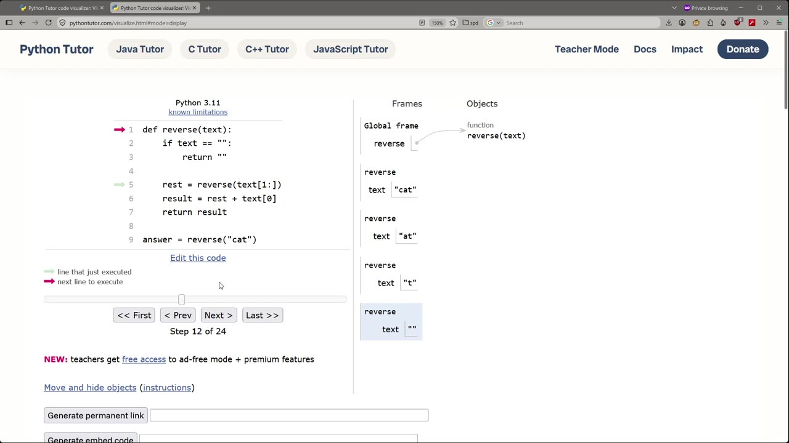

`[00:14:49]` I haven't solved the reverse of cat. I've only `[00:14:56]` solved the recursive to. And then I have to put that onto here to get the reverse of at. `[00:15:03]` And then I have to get that back here and I have to add the C in to get the reverse of cat. `[00:15:09]` Right. And so you could ask yourself, you're trying to solve one of these problems. `[00:15:14]` Suppose the recursive call all goes okay. Who cares? How do we use the answer? Right. And if, `[00:15:21]` and, and since you're the one coming up with the recursive call, you know, that's a bit of a weird `[00:15:26]` way to phrase it, but okay, let's see what else.

## [00:15:29]

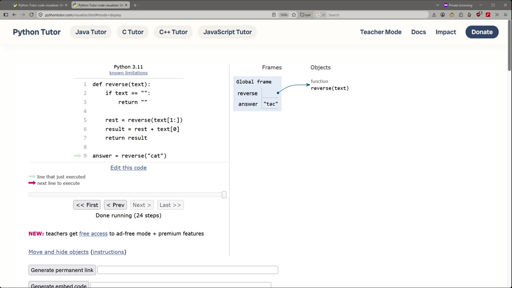

`[00:15:30]` In my notes. Oh, there's almost nothing in my notes we didn't already cover. Let's see. `[00:15:36]` We talked about base cases and recursive cases in some detail. We talked about how a case is `[00:15:40]` a situation. And so often people will point to a particular if or something like that and call `[00:15:45]` that the base case. Can I move? Right. You can see that if on line two, you might say that's the `[00:15:53]` base case and that's convenient language, but like, don't get confused. Occasionally you will `[00:15:58]` see code where there is no if like that. And so you're going to have to do that. And so you're `[00:16:00]` going to have to do that. That doesn't mean there's no base case. The base case might be `[00:16:04]` handled without a separate line of code. You'll see it eventually and you'll hopefully understand, `[00:16:09]` but base case doesn't mean code. It means situation. And I guess the other thing I want

## [00:16:14]

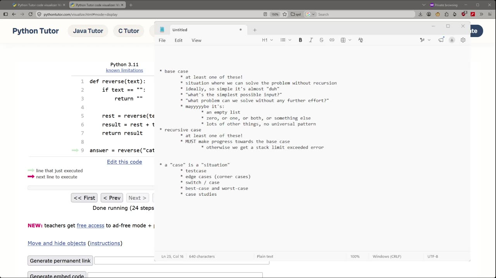

`[00:16:14]` to mention is that a recursive case is not the same thing as a recursive call. As you know, `[00:16:27]` a call like a function call, you know, is when a function gets called and you can have multiple `[00:16:34]` calls. You can have multiple calls. You can have multiple calls. You can have multiple calls. You `[00:16:35]` can have multiple calls. You can have multiple calls. You can have multiple calls as a response `[00:16:37]` to a single case. We haven't in any of our examples yet, but you can. And so just that's `[00:16:44]` just these separate words you want to know, right? You want to know the base case, recursive case, `[00:16:48]` and you want to know that recursive call is different. And I think that's the wrap up. `[00:16:54]` Let me see. What did I write at the end here? When you're trying to write a recursive solution, `[00:16:59]` here are three, I'll just copy it into this doc. This is my wrap up. When you're trying to write

## [00:16:59]

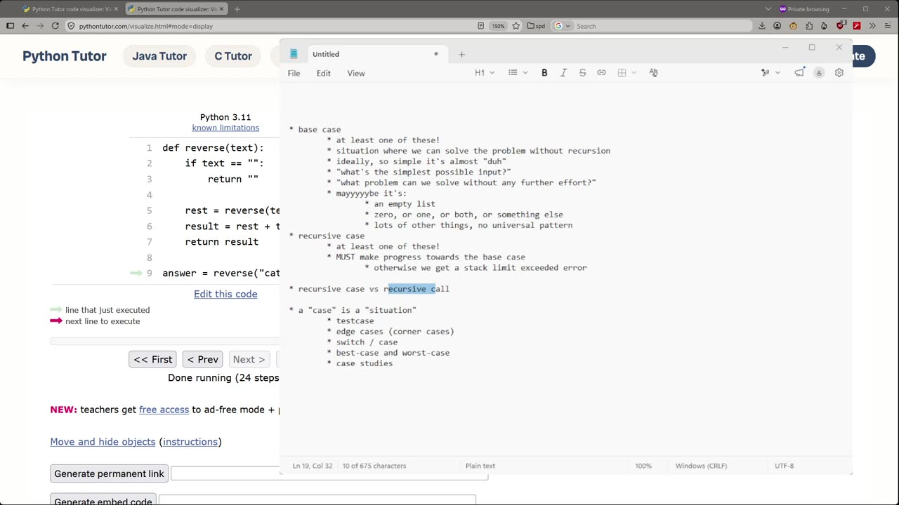

`[00:17:07]` a recursive solution, here are three. When you're trying to write a recursive solution, here are three. `[00:17:08]` Three problems that you could ask yourself. What's a situation where we can solve the problem `[00:17:12]` immediately? Oh, this isn't three questions. This is actually four questions, but these two are kind `[00:17:17]` of the same. They're just two different ways of saying the same thing. How can we make progress? `[00:17:21]` Or to put it differently, what smaller problem can we in fact solve? And also suppose it gives `[00:17:27]` us the answer. What do we do with the answer? And sometimes the answer is, sometimes what we do is `[00:17:31]` we're done. Like we just give the answer back, but not always. Sometimes we have to take the `[00:17:36]` answer to the smaller problem and combine it. And so this is your kind of setup for what we're `[00:17:42]` going to do in class.

## [00:17:44]

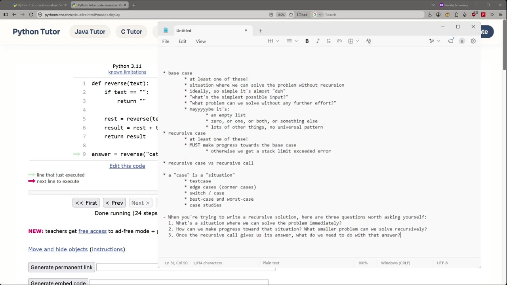
