# Transcript: 202630_w07_visualizestackframes.mp4

- Source: `C:\Users\hiros\BCIT-study-material\Algorithms\202630_w07_visualizestackframes.mp4`
- Duration: 00:21:13
- Segments: 228, screenshots: 29
- Whisper model: `large-v3` (auto-generated; may contain recognition errors)

## [00:00:00]

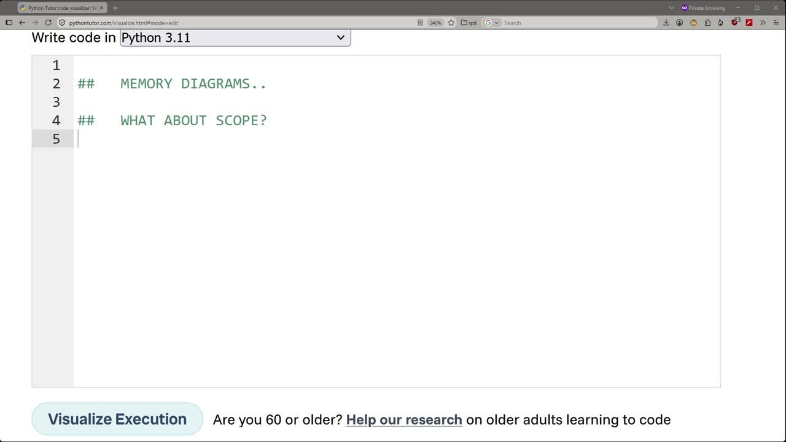

`[00:00:00]` In this video we're going to extend our knowledge of memory diagrams a little further `[00:00:03]` to include scope in particular to handle different scope regions like inside functions or methods. `[00:00:09]` As far as I'm aware this is really the only thing we haven't handled yet in our memory diagrams. `[00:00:19]` In our code so far we have just had little variables hanging out in space and when you `[00:00:27]` visualize those in python tutor we see that they're not hanging out in space they live in `[00:00:32]` a global frame in an area called frames and that suggests there might be other kinds of frames `[00:00:36]` and in effect that's what we're going to look at. So I wonder where those come from. Well maybe they `[00:00:43]` come from a function call and so in this code here you see that we're going to do something very much

## [00:00:45]

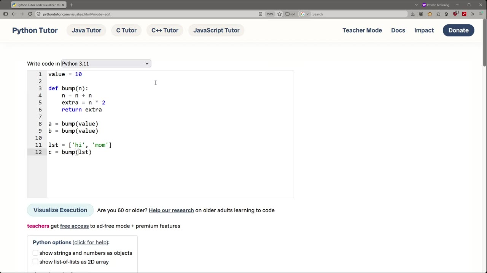

`[00:00:50]` like everything we've already always done. Then we're going to make a function then we're going `[00:00:53]` to call that function and call it again and then do a little goofing around down here and so you `[00:00:58]` may you know the question you want to be asking yourself is what will it show while I call the `[00:01:03]` function and so when I define the function it makes this little function object here and you `[00:01:11]` don't need to worry about that. `[00:01:11]` You could draw that you could not draw that I don't care I don't care and so when we invoke bump `[00:01:21]` of course the value of value sorry was 10 and so that 10 gets passed in here and then that 10 is in `[00:01:29]` the n and sure enough that 10 is in the n right and so we see that when we call the function we

## [00:01:30]

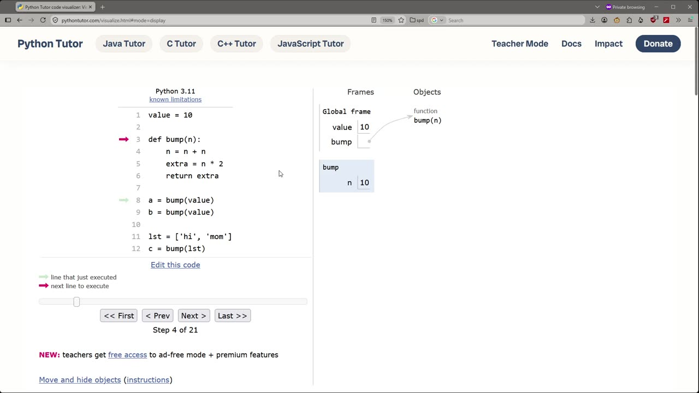

`[00:01:35]` get a new frame here the frame in python tutor has a label and inside the frame our parameter `[00:01:43]` looks like a variable. `[00:01:45]` And then on the next line we're going to reassign n to be n plus n. `[00:01:49]` Okay cool n is now n plus n. `[00:01:52]` Now the next time we're going to make a new value n times 2 and we're going to put it into extra `[00:01:58]` and extra is a local variable so parameters are kind of a special kind of local variable `[00:02:03]` and either way parameters and local variables live in this frame here right and when I reassign `[00:02:12]` if I just go back to the bit where I reassigned n. `[00:02:14]` When I reassign n it doesn't affect what's happening in the outer scope in the in the

## [00:02:15]

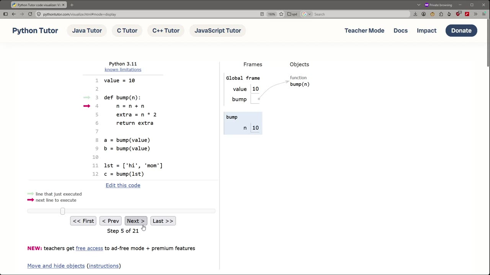

`[00:02:23]` scope that it was called from and the frame that it was called from I really should say frame `[00:02:27]` not scope but okay so proceeding along and now we're going to return extra and watch what happens `[00:02:33]` when we return extra so python tutor shows you that that's going to be the return value didn't `[00:02:38]` use to do that that's a nice feature and now that's going to come back to line 8 and it should `[00:02:43]` put that into a. `[00:02:44]` Okay. `[00:02:45]` And it puts it into a in this frame which is the frame that corresponds to the scope that this was `[00:02:50]` in then we're just going to do all that stuff again it's just the same do do do do and we return `[00:02:58]` 40 and it goes into b and so there you see that when I call a function it makes a stack frame

## [00:03:00]

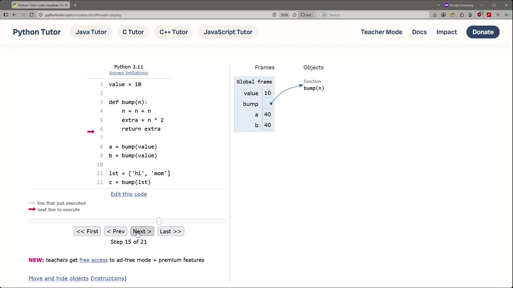

`[00:03:05]` and when I return it removes the stack frame the stack frame disappears oh and sorry I jumped ahead `[00:03:10]` and called them stack frames let's just pretend I said frames for a second just for a second. `[00:03:15]` Let's do another example here where I'm going to put this list of two strings into a little `[00:03:22]` variable called list and I'm going to call bump and it turns out that plus and times both work `[00:03:27]` on lists I don't really think you should use times very often but and so we're going to say `[00:03:34]` n equals n plus n and so just like before when doing assignment made a new like `[00:03:40]` didn't change the original variable it's going to `[00:03:44]` do assignment and then it's going to do n times 2 and do assignment again

## [00:03:45]

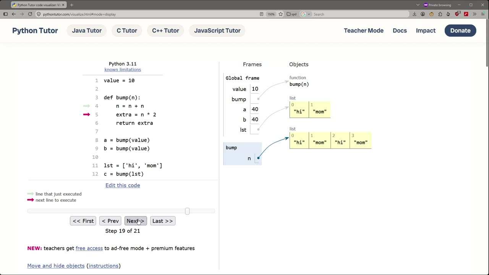

`[00:03:50]` and then it's going to turn extra now that means that the value in extra is going to get sent back `[00:03:57]` to c well the value in extra is this reference not this whole list but the reference this list `[00:04:03]` and so that is going to get sent back and boom that referenced this list I know it jumped around `[00:04:07]` but it's the same list like it didn't make a new list it just it just moved it in the picture um `[00:04:13]` so it it it copies over the reference and does not make a new list and so this is all just the `[00:04:19]` same as stuff we already knew except for the frames like all the stuff about making new lists `[00:04:25]` sometimes and making new variables sometimes. That's all old news I hope. The only thing that's

## [00:04:30]

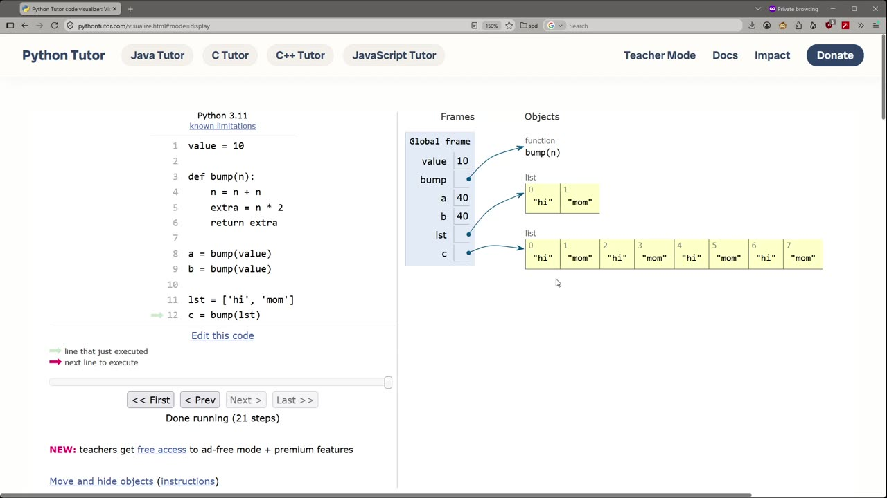

`[00:04:30]` new is that we have frames. Let's jump to a fancier example. This is still pretty simple `[00:04:39]` code but it's a little longer so we'll just have a quick look at it I'm defining three functions `[00:04:46]` and then I'm calling one of them. I called the first one Speed ViewingF coûts Lake. `[00:04:48]` And then you can see that I'm calling one of them. I've just set up a couple available new some code上 `[00:04:49]` and then I'm calling one of them. I call function first. Function first and function second and `[00:04:53]` function, they're all pretty similar. They've got a few different magic numbers in them, `[00:04:56]` but those don't matter. What is interesting is that first calls second, second calls third, `[00:05:03]` and third doesn't call any other function. And so, thank you. And so when we run this,

## [00:05:07]

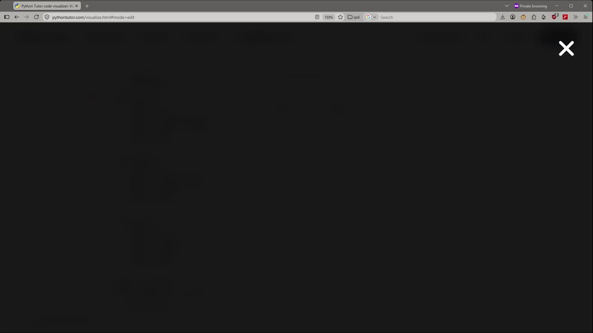

`[00:05:13]` it defines those three functions, of course, blur, blur, blur. And then it's going to call `[00:05:18]` first with a parameter, with an argument of three. So the argument of three gets copied `[00:05:22]` into the parameter N. And then we're going to start running some code. So it's going to make `[00:05:29]` a new value variable and assign that. And then it's going to call second. And when it calls second, `[00:05:36]` boom, we get a new stack frame, new frame. And this frame has a new value of N that is what we `[00:05:43]` got put in here. We got value put in here. And so this thing in value got copied into N. `[00:05:48]` And then it goes on and it triples that.

## [00:05:52]

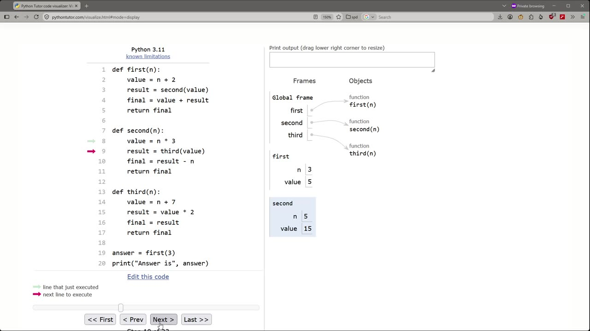

`[00:05:53]` And so it's going to call second. And then it goes on and it triples that. `[00:05:53]` And then it's going to call third with that value of 15. And there we are. Another stack frame. `[00:06:00]` 15 is passed in. It sits in the parameter N. And then we're going to say value equals 15 plus 7. `[00:06:08]` And then we're going to say result equals value times two. And then we're going to put result in `[00:06:13]` a final. I don't remember why I wrote that extra line of code. That's not very useful. `[00:06:16]` And then it's going to return that. And so what's going to happen to this return value? Well, `[00:06:22]` we're going to, `[00:06:23]` we're going to leave this frame because we're leaving this function code and we're going to go `[00:06:28]` back to where we were, which is line nine. And the set of frames here tells us that it'll be in `[00:06:35]` second. It doesn't tell us where we'll be in second, but I assure you the program is recording

## [00:06:37]

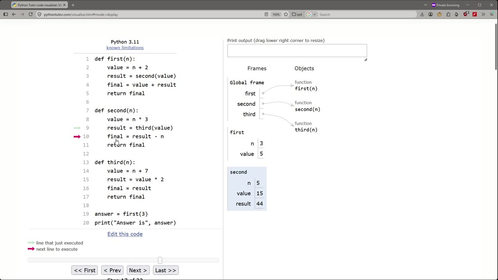

`[00:06:39]` that too. We just can't see it in this visualization. And, um, we have put that value that `[00:06:48]` we had 44 into the result. And so we're going to go, okay, result minus N is fine, `[00:06:53]` final. Sure. Return final. And again, that 39 is going to go back to line three, where it's going `[00:06:59]` to drop into result. There's 39 in the result and blah, blah, blah. Through we go. We return 44 back `[00:07:07]` to line 19, line 19. The answer is 44. And then we print it out and it prints it up here. All very `[00:07:12]` boring. Love it. Okay. So what did we learn here? We learned that multiple frames can exist `[00:07:16]` simultaneously. Each frame can have variables that have identical names to other frames.

## [00:07:22]

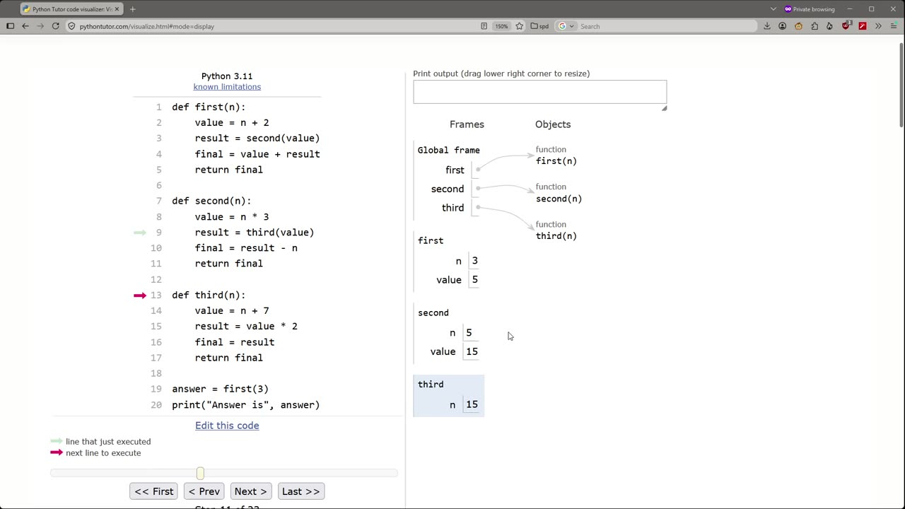

`[00:07:23]` And it's, it's fine, right? There's an N and a value, and there's an N and a value, and there's an `[00:07:26]` N and a value. That's all fine. Um, each function call creates one of these frames and the frames `[00:07:34]` don't go away until the function returns. So we haven't returned from first yet. And so this has `[00:07:39]` to hang around and these frames go away in an order that I think we can fairly describe as `[00:07:46]` last in first out. This is second to last in. So at second to last `[00:07:52]` second out. I mean, `[00:07:55]` And then this was earlier in, so it's later out and so on, right? This is first in first out. And `[00:08:02]` so that's why I call this these stack frames. Cause that's what they're called. This set of `[00:08:06]` all the frames is called the call stack. So this is the call stack. It is a stack. It holds frames.

## [00:08:07]

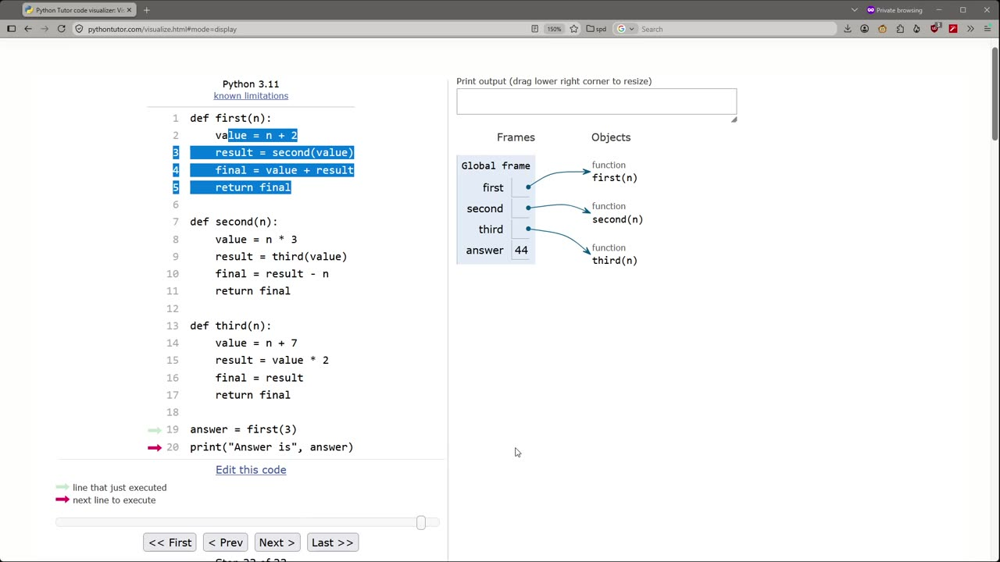

`[00:08:12]` They're called stack frames sometimes. Okay. And so if you want to, you could go back to this `[00:08:17]` little section and put your attention on what happens when a function returns the return value `[00:08:22]` to the frame and to what runs next. `[00:08:25]` Now, this next little bit's a bit in the weeds, but I just want to make sure we're clear `[00:08:33]` that the values at different levels of scope aren't necessarily the same value. And in fact, `[00:08:41]` they're generally not the same value. And so even though we have a variable here called value on `[00:08:45]` line one and a variable here called value on line five, the one on five is a local variable inside `[00:08:50]` this scope. And so it will exist in its own stack frame, like in the stack frame of the function.

## [00:08:52]

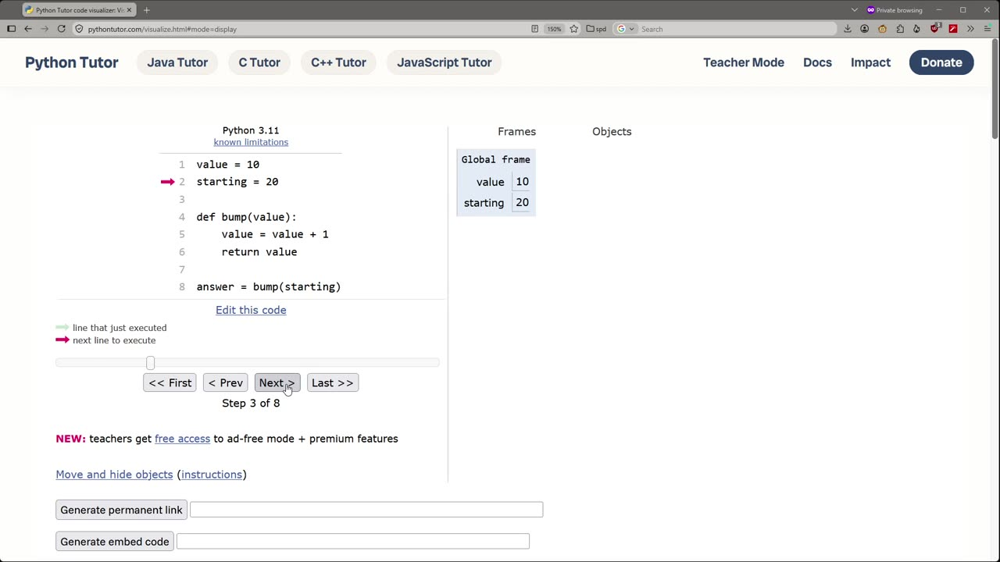

`[00:08:57]` And it's when, `[00:08:59]` when this value gets assigned to be value plus one boop, that affects this one. It doesn't affect `[00:09:05]` this other one. The rest of this is pretty straightforward. And if I modify, you know what, `[00:09:13]` I'm not going to do the other version, but there is a way to get the value out there. `[00:09:17]` There's a way to read the value in. There's a more difficult way to get the value out, `[00:09:21]` but generally you shouldn't be doing that. Generally you should be passing things through `[00:09:24]` parameters, right? Which I hope you all know. Okay. What am I doing next? `[00:09:32]` Um, what's this an example? `[00:09:37]` Well, this is a combination of stuff. We've already been doing with how some things modify

## [00:09:37]

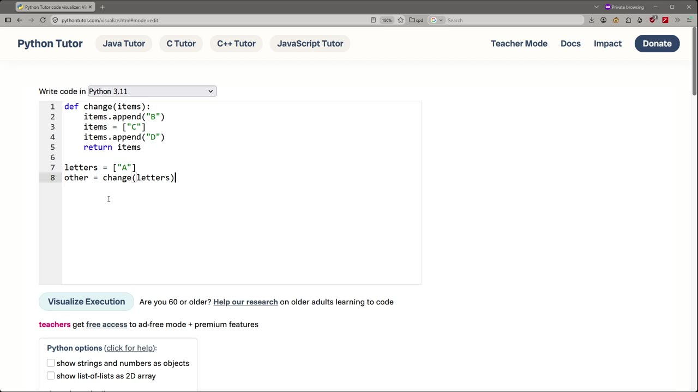

`[00:09:41]` lists and other things make new lists, right? That's stuff from before with stuff from this `[00:09:49]` lesson about, um, frames. And so the point is that these things, the point of this little example is `[00:09:56]` these things work together just in the most simple way you can imagine. So I'm going to define this `[00:10:01]` function. I'm going to set letters to be a new list with one element. The element is the string `[00:10:05]` A. `[00:10:06]` pass that into change so we're in the change stack frame now it has got a parameter of items `[00:10:12]` and that parameter is visible here and it references this same list right and so the `[00:10:17]` the reference got copied over the list didn't get a new copy of it made `[00:10:22]` and so when we dot append it's modifying this original like like this items points to the same

## [00:10:22]

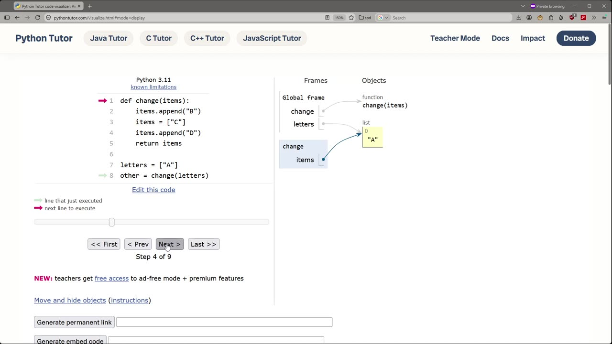

`[00:10:29]` thing that letters points to and so when we items append it's going to modify letters in effect like `[00:10:35]` it's the same not like letters is the real name for this neither of them one is neither one of `[00:10:40]` these names is the real name they're both just names that this thing answers to and so then when `[00:10:44]` we do this assignment on line three we know that assignment is different from mutating method calls `[00:10:50]` and so assignment will make a list and point items that list line four is going to append to the new `[00:10:57]` list then we're going to return the new list and line eight says we're going to put that that `[00:11:02]` reference to the new list into a new variable called other and so `[00:11:05]` it kind of jumps here but you're going to see that there's a new variable here and it has an arrow

## [00:11:07]

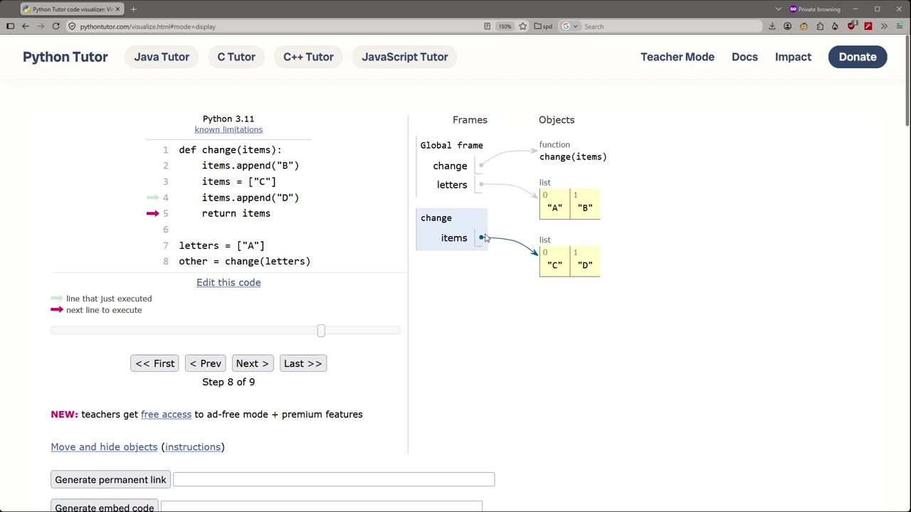

`[00:11:10]` pointing to this list and it's not a new list it doesn't make a new list in this next step `[00:11:14]` it just okay in in one version when i was doing this it it moved it around and so it looked like `[00:11:20]` it might be making a new one but it was clear this time okay and so again this is just a combination `[00:11:26]` of the old ideas um the the new call stack frame the variables in that frame are their new variables `[00:11:37]` and so the things that would result in arrows getting unhooked still result in arrows getting `[00:11:42]` unhooked and the things that would keep the arrows hooked together still keep the arrows hooked `[00:11:45]` together it's like not any different in terms of when we make a new list or when we make a new `[00:11:52]` object or things like that do do do next thing okay the next thing is methods and again what

## [00:11:52]

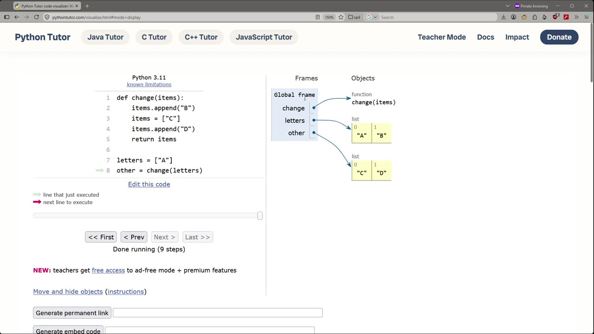

`[00:12:06]` you're going to see is this is not a new idea we already covered the idea in the first couple `[00:12:12]` of episodes so we'll just cover this in this next one step the next thing is method we're going `[00:12:18]` to do is we're going to use this method because in this case we're going to look at the definition `[00:12:23]` of methods and we're going to call this method initialize so a method is used to define a class `[00:12:28]` so you can see here we define a class it's got three methods um this method doesn't call any `[00:12:34]` other methods but this method does so you can see what happens when a method calls another method `[00:12:37]` so we're going to do first is we're gonna when we run it we

## [00:12:37]

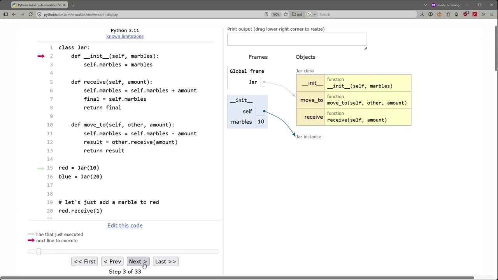

`[00:12:40]` zoom through the class definition and we get the class here okay whatever i don't care and then we `[00:12:41]` call the constructor which runs the initializer the initializer sets marbles to 10 in the new instance `[00:12:42]` and then it puts that into this variable called red by which or it puts it in i mean that it `[00:12:48]` gets a reference to it and the same thing is going to happen again except it's going to be `[00:12:52]` 20 marbles and it's going to be referenced from the variable blue call it let me give it the `[00:12:58]` property 20 marbles put it into blue did i just double jump yeah i think i just i just think i `[00:13:04]` just like my finger just double clicked okay so what happens next what happens next is we're `[00:13:11]` going to call red dot receive red dot receive is just basically increasing by some number `[00:13:17]` like where these marbles come from i don't know we just we just bought one more we bought one `[00:13:21]` more red marble at the store and so you can see that because it's called on red that self is this

## [00:13:22]

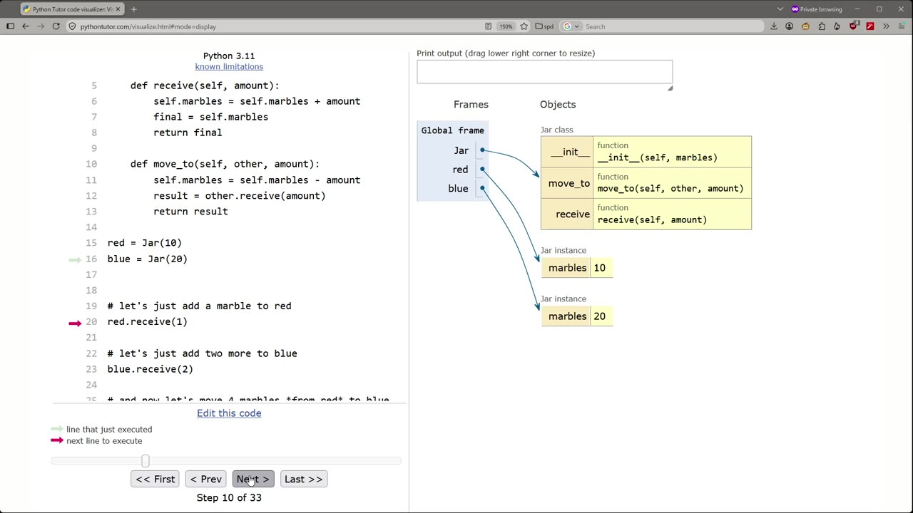

`[00:13:28]` thing that was that red referenced right red had an arrow to here so self has an arrow the same `[00:13:32]` thing now we're going to go into this method call it's just like going into a function call it's got `[00:13:38]` a stack frame the whole self `[00:13:41]` thing is different but everything else is the same and you already knew all that from oh it's `[00:13:45]` just the same okay and so line six is gonna find what self marbles is it's gonna add one to it `[00:13:52]` because one is the amount and then it's gonna put that into self marbles okay great and then it gets `[00:13:57]` this final it returns final whatever we're gonna go on and do it again we're gonna buy two more `[00:14:03]` blue marbles so blue is the the thing that blue references is is

## [00:14:07]

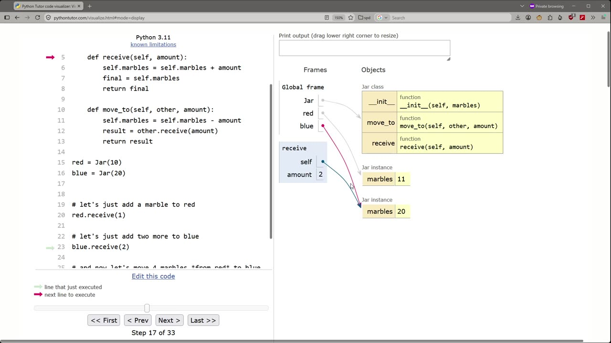

`[00:14:11]` it's gonna find that two by itself um we've got the two in the amount we go through we do the `[00:14:18]` mutation over here we set up final over return it okay fine and now we get the one slightly more `[00:14:24]` complicated version where it's going to call move to and move two calls receive so we call move two `[00:14:31]` um we're moving four out of blue and four out of right into blue so we're gonna this 11th gonna go `[00:14:38]` down and the 22 is gonna go up i think hope i got that right `[00:14:41]` i'm getting a little tired okay so four got removed from the thing that red points to but `[00:14:48]` right now that's self and then we're going to put them into the other one we're going to do that by

## [00:14:52]

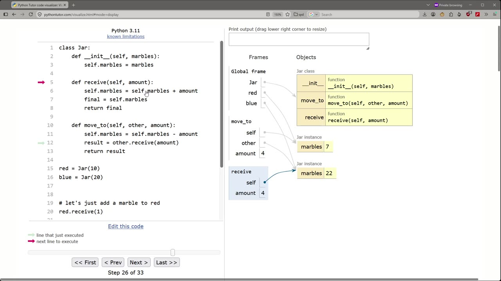

`[00:14:53]` calling receive you can see here on line 12 that we call receive and so what you're seeing here is `[00:14:58]` it's there's more details like all the details are getting a bit distracting and complicated `[00:15:01]` like it's like it's a lot of details to take care of but it's all just the same machinery as before `[00:15:08]` right we know about method calls from last term we know about self being this kind of funny thing `[00:15:14]` that's how method calls work then we know about um objects having properties we know about that `[00:15:21]` from the an earlier video we know about stack frames from a few minutes ago it's all just this `[00:15:27]` stuff it's just there's so much of it going on that it feels a bit bewildering maybe `[00:15:30]` but it's all actually stuff we already know and then we print it out don't care okay

## [00:15:37]

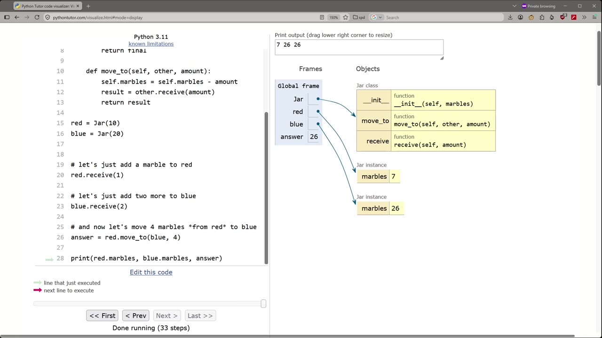

`[00:15:38]` okay `[00:15:40]` now this video is not about recursion but i want to show you how `[00:15:45]` un new like how simple and the same thing recursion is with respect to what we're doing `[00:15:53]` here we make the function we call it it gets a stack frame it calls itself it gets a stack frame `[00:16:06]` it calls itself it gets a stack frame it calls itself it gets a stack frame right `[00:16:19]` and then when they return they return they return and so we'll come back to this but i just wanted you to see that it's not any different just because it's recursion

## [00:16:22]

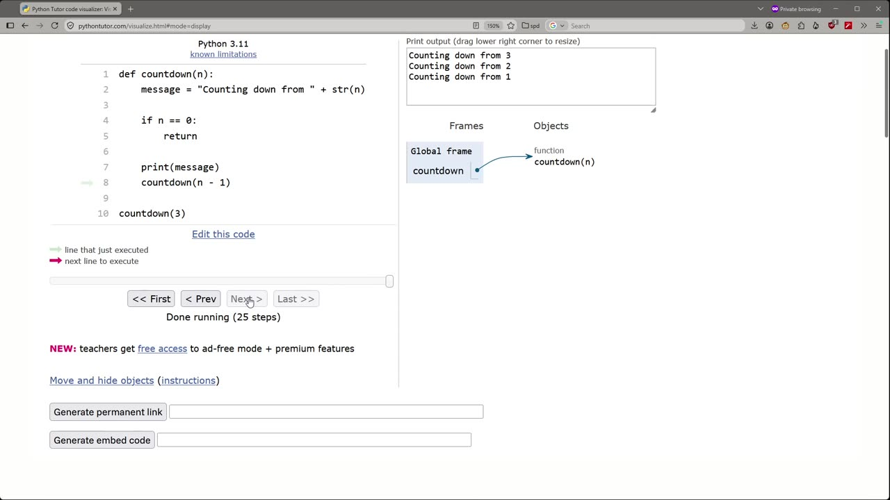

`[00:16:31]` okay we're almost at the end of this video i just want to tack on one more thing that we didn't cover previously `[00:16:37]` which is we didn't do dictionaries previously and i just want to show you the dictionaries are again if you can do all the other stuff you can do this if you can't do all the other stuff well uh i don't know `[00:16:51]` but this is a grâce to it kingdom `[00:16:53]` we're right in the middle of this video all right de decorate `[00:16:54]` but we're right in the middle of this video all right de create `[00:16:57]` imported class that makes things weird but we're just going to have this variable record and it `[00:17:02]` points to a dictionary you can see the dictionary is just like an object instance except instead of `[00:17:05]` saying blah blah instance it says dict you could write whatever you like there something that was

## [00:17:07]

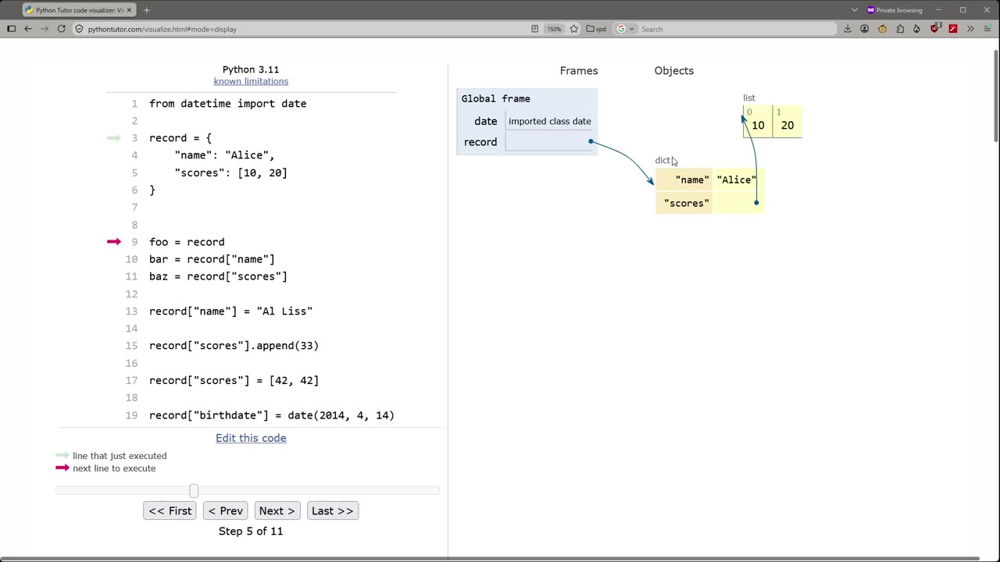

`[00:17:10]` made it was clear like sorry what i'm trying to say is i don't mean write whatever you like i mean `[00:17:15]` write something that's clear but i'm not super picky about exactly what you write right if you `[00:17:21]` wrote instance of dictionary or you wrote dictionary or you wrote dict or if there was only `[00:17:26]` one kind of thing here and you didn't even write anything you know like as long as it's clear i `[00:17:30]` don't care i do care if it's not clear um anyway and so you can see that from inside the dictionary `[00:17:37]` we reference a list and that works just the way it would if we were referencing a list inside a `[00:17:42]` list and then what does the rest of this thing do oh we're just gonna make some new variables that `[00:17:47]` reference the things to show you that um reassigning a dictionary is just like reassigning `[00:17:52]` a list but reassigning something inside a dictionary is like reassigning something

## [00:17:52]

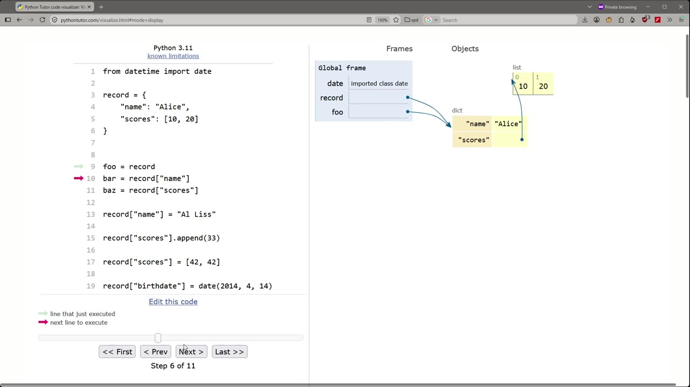

`[00:17:56]` inside a list and so when it's a string we just get a new copy of it but when it's a list we get `[00:18:03]` a new reference to it and then i'm going to edit the dictionary's name and that doesn't actually `[00:18:12]` edit this because it's it happened like it already happened it already made that copy `[00:18:17]` then i'm going to add a new score there and i went through the dictionary to get to the score `[00:18:22]` but you can see that if i just were to ask for baz2 i would now see that new score `[00:18:27]` but if i just were to ask for baz2 i would now see that new score `[00:18:28]` that's because i did an append but if i do an assignment here `[00:18:32]` you see that it makes a new list makes a new reference and and this this other variable that

## [00:18:37]

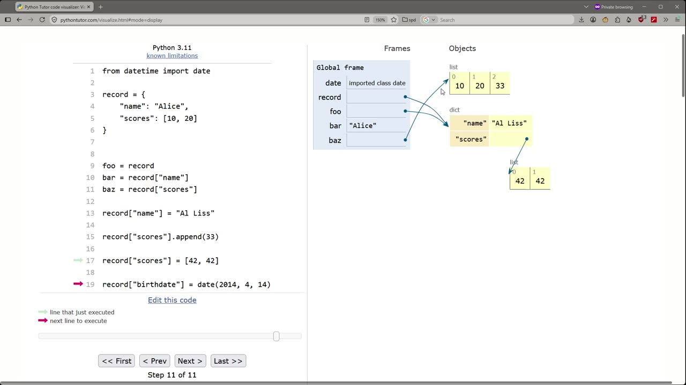

`[00:18:39]` sees that is not um not not seeing the new values because why would it and then i'm going to also `[00:18:47]` i'm going to show that you can add new values to dictionaries because you knew that and that just `[00:18:52]` works the way you think and i think i can somehow i feel like i'm supposed to be able to drag this `[00:18:56]` around why is that i can sometimes do that i can sometimes do that i can sometimes do that i can `[00:18:58]` sometimes drag this around i can't sometimes can't if i click this thing oh okay there we go `[00:19:03]` so i can just drag those around so they're not as confusing okay so what do we do in this video `[00:19:08]` at the end here we did i can drag this around too at the end here we did dictionaries you should be `[00:19:13]` able to draw dictionaries we also did these stack frame things let me just find some suitable example `[00:19:21]` from the earlier in the video and so um you should understand what happens when stack frames are

## [00:19:22]

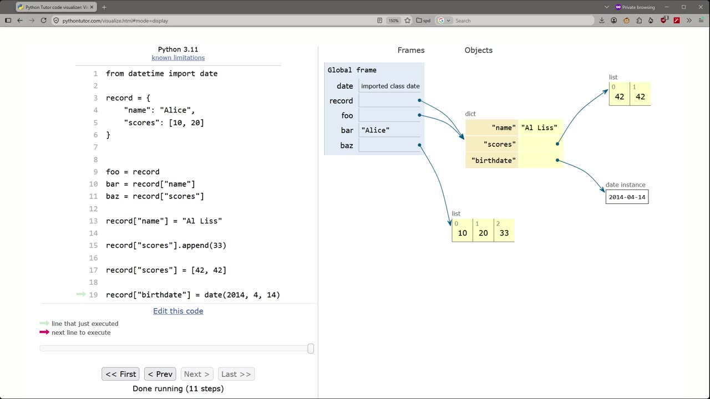

`[00:19:34]` created and i'm going to show you how that works so i'm going to show you how that works and i'm going to `[00:19:35]` might ask you to do something like, I would say, um, so I had to say something like this. I would `[00:19:52]` say, as this code runs at some point, it's going to come across this print. And here is where I `[00:19:58]` want you to show the memory diagram. Right. And so if I asked you to do that, this is where it

## [00:20:07]

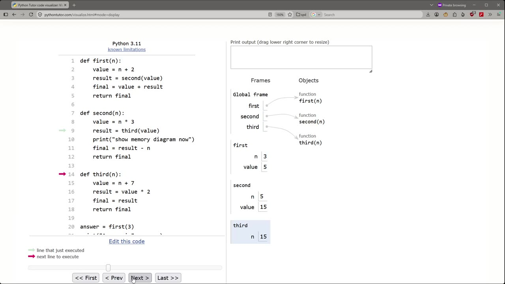

`[00:20:13]` printed. So this is the diagram you would show. Right. And notice that in this example, third `[00:20:21]` already got called, but it also already returned. And so if I just go back through the steps, `[00:20:28]` notice that third is created there and I'll go forward. Third returns, the frame gets removed `[00:20:34]` and we go back to line nine and then we go on to line 10, which is where you're supposed to take `[00:20:39]` the snapshot. Right. So I could ask you to do this much like with the class object objects. `[00:20:44]` I don't care about the function objects. I don't care if you do these or not. You just leave these, `[00:20:49]` leave the names out, leave these things out. `[00:20:51]` But you should be able to show multiple stack frames and be able to take a sort of a snapshot

## [00:20:52]

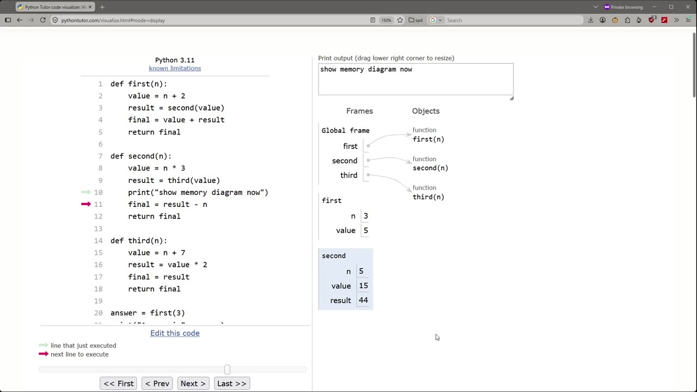

`[00:20:55]` partway through execution, which is more complicated than before where I said, `[00:20:59]` just show me at the end. But now I might say, show me a snapshot for the middle. `[00:21:05]` And that's it. That's memory diagrams about stack frames `[00:21:08]` with a little bit of dictionary stuff tacked on. Thank you.
