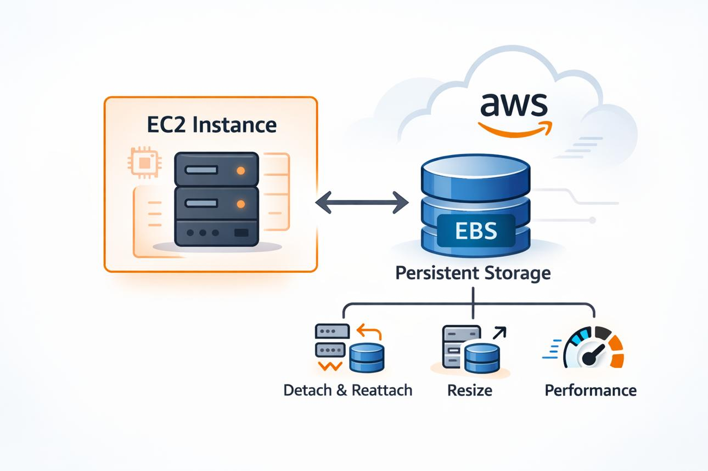
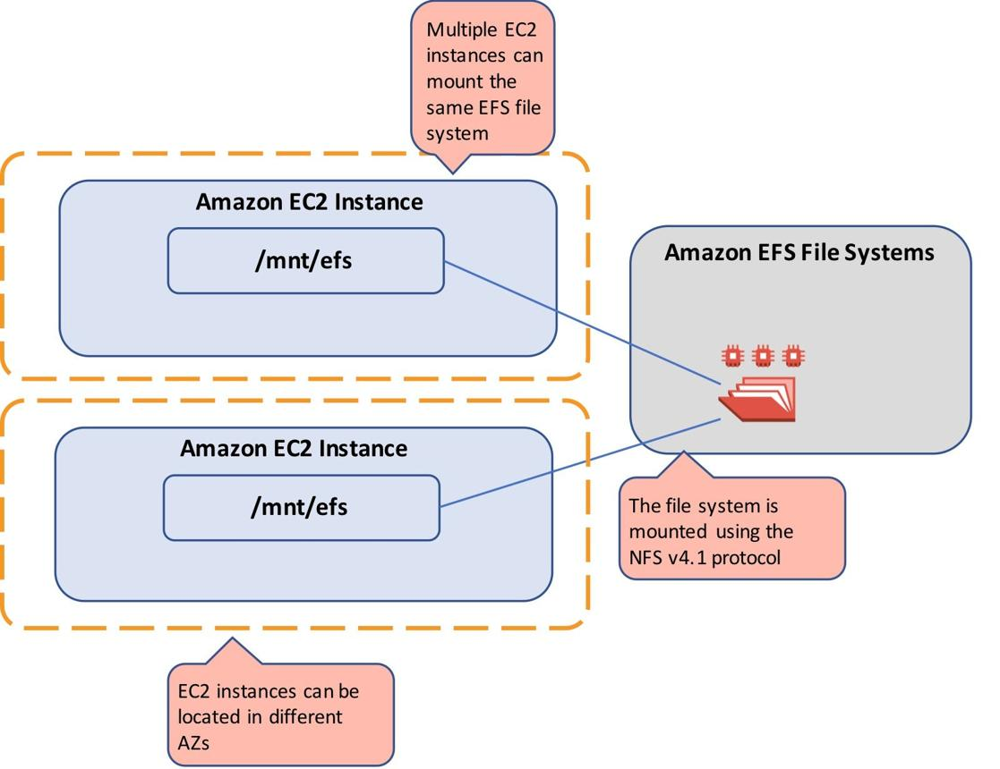

# AWS storage services

| AWS service | Key points                                                                                                                                                                                                    |
| ----------- | ------------------------------------------------------------------------------------------------------------------------------------------------------------------------------------------------------------- |
| Amazon S3   | - Object storage with unlimited scalability and 11 nines durability - Multiple storage classes for cost and performance optimization - Supports encryption, access controls, and event-driven workflows |
| Amazon EBS  | - Block storage for EC2 with consistent low latency - Offers SSD, provisioned IOPS, and HDD volume types - Supports snapshots, encryption, and Multi-Attach for io2 Block Express                       |
| Amazon EFS  | - Fully managed, scalable file storage with NFS support - Shared access across multiple EC2 or on-premises servers - Automatic tiering to lower-cost storage and strong durability (11 nines)           |

## 1. Amazon S3 — Object Storage

Best for storing large amounts of unstructured data, files, and backups that need to be accessed over the internet or by applications.

- Example 1: Website images and videos — Store images, videos, and downloadable files for a website or mobile app. S3 scales as demand grows.
    
- Example 2: Backup and disaster recovery — Store backups of databases, application files, and important business data using lifecycle policies and lower-cost storage classes.
    
- Example 3: Data lakes and analytics — Store large volumes of logs, customer data, and IoT records for analysis using services such as Amazon Athena.
    

## 2. Amazon EBS — Block Storage

Best for storage that an EC2 instance uses like a traditional hard drive, especially when applications need predictable performance and low latency.

- Example 1: Database storage — Run a database such as MySQL or PostgreSQL on EC2 and use SSD-backed EBS volumes for fast reads and writes.
    
- Example 2: Operating system and application disks — Store an EC2 instance's operating system, installed software, and application files on an EBS volume.
    
- Example 3: High-performance transaction processing — Use provisioned IOPS volumes for demanding workloads, such as financial transaction systems that require consistent, high-speed disk operations.
    

## 3. Amazon EFS — File Storage

Best for applications that need a shared file system accessible by multiple servers at the same time.

- Example 1: Shared files for web servers — Allow multiple EC2 instances running a web application to access the same uploaded files, images, and documents.
    
- Example 2: Content management and collaboration — Give multiple application servers access to a common directory of shared files without manually copying files between servers.
    
- Example 3: Data processing and analytics — Allow multiple EC2 instances or supported on-premises Linux servers to read and write shared datasets, such as files used in scientific computing.