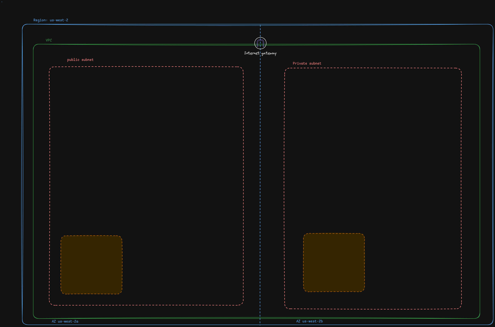

# VPC exercise resources

A VPC is a Virtual Private Cloud. It is a tool that allows you to create a virtual private network within a public network. You can think of this a little like a tool that allows you to create your own network. 

This is often done to add security to websites and other services. You can create subnets in your VPC that are not accessible from the public inernet. You would run some of the more sensitive components in your network here, like a database.

Generally a VPC exists at the Region level, e.g. "us-west-2"

**Reference:**
- [What is an Amazon VPC](https://docs.aws.amazon.com/vpc/latest/userguide/what-is-amazon-vpc.html)
## VPC CIDR Blocks

When you create a VPC, you must specify an IPv4 CIDR block for the VPC. The allowed block size is between a `/16` netmask (65,536 IP addresses) and `/28` netmask (16 IP addresses).

When you create a VPC, it is recommended that you specify a CIDR block from the private IPv4 address ranges as specified in [RFC 1918](http://www.faqs.org/rfcs/rfc1918.html).

| RFC 1918 range                                    | Example CIDR block |
| ------------------------------------------------- | ------------------ |
| 10.0.0.0 - 10.255.255.255 (10/8 prefix)           | 10.0.0.0/16        |
| 172.16.0.0 - 172.31.255.255 (172.16/12 prefix)    | 172.31.0.0/16      |
| 192.168.0.0 - 192.168.255.255 (192.168/16 prefix) | 192.168.0.0/20     |

The AWS VPC documentation has the following considerations:

- You can't specify the following CIDR blocks for your VPCs:
    - 0.0.0.0/8
    - 127.0.0.0/8 (internal host loopback address range)
    - 169.254.0.0/16 ([link-local address range](https://docs.aws.amazon.com/AWSEC2/latest/UserGuide/using-instance-addressing.html#link-local-addresses))
    - 224.0.0.0/4 (multicast address range)

**Reference:**
- [AWS What is CIDR](https://aws.amazon.com/what-is/cidr/)
- [CIDR Subnet Guide](https://cidr.xyz/subnet-guide/)
## VPC Subnets

A VPC needs to contain one or more subnets. Subnets exist at the Availabilty Zone level. So our VPC in us-west-2 could contain 2 subnets: in us-west-2a and us-west-2b

## Creating a VPC with networking

- VPC
	- Name: bcit-demo-vpc
	- CIDR: 10.0.0.0/16
	- After creating:
		- Actions -> Edit VPC Settings -> Enable DNS hostnames
- Subnets
	- bcit-demo-sub-pb
		- AZ: us-west-2a
		- cidr: 10.0.1.0/24
		- After creating:
			- Actions -> Edit subnet settings -> Enable auto-assign public IPv4 address
	- bcit-demo-sub-pr
		- AZ: us-west-2b
		- cidr: 10.0.2.0/24
- Route table
	- When you created the VPC a default route table was also created
	- bcit-demo-rt
	- After creating
		- Subnet associations -> Edit subnet associations -> bcit-demo-sub-pr
- internet gateway
	- bcit-demo-igw
	- After creating:
		- Actions -> Attach VPC -> select bcit-demo-vpc
- Edit main route table, the one auto created
	- Edit routes -> Add route 0.0.0.0/0 Internet gateway, internet gateway above

Launch EC2 instances

- Public EC2
	- bcit-demo-pb
	- Debian
	- Add to VPC created above, bcit-demo-sub-pb
	- Create security group
		- SSH anywhere
- Private EC2
	- bcit-demo-pr
	- Debian
	- Add to VPC created above, bcit-demo-sub-pr
	- Create security group
		- ICMP anywhere

