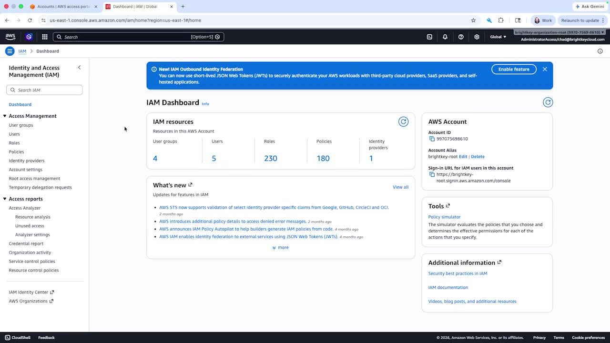

# Transcript: 6.1 Create IAM users [1_anp33394].mp4

- Source: `C:\Users\hiros\study stuff for cursor\Cloud-comp\6.1 Create IAM users [1_anp33394].mp4`
- Duration: 00:01:00
- Segments: 7, screenshots: 2
- Whisper model: `large-v3` (auto-generated; may contain recognition errors)

## [00:00:00]

`[00:00:06]` There are different ways of interacting with AWS, and if you just created your AWS account, you might still be logging in using the root account credentials. `[00:00:15]` And so we're going to see if we can do something about that, because even if you have administrative permissions using IAM, there are certain things you can't do, like close the account. `[00:00:28]` And so what we're going to do is we're going to go to the IAM service, and we're going to create an administrative user. `[00:00:33]` But while we're doing that, we're going to take a look at some other permission types, because not everybody needs administrator permissions for everything that they do. `[00:00:44]` And so the first thing we're going to do, down the left-hand side, is we're going to go to policies.

## [00:00:45]

`[00:00:49]` And in here, you can see that there's a large number, combination of AWS managed and customer managed. `[00:00:56]` And so let's reduce that list to something that's a little bit smaller.
