# Transcript: 202630_w03_logs (1).mp4

- Source: `C:\Users\hiros\BCIT-study-material\Algorithms\202630_w03_logs (1).mp4`
- Duration: 00:18:05
- Segments: 148, screenshots: 25
- Whisper model: `large-v3` (auto-generated; may contain recognition errors)

## [00:00:00]

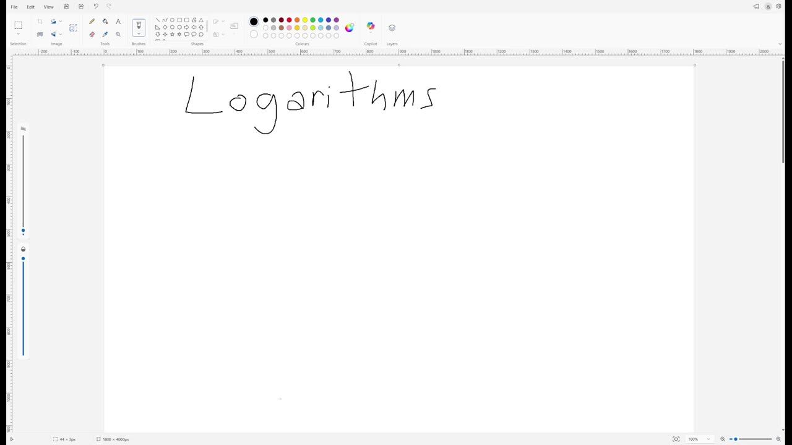

`[00:00:00]` In this video we will discuss logarithms. We will try to get a light grounding in what they are `[00:00:04]` formally and intuitively and then we will try to really notice the thing about them that is `[00:00:09]` relevant to algorithm analysis. Because in our context in this algorithms context it is very `[00:00:15]` valuable to know a few aspects of logarithms but relatively simple aspects. So that's the trade-off `[00:00:21]` simple aspects serious understanding. Okay let's start with a quick review of what they even are `[00:00:27]` how we even get the idea of logarithms. So back in elementary school maybe we learned addition `[00:00:33]` I hope so and after that maybe we learned subtraction right. So if what I want to know `[00:00:41]` is b I already have a I want to know b well b is a minus c and also I'm allowed to swap these around

## [00:00:45]

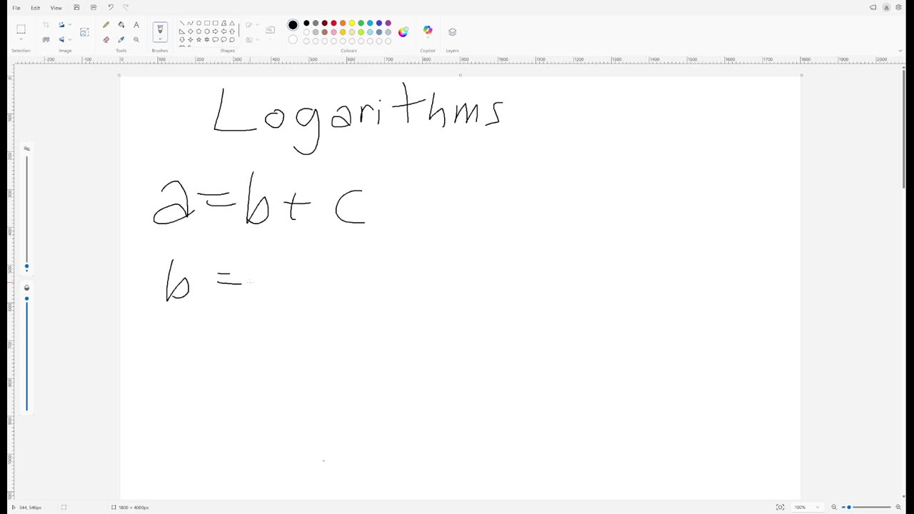

`[00:00:50]` and therefore it's also true that c equals a minus b right. And then a little bit later `[00:01:00]` still a little bit later we'll get to the idea of logarithms. So back in elementary school `[00:01:01]` still in elementary school maybe we learn multiplication right. So we learn that for `[00:01:07]` example q equals r times s and then just after that maybe we learn division right. So in this `[00:01:17]` first example we had r and s we wanted q but now what I want is r. Well good news I can get that `[00:01:23]` with q divided by s except I'm lazy and I'm going to write it with a slot that was ugly. Okay and

## [00:01:30]

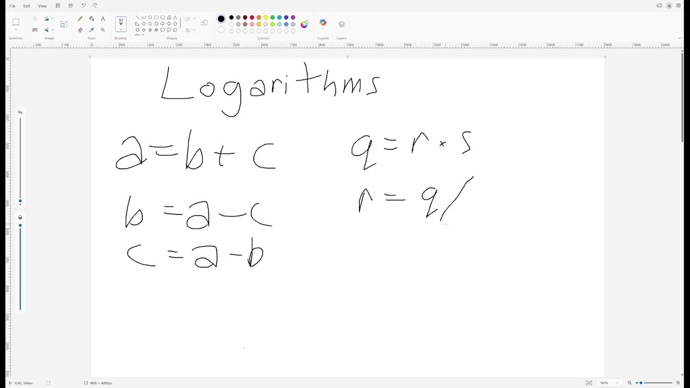

`[00:01:33]` then maybe I want s. `[00:01:35]` Like I've already got q and r but I want s. How do I do that? Well I divide. `[00:01:40]` Okay and so that's all in elementary school but eventually you get to high school `[00:01:44]` and you learn exponentiation right. And so you learn that you can go let's say let's call it `[00:01:54]` j equals k to the power of m right. And just as we went from addition to multiplication `[00:02:06]` and then like later like. `[00:02:08]` first multiplication is just add add add add but eventually we just treat it like it's its own `[00:02:12]` thing and at first this is multiply multiply multiply multiply but it's better to eventually

## [00:02:15]

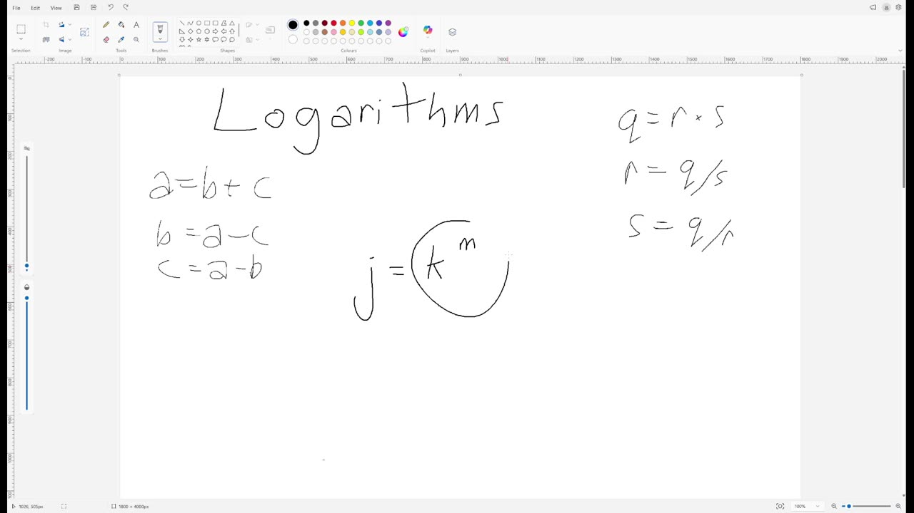

`[00:02:19]` just treat it as its own thing so if we want to do this thing in reverse well things get a little `[00:02:26]` bit more complicated actually let me back up and say that we can swap the b and the c we can swap `[00:02:32]` the r and the s but we can't just reverse the k and the m it would change the value let me give `[00:02:38]` you an example two the power of three is eight but three squared is nine those are different values `[00:02:46]` even though i just all i do is swap the numbers well it ruined everything okay so it matters which `[00:02:52]` is where okay and so if what i want is k then what i'm going to do is i'm going to take j

## [00:03:00]

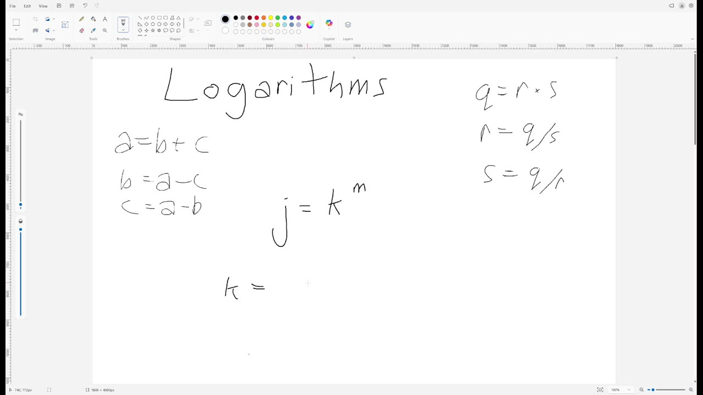

`[00:03:00]` and take a root in particular the mth root so if you imagine i did k squared `[00:03:06]` and i want to reverse `[00:03:07]` that, that's the square root. Okay, that is a reverse of exponentiation. But we don't use this `[00:03:15]` very much in algorithms, like occasionally, but not enough that I would bother teaching it to you `[00:03:18]` in a separate lesson. What we use all the time is the other one, right? The one where what I want `[00:03:27]` is m. I've already got j and k. And so that is the logarithm. Now in the previous version, `[00:03:38]` k, the position that k is in, that's the base of the exponent. And so we're going to keep `[00:03:43]` that, we're going to call it the base. And because the base, we write it in the basement.

## [00:03:45]

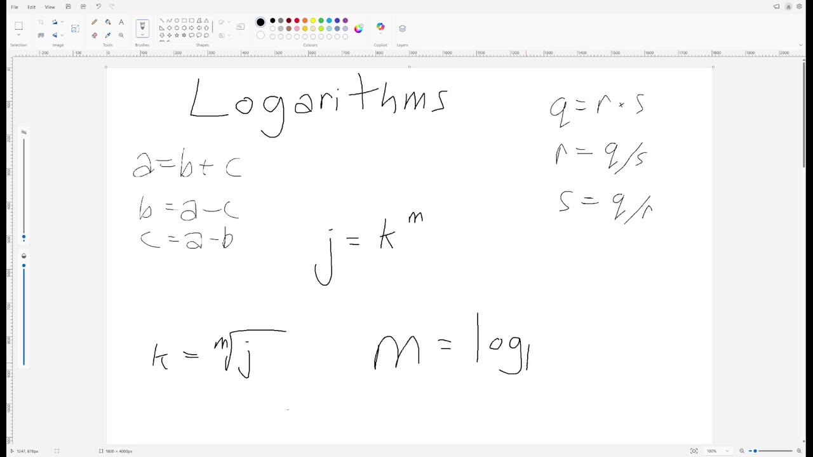

`[00:03:48]` That's the subscript there. And I say basement to remind me where it goes. `[00:03:52]` And I'm going to put the j here. Except that because I do a lot of programming, and I write `[00:03:57]` into text files instead of onto, you know, places where I can just do anything I like. `[00:04:02]` I find it's easier if I put parentheses around it. So that's what I tend to do. And I suggest `[00:04:06]` you consider doing that as well. So that's it. `[00:04:12]` But that's the definition of the logarithm, is it's the reverse of exponentiation, `[00:04:16]` where the thing you want is the exponent. Okay. So let me just do a little example of that. Just

## [00:04:30]

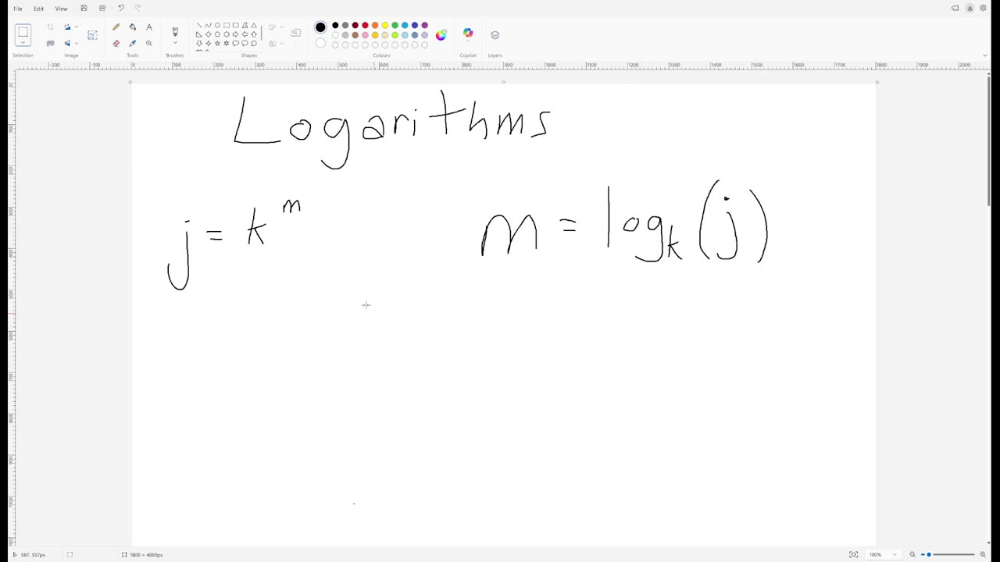

`[00:04:32]` basically say the same thing again, except with an example. So I asked my calculator and it said `[00:04:37]` that seven to the power of five. It says that's 16807, right? And so with that in mind, if I want `[00:04:56]` to know what is the log base seven of 16807, I'm asking, what do I, you know, if I go seven to the `[00:05:08]` power of what will give me this? And of course we can see up here, the answer is five. Okay.

## [00:05:15]

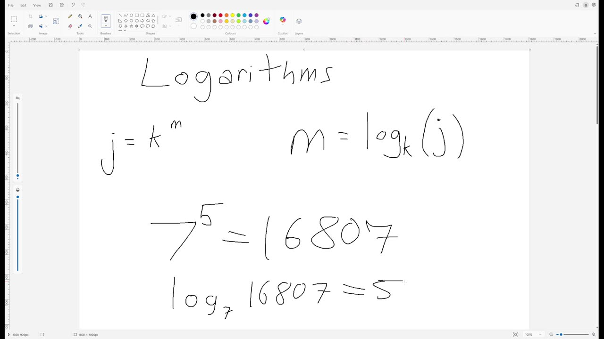

`[00:05:19]` So that was a very math class example. We use seven as our base, but seven is not a very common `[00:05:24]` base. Like it's perfectly good algebra, but it's not very useful to us. You should know that there `[00:05:31]` are three popular bases. You should be aware of all three of them and you should know which one `[00:05:36]` we are going to use. Just shrink this way down. Okay. So some people like base 10. `[00:05:49]` I use that sometimes for sure, but not in this class much. Some people in math and physics and `[00:05:57]` biology and areas like that, like base E, I can't stand that. I'm sorry. I'm just not educated

## [00:06:00]

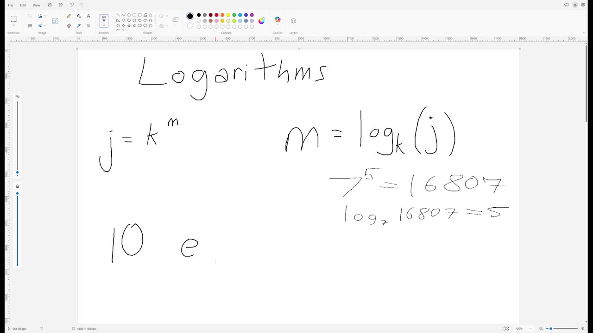

`[00:06:02]` enough or something. In computing science, we almost always think in base two. `[00:06:08]` We do our binary representation base two. We also do our logs in base two, `[00:06:14]` mostly. I mean, I don't mean like every single time in computing science, it's always two, `[00:06:20]` but if nobody tells you what it is and it's computing science, you should probably assume `[00:06:24]` it's two. I mean, sometimes actually what it is, is the base doesn't matter, but if the base does, `[00:06:31]` if the base does matter, it's probably two. Okay. Let's do some examples. What is the log base two?

## [00:06:45]

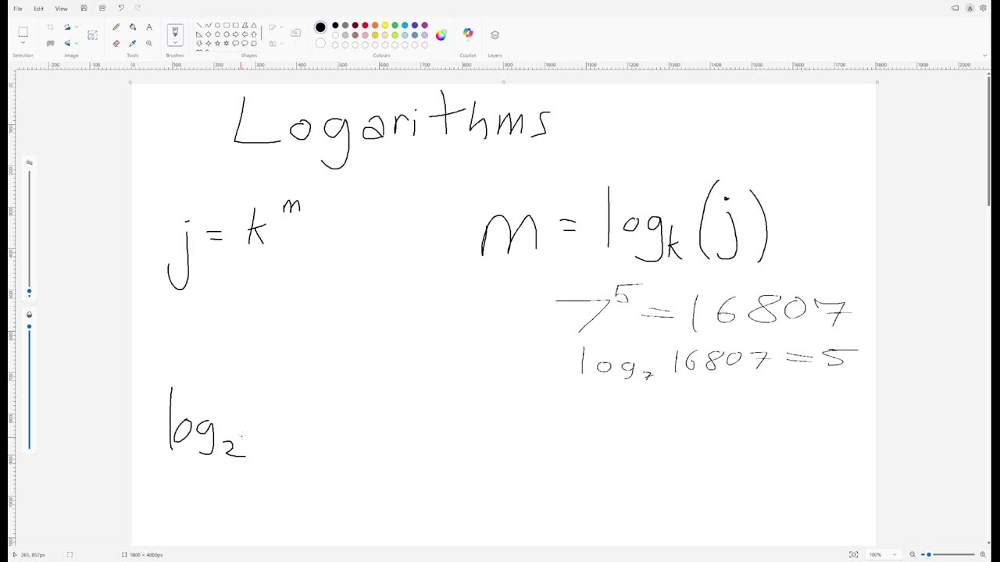

`[00:06:46]` Of 32, right? So I'm saying two to the power of what is 32. Okay. So you could `[00:07:00]` just guess and test, right? You could just try some numbers. Just real quick pause here. `[00:07:04]` Just try numbers until you get it. Pausing. And now I'm going to resume. So you'll find `[00:07:11]` that two to the, I don't need to be right over there. Two to the fifth is 32, right? Two times, `[00:07:18]` two times two times two times two. That's 32. Okay. And then this next one, you should definitely

## [00:07:30]

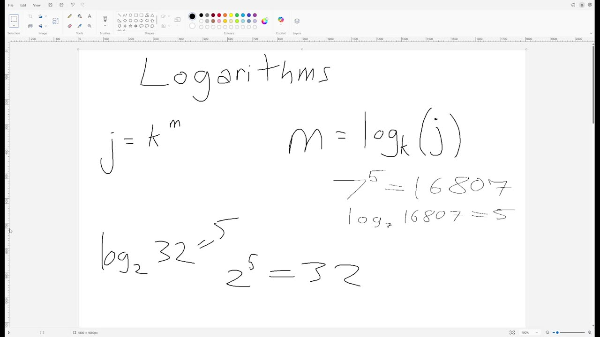

`[00:07:32]` do it yourself as an example. First, you turn it into a regular exponential equation in sort `[00:07:38]` of this form, and then you try guessing some numbers and trying them out until you get the `[00:07:44]` right answer. So what is the log base five of 625? So I want you to pause. And when you pause, I want `[00:07:54]` you to make an equation like this, and then I want you to figure out what is the answer. Okay. So you `[00:08:00]` should have already paused by now. So we have, that's the same as saying five to the x is 625. `[00:08:11]` It turns out that x is four. Okay. Now you might wonder why we care.

## [00:08:15]

`[00:08:31]` I'm not going to ask you to do a lot of algebra with logs, maybe zero, maybe just a very small `[00:08:36]` amount. Not sure. I'm not going to ask you to do a lot of algebra with logs, maybe zero, maybe just a very small amount. Not sure. `[00:08:42]` But I will ask you word problems. And sometimes the answer to the word problem `[00:08:45]` will be something to do with logs. Maybe it'll be some log of n or some log of x or `[00:08:53]` log of 10 million or something. You will need the skill to spot `[00:08:58]` which situations involve a log and which do not. So I will now explain why I would do that to you.

## [00:09:00]

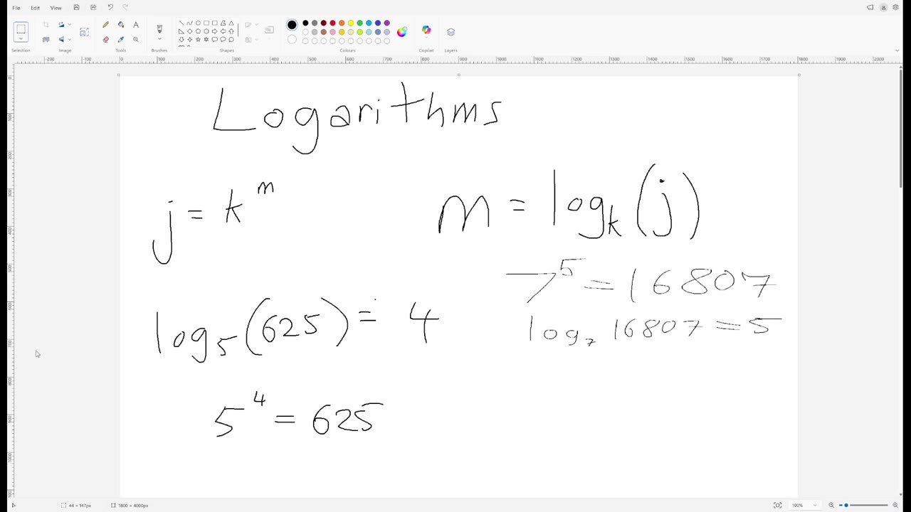

`[00:09:05]` Like, what does this have to do with our subject? As we already know, `[00:09:15]` log `[00:09:18]` base, that's really ugly. Log base b of n means b to the what is n. And when I say b to the what, `[00:09:35]` I'm saying b times b, oh, I shouldn't use x there. I don't know. I needed a letter. So I'm just going `[00:09:43]` to use q. b times b times b times b dot dot dot dot dot. How many of these will I need to equal n?

## [00:09:45]

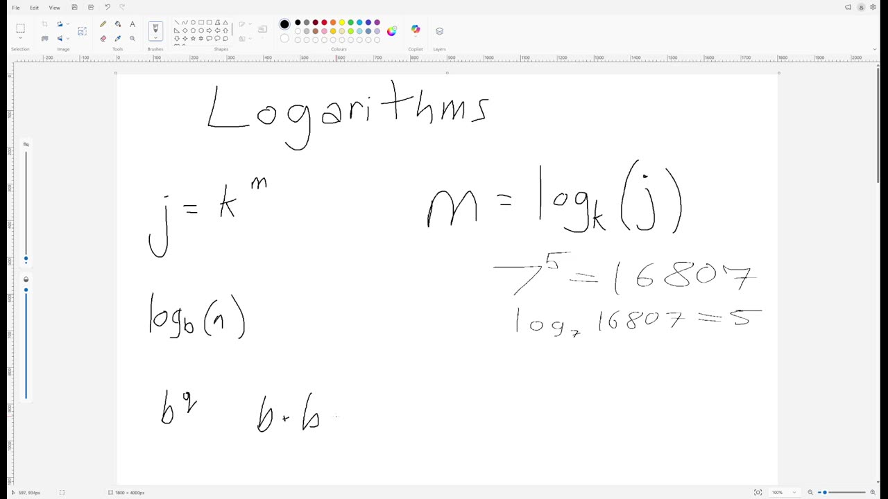

`[00:09:53]` All right. That's q. So the thing is this also works in reverse. `[00:10:03]` Right? So I can say n divided by b, divided by b, divided by b, divided by b, dot dot dot dot equals 1. `[00:10:20]` And there were q multiplications to go this way. And there are q divisions to go from n down to 1. `[00:10:28]` you know, it's like times, times, times up and divide, divide, divide, divide down.

## [00:10:30]

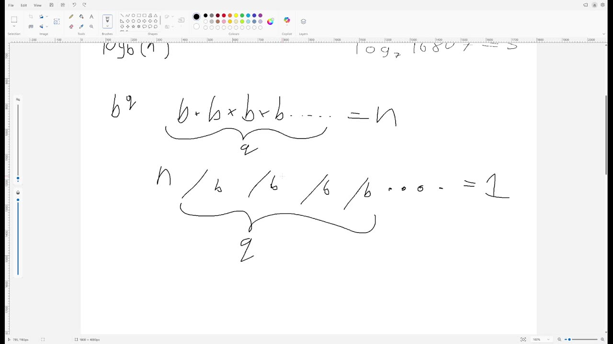

`[00:10:35]` Okay. I'm going to give you an example that's not base two, which is a little weird. And then `[00:10:40]` we'll do base two stuff. So imagine I have a million people playing in a tournament of some `[00:10:47]` game. I'm going to regret writing this out. You know what? It's time for the text tool. `[00:10:59]` I have a million people playing this tournament, right? And in this game, people play three at a `[00:11:05]` time and only one person wins and we're doing a single elimination tournament, right? So in the `[00:11:09]` first round of this tournament, two thirds of the people are eliminated. And now we've got `[00:11:14]` this many people, one more round, third round. Sorry. No, no, no. Sorry. After two rounds,

## [00:11:15]

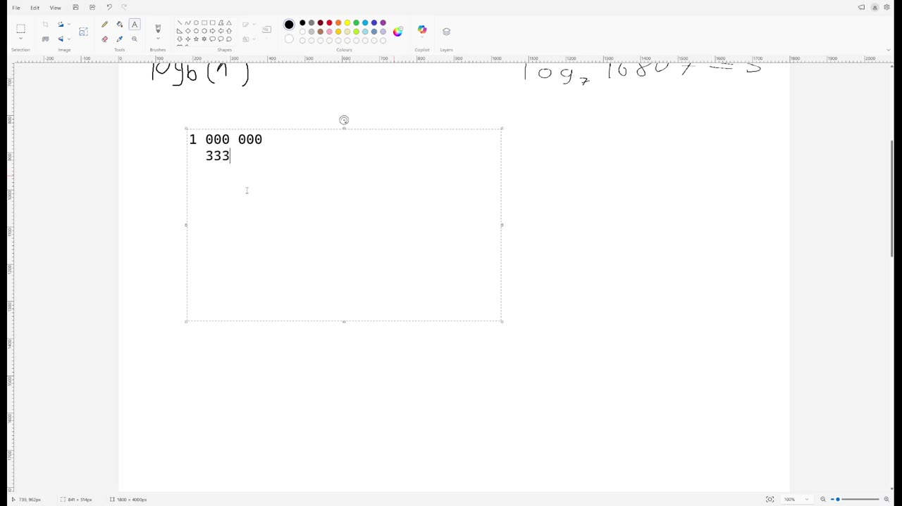

`[00:11:22]` we've got that many people, right? After a third round, we're down to approximately `[00:11:28]` this apparently. After another round, somehow the number is, `[00:11:35]` which is like ridiculous to me. Like, how can this be true? But anyway, I'm just going to call `[00:11:42]` it that round number. It doesn't matter. Go again. We're at four, one, one, five, go again. We're at `[00:11:50]` 1372 for, these are a little bit approximate. Okay. So you can confirm for yourself that these

## [00:12:00]

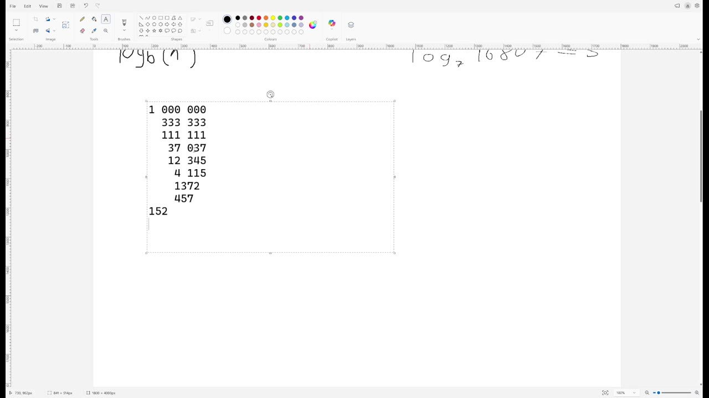

`[00:12:14]` are mostly at least roughly correct. And so let's count them up. That's one, `[00:12:21]` two, three, four, five, six, seven, eight, nine, 10, 11, 12, 13, right? So it's roughly 13 steps. `[00:12:34]` It would depend a little bit on exactly how things worked out, but roughly 13 steps. `[00:12:40]` And so therefore what we know is that we just worked out by hand that log base three

## [00:12:45]

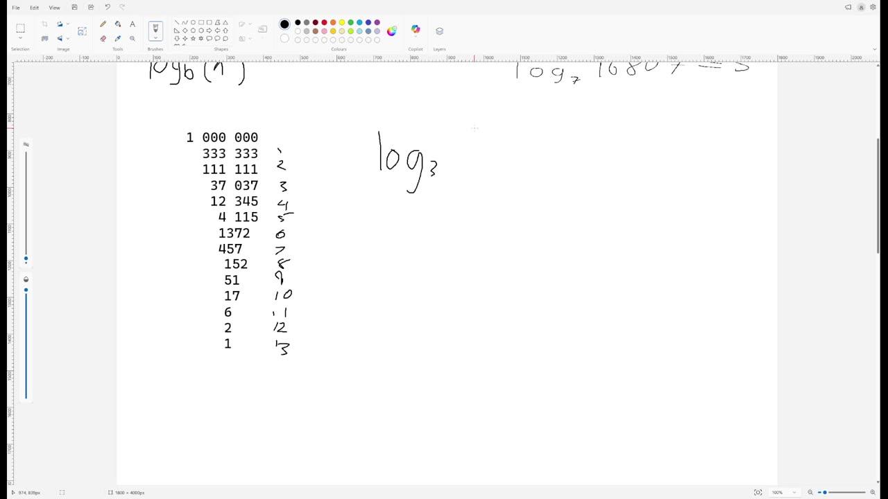

`[00:12:45]` of a million is, whoops, is approximately `[00:12:55]` 13, right? But if I came back to you, if you did this work and I came back to you and said, `[00:13:01]` actually, wait, wait, wait, sorry. I know I said a million, but that was just like, `[00:13:04]` that was just like, I was being silly. It's some number N and later we'll know what N is. `[00:13:10]` How many rounds will we need? And so the answer is clearly log base three of N, right? And so `[00:13:20]` this kind of reasoning is what you need to be able to do is turn a word problem, `[00:13:24]` where I say, if I have a million people and I eliminate a third of them in every round of the

## [00:13:30]

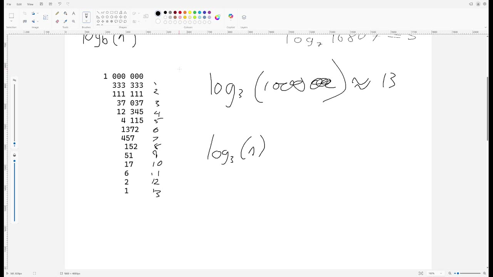

`[00:13:31]` tournament, how many rounds of the tournament will I need? I will need log base. Sorry. I guess `[00:13:36]` if I say it's a million people, then the answer is log base three billion. And if I say it's N `[00:13:40]` people, then the answer is log base three of N. This is this thing right here. This is the center `[00:13:44]` of this whole video. I'm not quite done, but I'm getting close to done. Okay. Let's take an example `[00:13:52]` that is base two. Suppose I start with 1600 numbers, just a number that you've probably `[00:13:58]` never seen before. And I'm going to binary search it until I'm done. And I didn't get lucky halfway `[00:14:05]` along. Like it has to go all the way to the end and finish. Okay. So it's going to go 800 is one `[00:14:12]` step. And then 400 is a step. Then 200 is a step. And then 100 is a step. So that was four steps,

## [00:14:15]

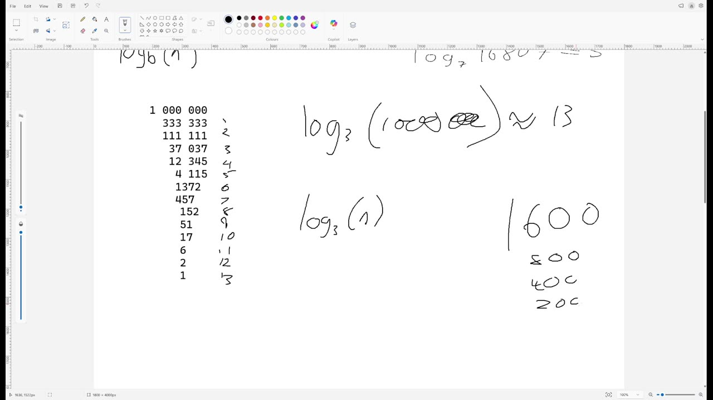

`[00:14:17]` right? And then we're going to go 50, 25, 12, six. That was, `[00:14:22]` four more steps. We're at eight steps. We're gonna go three. And then we're going to maybe `[00:14:27]` be done, but like, maybe it takes, I don't know, it might take two, one, or might go down to one. `[00:14:31]` Like we're not sure exactly how many steps that, right? So one, two, three, four, one, two, three, `[00:14:37]` four, one, two, three, four, or three, right? So that was either 11 or 12, right? And so that's `[00:14:48]` telling us that log base two of 1600 is, `[00:14:59]` uh, at least as big as 12. Whoops, wrong. Sorry. At least as big as 11

## [00:15:00]

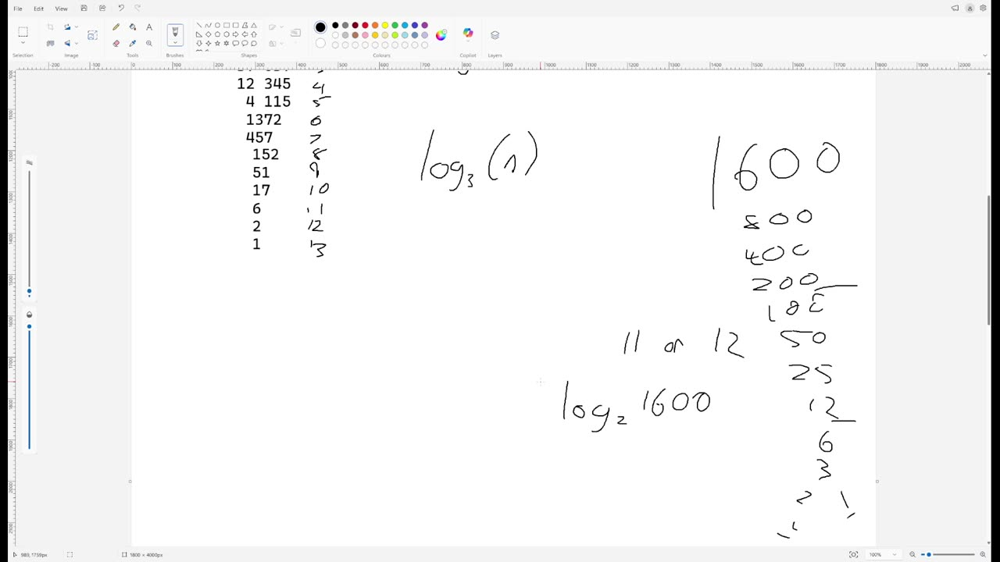

`[00:15:07]` and no bigger than 12, right? And I mean, actually it's actually, well, this is still `[00:15:15]` approximate. Sorry. It's still approximate 10.64. I think unless I copied it down wrong, `[00:15:22]` wait, that's clearly wrong. What am I doing? Sorry. Checking notes. What did I do wrong? `[00:15:31]` Oh, I just counted wrong over here. `[00:15:33]` Right. This doesn't count as a step. Ha ha ha. Yeah. Okay. Sorry. I counted wrong on the left. `[00:15:40]` Good lesson. I'm glad I already calculated on the calculator and checked my notes.

## [00:15:45]

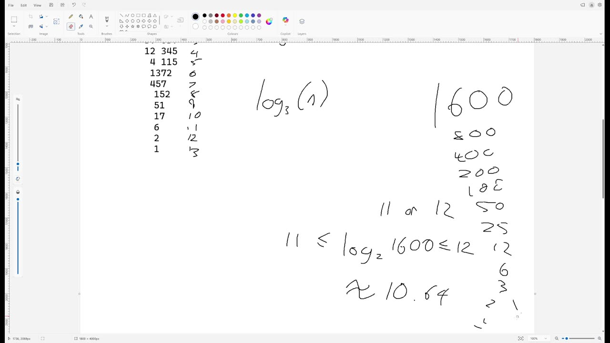

`[00:15:45]` Do, do, do. Okay. This is zero steps. One, two, three, four, five, six, seven, eight, nine. `[00:15:56]` And on this side, it's 10. This side, it's 10, 11. Much better. Okay. So I have to fix these `[00:16:02]` numbers here. `[00:16:04]` 10 or 11, 10 or 11, 10.64. Okay. And so, um, I want you to notice that I was not very picky about `[00:16:15]` how exactly we got there, right? I'm not really worried about this 10.6. I mean, I'm not at all `[00:16:20]` worried about this 10.64. It would be plenty good enough for you to say between 10 and 11, `[00:16:26]` or to say around 10 and a half, or if it was like actually like 10.04 or even 10.14.

## [00:16:30]

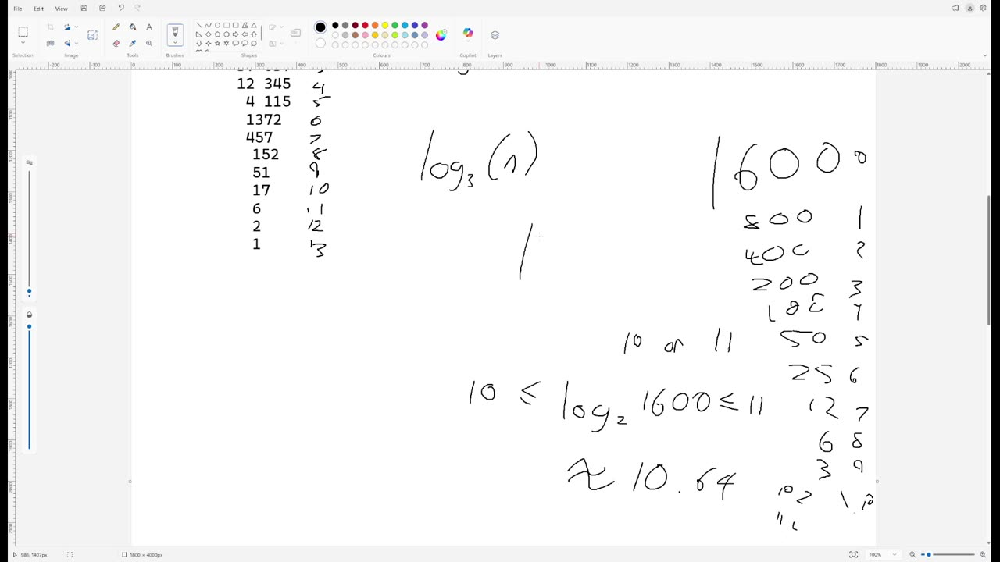

`[00:16:34]` To be like around 10. Okay. So don't, this is not a class about many digits of precision. `[00:16:44]` This is a class about understanding the big picture. I mean, still the numbers of the big `[00:16:49]` picture, but the big picture. And so while I might ask you a question like this on an exam, `[00:17:02]` I want you to remember that the really important thing is being able to turn a word problem `[00:17:08]` into a log when it's appropriate. Let me give you a counterexample here. `[00:17:14]` Here, I was binary searching 1600 things, but I can start with 1600 things and check them one at a

## [00:17:15]

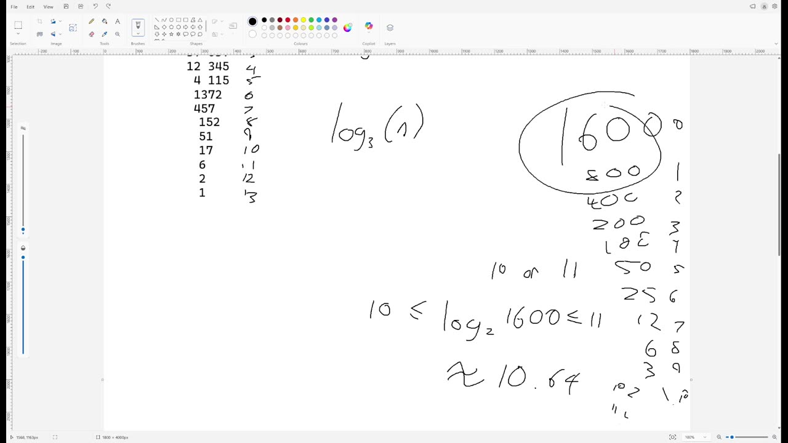

`[00:17:20]` time, like in a linear search, right? And so after one step, I'm at 1599, then I'm at 1598, `[00:17:30]` then I'm at 1597, dot, dot, dot, dot. This is not a log. This is a linear process. We're going one at a time. `[00:17:38]` Okay. So this is the big thing is trying to figure out which processes involve logs. `[00:17:50]` If the thing you're doing is counting, how many times will we need to multiply to get to n, `[00:17:54]` or how many times will we need to divide starting at n and going down to one, then you should `[00:17:59]` consider whether or not it's a log because it might be a log. Okay. Thank you.

## [00:18:00]

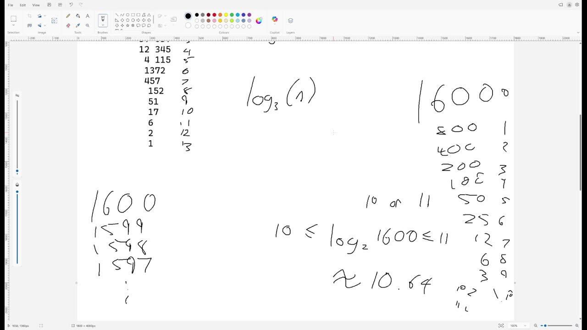
