# Transcript: 202630_w03_mathwords.mp4

- Source: `C:\Users\hiros\BCIT-study-material\Algorithms\202630_w03_mathwords.mp4`
- Duration: 00:13:45
- Segments: 118, screenshots: 19
- Whisper model: `large-v3` (auto-generated; may contain recognition errors)

## [00:00:00]

`[00:00:00]` It's time for more math words! In this video I'm going to mention some math words you should `[00:00:06]` already mostly know and I'm going to explain how we use them some of them just a little `[00:00:10]` bit differently in the context of algorithms especially in the context of Big O. We haven't `[00:00:16]` even explained Big O yet although hopefully you got a bit of background in a prior class `[00:00:21]` but actually we're not explaining Big O right now we'll explain it later. This video is just `[00:00:28]` the math vocabulary side so that when we talk about these things later we can you know be on `[00:00:33]` the same page about what these words mean. When we talk about this later I don't want you to be lost. `[00:00:39]` So I'll say that again. This is not supposed to be really a proper explanation of Big O. `[00:00:44]` I'm just explaining some math words that we will use with that and you should memorize

## [00:00:45]

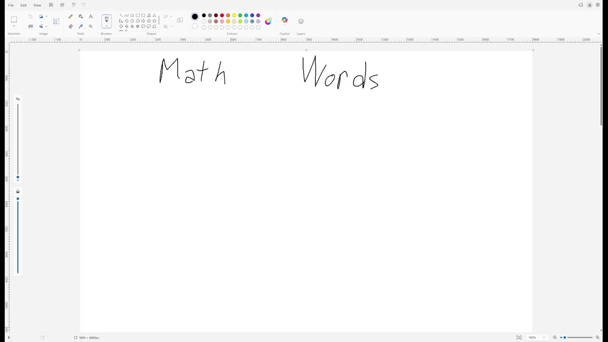

`[00:00:49]` these math words. Okay so first of all hopefully you already know that `[00:00:58]` that y equals x that this equation qualifies as linear yeah my writing okay so this is the first `[00:01:10]` word this is linear and in fact more generally students seem to usually know this the classic `[00:01:21]` linear equation is mx plus b right every linear equation can be expressed this way but I mean b `[00:01:28]` might be zero so

## [00:01:30]

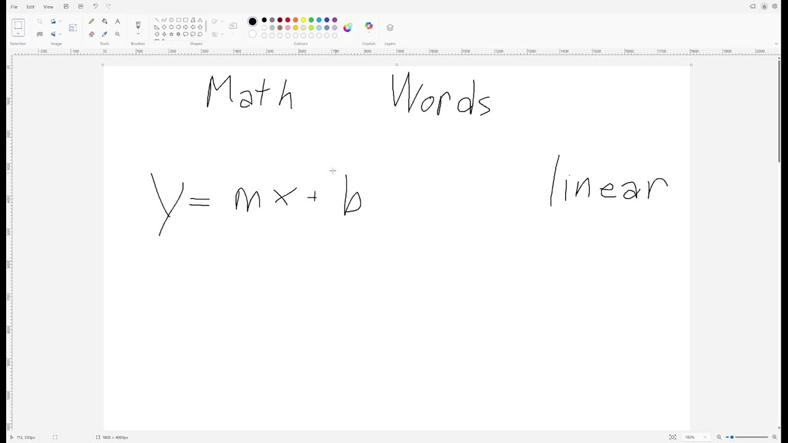

`[00:01:30]` it might look like this and m might be one and if it's one we don't write it `[00:01:35]` so it might look like this or maybe m is one and b is not zero so you know it can look different ways `[00:01:42]` but yeah linear is this right and hopefully you also know that to write that maybe you `[00:01:53]` don't I'm not sure if you're supposed to know this that to write that is Big O we write `[00:02:03]` just Big O of x actually we usually use n for this so I'm going to write n `[00:02:08]` but I mean over here it was x so it should have been Big O of x in that case either way right okay

## [00:02:15]

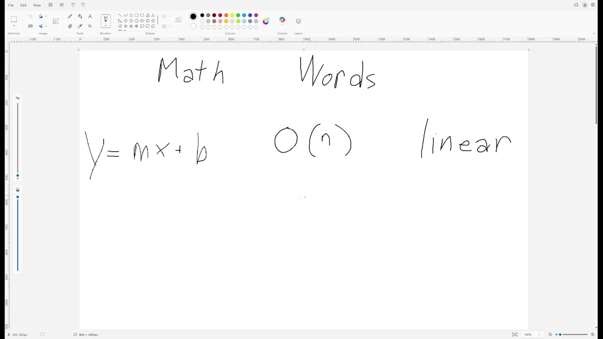

`[00:02:17]` let's move on next thing what if we have like y equals x squared or like y equals `[00:02:26]` x the third x cubed you know or y equals x cubed plus three x plus four we use a word you already use `[00:02:44]` but we use it in a little bit of an unusual way maybe these are all called polynomial `[00:02:58]` now this is very very similar to math class usage but there are a few slight differences

## [00:03:00]

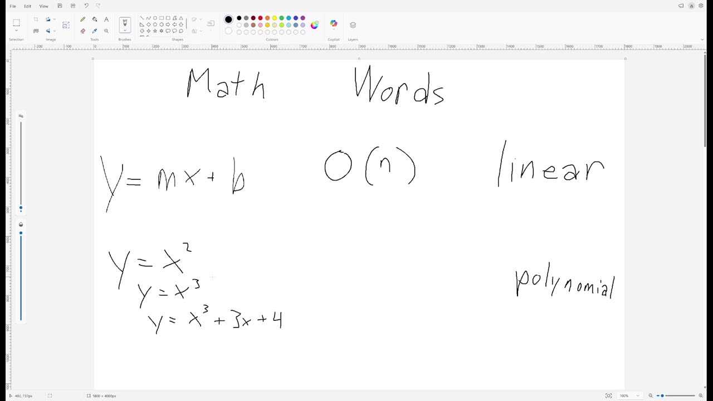

`[00:03:05]` the really big one is that in math class a polynomial requires integer exponents `[00:03:10]` but if I make one of these a real value like formally I guess it's not a polynomial `[00:03:18]` but algorithms people are still going to call this polynomial like formally you say things like `[00:03:23]` this is in polynomial time or something but it might get abbreviated just polynomial `[00:03:28]` this doesn't come up a lot but you know it's still true also depending on your math text book `[00:03:34]` in some math text books this counts as a polynomial because it in in some math text books this `[00:03:42]` counts as a polynomial but in some math text books it doesn't count as a polynomial until

## [00:03:45]

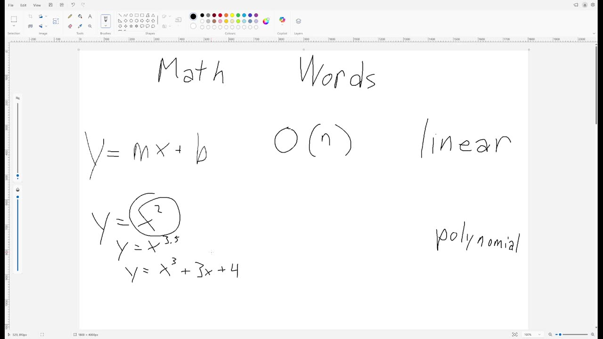

`[00:03:48]` you're adding up two of them right so that depends on what book you know what department that's in `[00:03:53]` you know, what your teacher taught, etc. But either way, in this class, even one monomial `[00:03:59]` alone, that counts as a polynomial. Okay. I know it's a little confusing. Sorry. Not my, `[00:04:06]` I didn't make this stuff up. Don't blame me. Again, I'm not really explaining this, but `[00:04:13]` saying it's polynomial is actually kind of more like saying there's a close, `[00:04:22]` there's an actual polynomial that's close to this, but like, okay, whatever. `[00:04:26]` Okay. And so hopefully know that the big O of that is big of N squared here. I'm just going to

## [00:04:30]

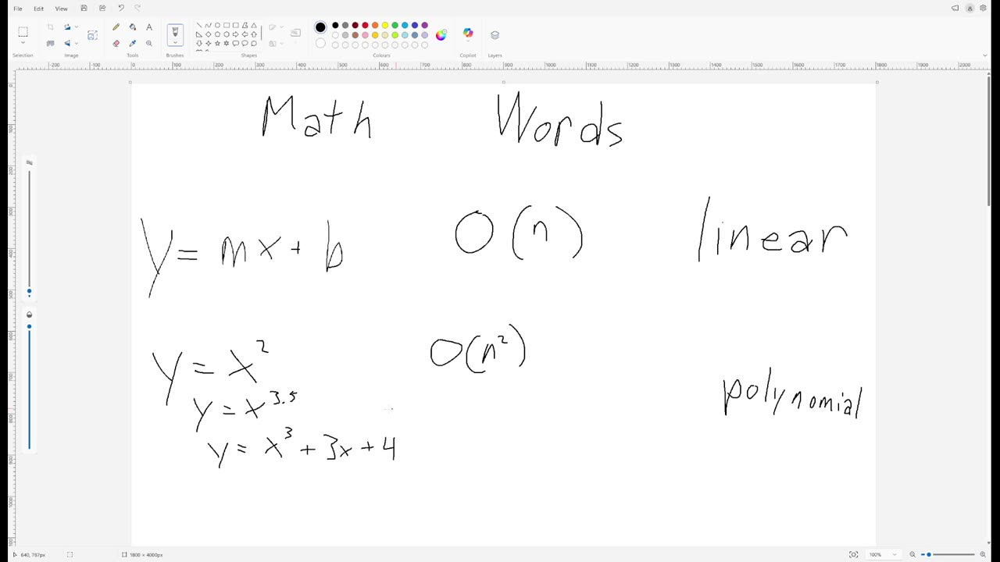

`[00:04:32]` put a two here to show that we could, but it doesn't matter. The big O of that is, oh, sorry. `[00:04:37]` Those are Xs. I don't know if I should be consistent. I should be consistent, right? `[00:04:45]` I guess there's different ways to be consistent. Okay. So the, um, Y equals X squared becomes big `[00:04:51]` O of X squared. Y of two X to 3.5 becomes X to 3.5. So we drop, `[00:04:58]` this constant coefficient here. We just drop that. And this one becomes, okay. So `[00:05:05]` we're going to remove a bunch of this. We're going to remove all of these terms, `[00:05:11]` right? We call these dominated terms, or we say that this term is dominant,

## [00:05:15]

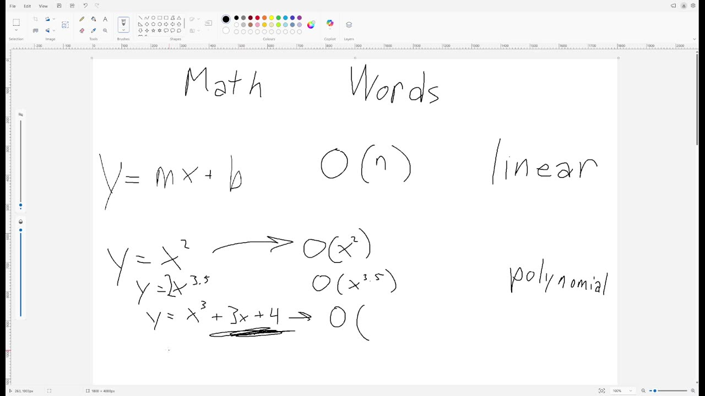

`[00:05:16]` right? And what does that mean? It means that if X got really big, this would be the only term `[00:05:22]` that mattered. Again, I believe you got a little practice doing this in math class a year ago, `[00:05:29]` or something. Not sure. Okay. So you have to know this word polynomial. Also, um, some of these `[00:05:39]` have special names. And in particular, if somebody says quadratic, you need to know which one of `[00:05:52]` these is quadratic. That's like maybe the least important word in the video, but like still you `[00:05:58]` should just know that, right? Okay. Quadratic. Also, um, it is technically true. Okay. Like we

## [00:06:00]

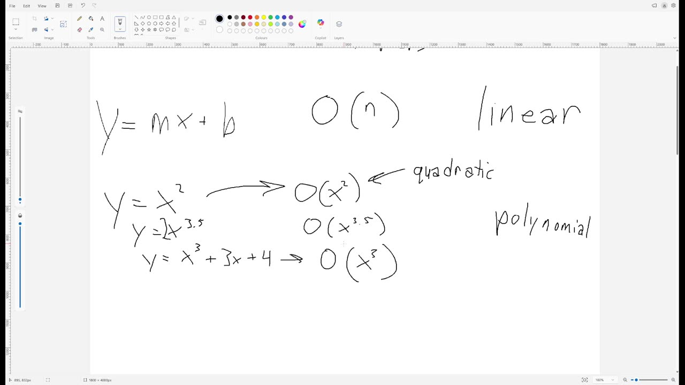

`[00:06:06]` got a little bit of pedantry here, right? Um, so we're going to do a little bit of pedantry here, `[00:06:08]` right? Um, so we're going to do a little bit of pedantry here, right? Um, so we're going to do a `[00:06:08]` it is technically true that linear is a type of polynomial, right? It's just X to the one, `[00:06:18]` but it's also technically true that a square, and this is not a square, but you need to pretend `[00:06:26]` that it's a square. Please pretend for me. It's technically true that a square is a rectangle, `[00:06:30]` but if somebody who maybe doesn't know the word in English or something points that and says, `[00:06:36]` what's the word for that in English? And somebody says rectangle, `[00:06:40]` I'm going to be like, WTF, that's a square. I mean, it's technically true that it's a rectangle,

## [00:06:45]

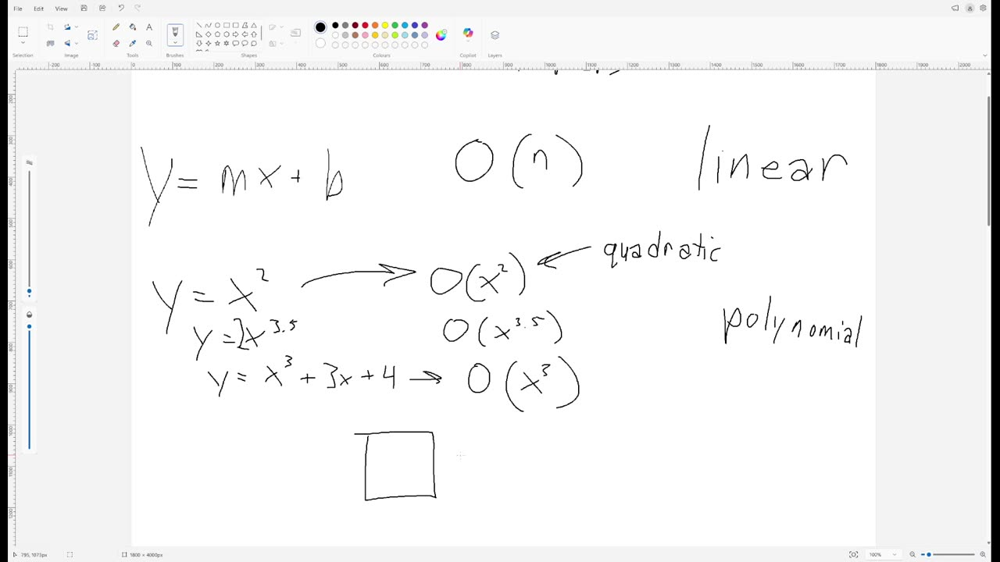

`[00:06:46]` but it's like, it's a weird thing to say, right? And so similarly, if you call this up here, `[00:06:52]` polynomial, you are technically correct. But if you do that in a job interview, `[00:06:59]` you might not get the job. Uh, if you do that on an exam, you might not get the points, `[00:07:04]` right? So I acknowledge it's technically correct, but don't say that. Don't `[00:07:08]` call this polynomial unless you're explaining that you're being kind of, you know, you're being `[00:07:15]` pedantic, right? Okay. Next thing is exponential. Exponential is not going to come up very much in `[00:07:28]` this class, but I do want to mention it briefly. Um, exponential means that the variable is in the

## [00:07:30]

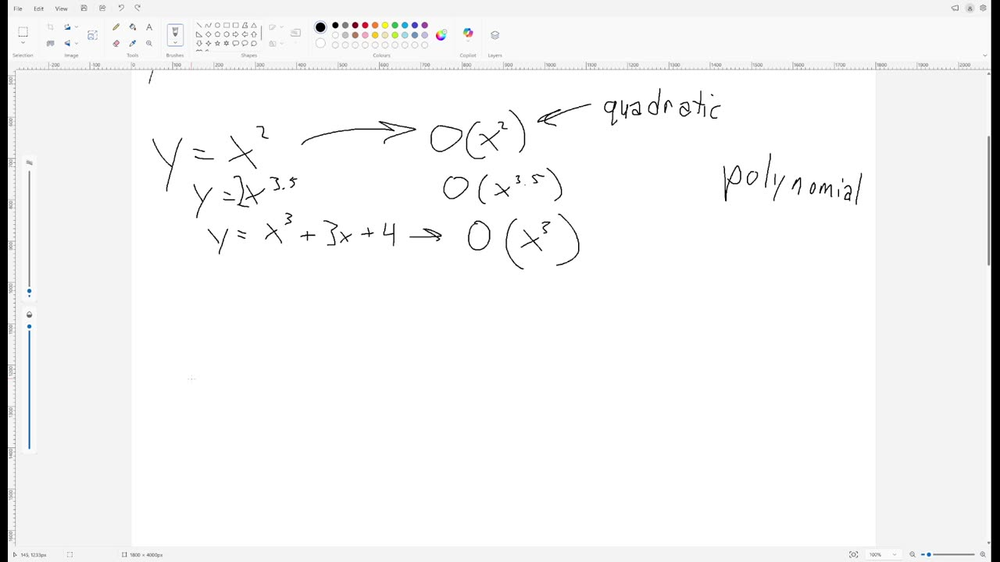

`[00:07:37]` exponent. Now these all have exponents, right? But that does not make them exponential. And a lot of `[00:07:43]` people who are trying to sound smart, but actually aren't as educated as they're trying to pretend to `[00:07:48]` we'll use the word exponential to mean just like anything big. And they'll also use exponential for `[00:07:52]` like any polynomial, any power function, just all sorts of stuff. Um, and that's all wrong. `[00:07:59]` It's just wrong. And you're not going to get away with that in this class. Like I got to have some `[00:08:04]` standards, right? And so the variable is in the exponent that's exponential. Please learn this `[00:08:13]` please for me, please. Whoa, come on writing. I'm not actually sure this will ever come up on an

## [00:08:15]

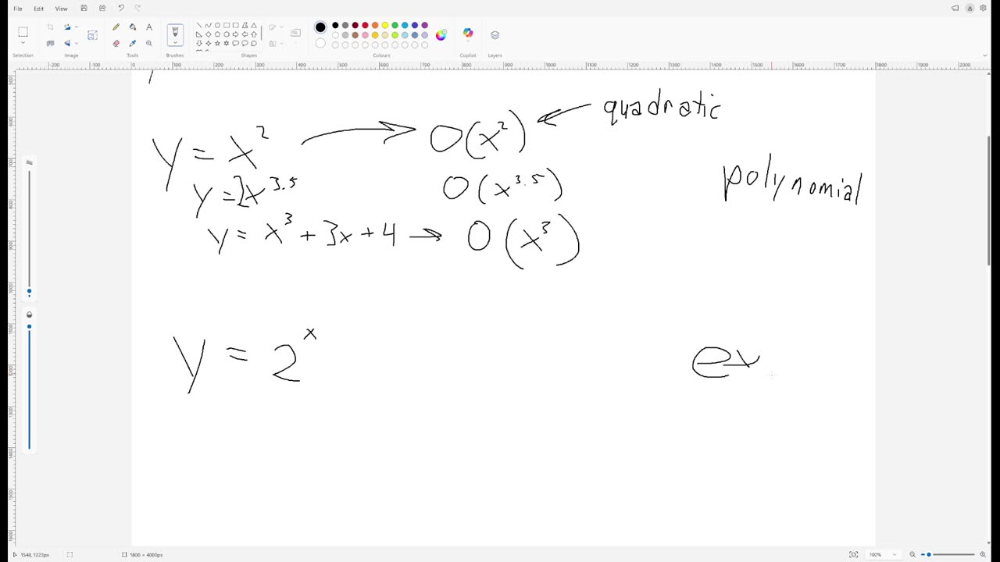

`[00:08:19]` exam because I want to focus on stuff. `[00:08:21]` It's easier to understand, but you know, there we are. Okay. And of course, you know that this is `[00:08:32]` logarithmic logarithmic. Now you also probably should know that there's a base here, but actually `[00:08:43]` we don't care what the base is. So like, okay, fine base, but we usually don't bother writing `[00:08:50]` the base in big O because it doesn't actually change the answer in big O. Um, maybe there's a

## [00:09:00]

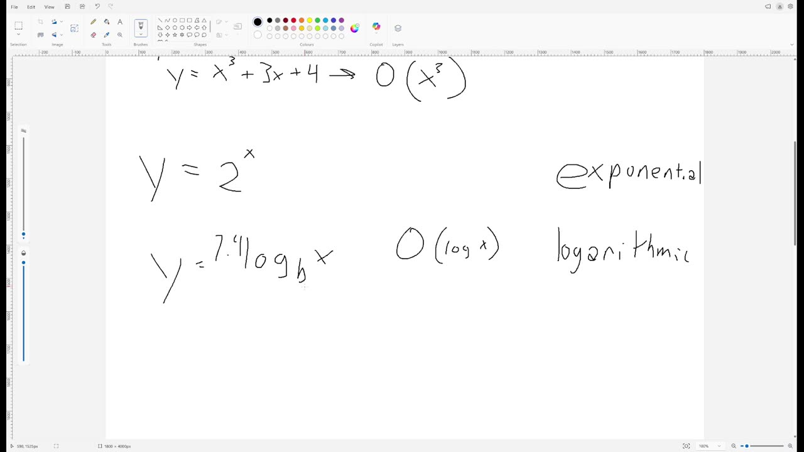

`[00:09:00]` doesn't matter. Um, yeah, you can put it in over here if you need to, like, it's probably not going `[00:09:08]` to hurt anybody's feelings, but it's actually not making your answer more accurate. Okay. `[00:09:17]` And the next thing you need to know is that when you add together different kinds of these things, `[00:09:22]` one of them is going to win and one of them is not going to win. Right. And so the one that `[00:09:27]` eventually gets to win when N gets really big, that's the one that matters. We call that the `[00:09:33]` term and actually already sort of a little bit mentioned it up here in the polynomial section. `[00:09:39]` Okay. So for example, in Y, come on, Y equals N plus log N. These are like different categories.

## [00:09:45]

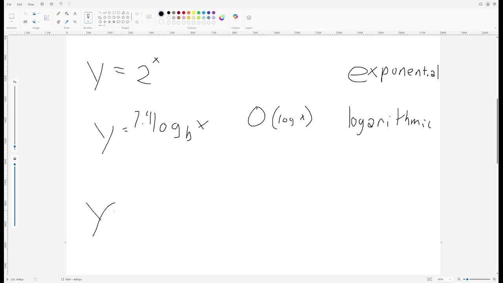

`[00:09:53]` So how are we going to decide what this whole thing is? Well, when N gets large, this term is `[00:09:58]` going to win. In fact, even if I go like a hundred log N, that's hard to read. Let's go 70. `[00:10:05]` Seven log N. I should just write six, seven. So people can scream. `[00:10:11]` Oh, I already made that joke before, didn't I? Uh, um, if I write N plus 77 log N, `[00:10:20]` like at first, maybe this is the big one because it's got that 77, but as N gets large, `[00:10:24]` this one becomes much, much larger. And so that makes this the dominant term. And so this is

## [00:10:30]

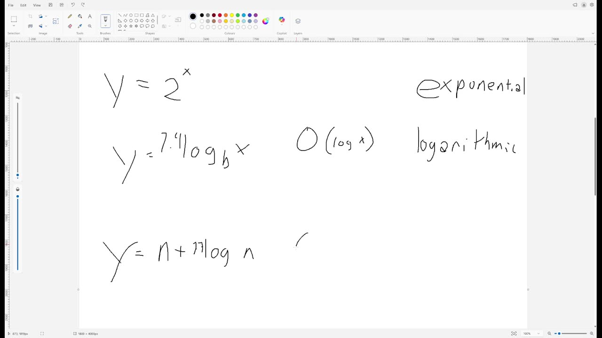

`[00:10:32]` big O of N. Right. `[00:10:35]` So for example, um, maybe there's a big number here, or maybe there's a 13 over here, big number `[00:10:54]` here. Come on. It doesn't matter because what matters is that when N gets large, this N squared `[00:11:00]` will become the dominant term. Well, I mean, it's always the dominant term. It will overwhelm `[00:11:04]` this term. And so this is big O of N squared. And suppose I just duplicate this and change it a bit.

## [00:11:15]

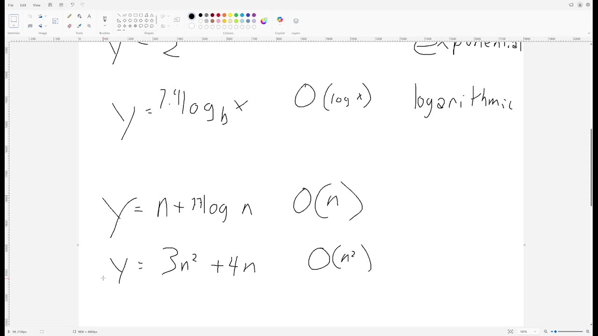

`[00:11:25]` This is now an exponential on this, like the second term here is an `[00:11:29]` exponential. So this is now an exponential on this, like the second term here is an exponential. `[00:11:29]` Right. And so this whole thing is exponential because this is the dominant term. `[00:11:40]` Okay. So let's summarize. Oh, wait, wait, wait. Sorry. Sorry. One more thing. If Y is just some `[00:11:49]` number, any number like four or 44 or 544 or 444.44, any number, we call this constant and

## [00:12:00]

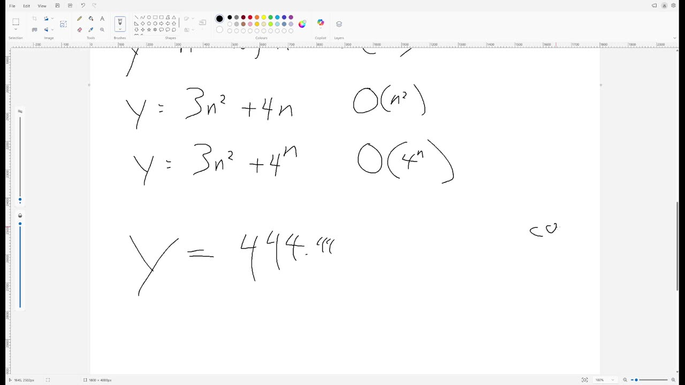

`[00:12:05]` we rate it as big O of one. Doesn't mean there's one thing. It just means it's not getting bigger `[00:12:10]` when N gets large. And so this whole thing is exponential because this is the dominant term. `[00:12:11]` Okay. It's bigger, right? There's no N over here. There's no X over here. It's just a number. `[00:12:17]` Okay. So let's summarize. You should be able to match the following words to `[00:12:23]` like these different kinds of equations. Let's write them out in proper font here. So that if `[00:12:31]` my handwriting is the problem that we've got constant, we've got linear, we've got polynomial. `[00:12:37]` I already did that. Wait, what am I saying? Oh yeah. Constant,

## [00:12:45]

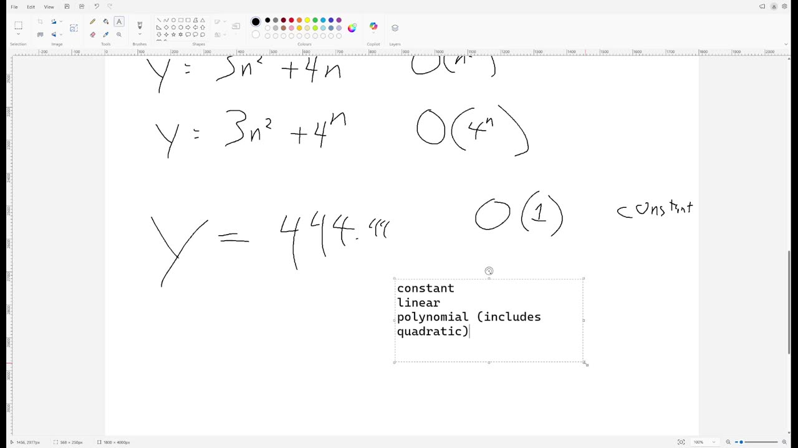

`[00:12:58]` linear, polynomial, quadratic, exponential and logarithmic. You should know that although `[00:13:03]` technically linear is polynomial, don't say that. At least not unless you're making it really clear `[00:13:09]` that you know that the thing you said is technically correct, but not what people would `[00:13:13]` normally say. You should be clear that exponential and polynomial are not the same and you should be `[00:13:19]` able to tell them apart. You should know which one is which. And when you add things together, `[00:13:24]` you should at least for easy cases, be able to tell that the `[00:13:28]` dominant term is going to overwhelm the other term. Right. And by the way, when we multiply

## [00:13:30]

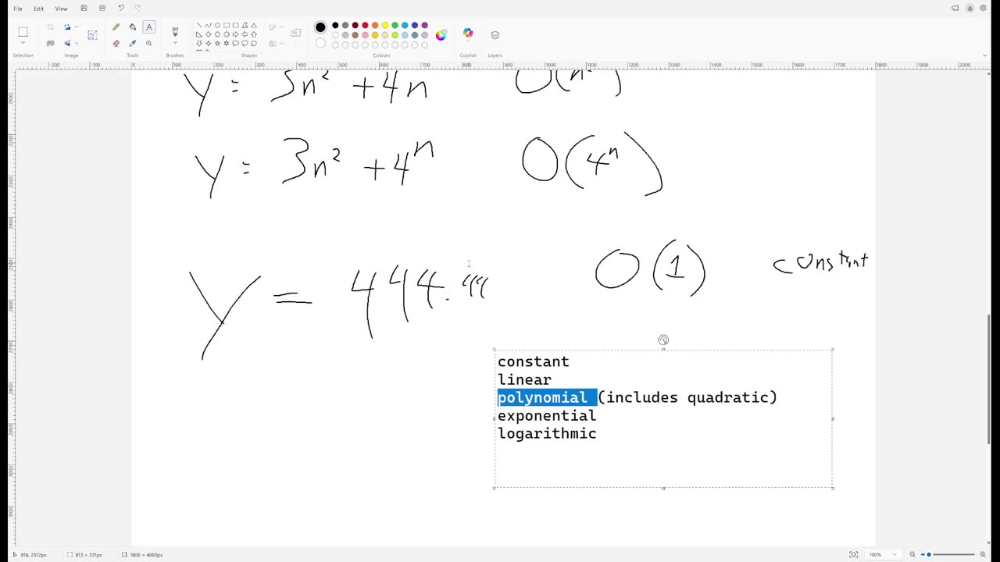

`[00:13:33]` things together, that's trickier. So we're just not, we're not worrying about multiplying things `[00:13:36]` together for now. Just when you add two things, you know how to do. Okay. And that's what I need `[00:13:41]` you to know about the math words.
