# Transcript: 202630_w04_asymptoticanalysis.mp4

- Source: `C:\Users\hiros\BCIT-study-material\Algorithms\202630_w04_asymptoticanalysis.mp4`
- Duration: 00:17:51
- Segments: 166, screenshots: 24
- Whisper model: `large-v3` (auto-generated; may contain recognition errors)

## [00:00:00]

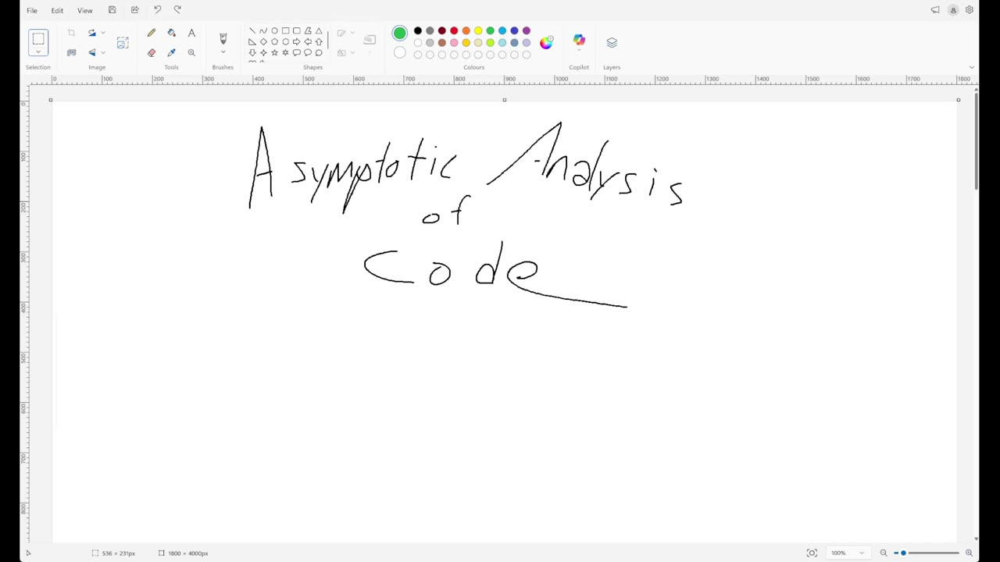

`[00:00:00]` this is a video about doing asymptotic analysis of code, or pseudocode. So what that means is `[00:00:07]` we're going to look at code, and we're going to figure out what its total cost is, not necessarily `[00:00:12]` down to the exact microsecond or whatever, but just in big O, just asymptotically, right? `[00:00:19]` So let's start with our first example. So here we've got a function that operates on some kind `[00:00:28]` of data. And it doesn't say here yet, but I'm telling you that data here is a list, right? `[00:00:39]` And we're going to use a sort of a magic variable n. n is the variable we use by default to express,

## [00:00:45]

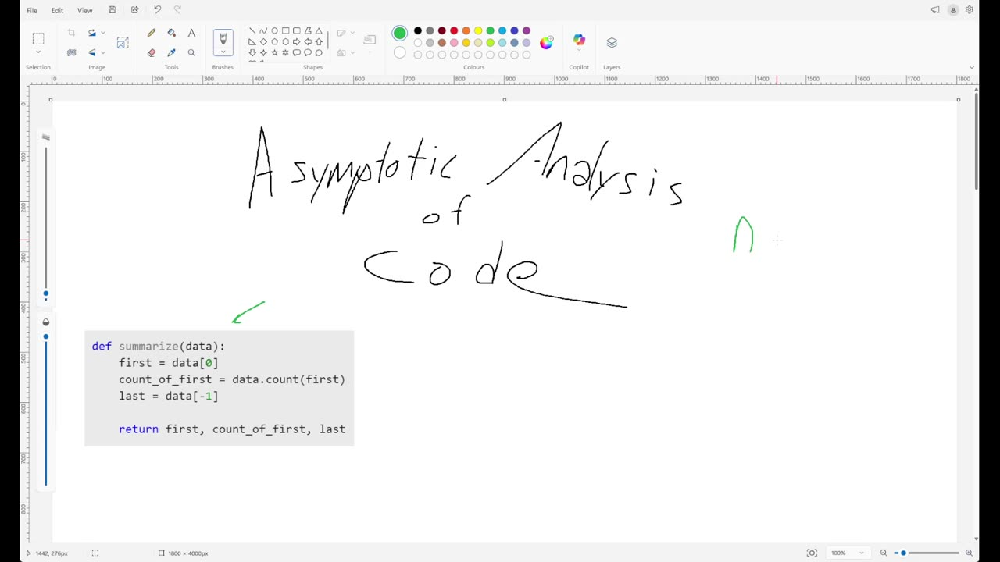

`[00:00:48]` let's do that a little better, the length of the input, whatever the input is. `[00:00:55]` And so it's pretty clear that here that input is this variable, `[00:00:58]` data, okay? And so the first thing we're going to do is we're going to figure out how much does `[00:01:05]` each line cost to run and write those down. And so the first line, we have to access one element `[00:01:12]` of a list, and we have to have a way of getting that value. We can know it, and eventually we `[00:01:18]` should know it. We should just have it memorized eventually. Or we could look it up. So finding `[00:01:23]` one element in a list by its index, that is big O of 1. And assignment over here is also big O of 1.

## [00:01:30]

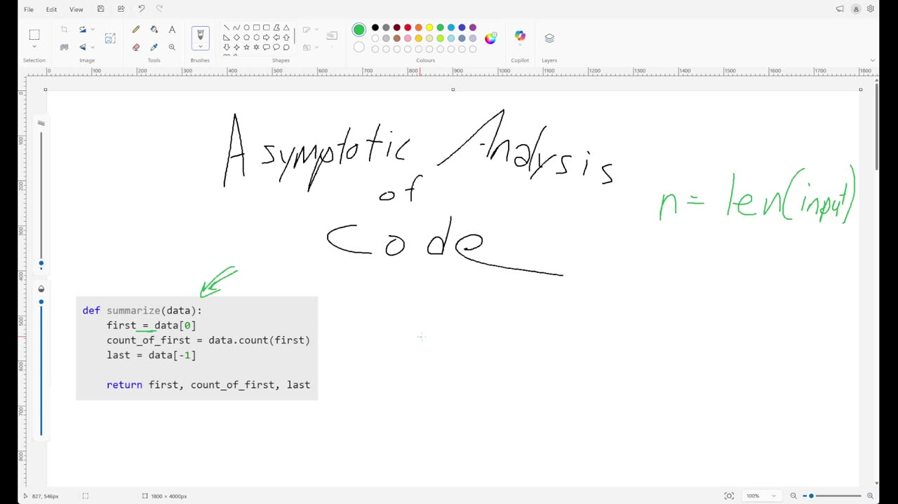

`[00:01:30]` And so big O of 1 plus 1 is big O of 2, but big O of 2 is big O of 1. Like, you don't say big O of 2. `[00:01:40]` That's a, it's not like formally wrong, but don't say that. Okay, and so then the next line. Well, `[00:01:47]` there's still an assignment here. That's 1. But actually, it turns out that the important part `[00:01:52]` here is this dot count. The dot count method has to go through and look at every element of the `[00:01:58]` list to count up how many copies there are of whatever it was that was in the list. And so `[00:02:00]` first. It's basically a linear search without an early exit. So that means that this line is, `[00:02:09]` you know, we're paying n, which again is the length of the input. And then we're also paying

## [00:02:15]

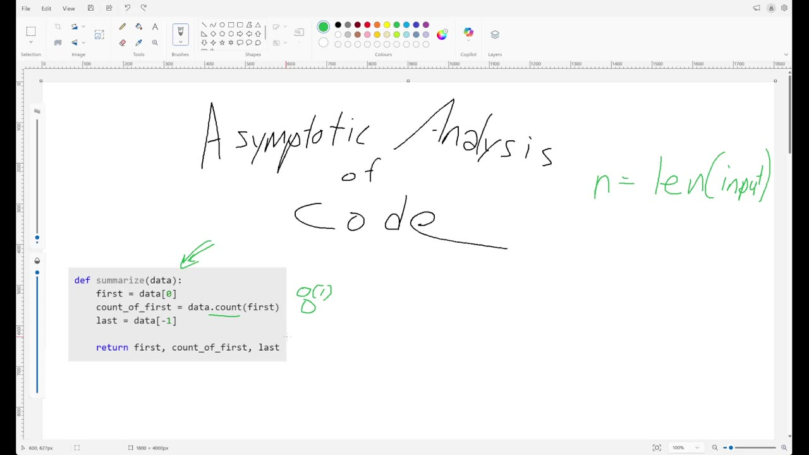

`[00:02:16]` 1 over here. And n plus 1, as you know, is big O of n. And then in the third line, we have to do `[00:02:26]` another, it's just like the first line, we have to look into something at a particular index, `[00:02:31]` and we also have to assign. `[00:02:32]` So that is where my cursor go. There it is. And then the final line is just making a kind of a `[00:02:41]` multi part thing, a tuple as it turns out, and then returning it. And that's also a big O of 1. `[00:02:45]` So that's our first thing to learn is that when you're trying to do this asymptotic analysis of `[00:02:53]` code, you have to be able to know how much each line costs. And that is often done by just looking `[00:02:59]` at what's there and remembering those costs. But if necessary, you might have to look things up.

## [00:03:00]

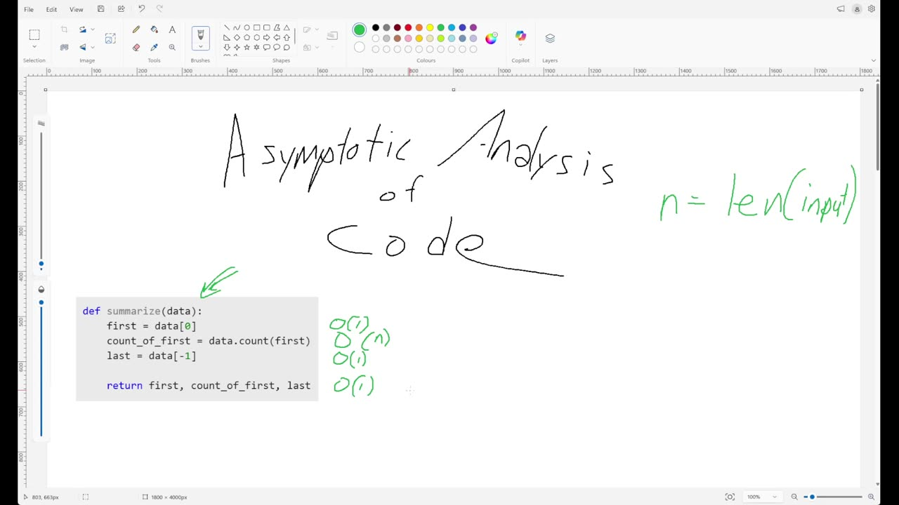

`[00:03:03]` Okay. `[00:03:05]` Second thing to know is that we've got a bunch of things that happen just 1, 2, 3, 4 in a row, `[00:03:09]` or any number in a row, right? 1, 2, 3, those are too ugly, 2, 3, 4 in a row. `[00:03:18]` We're just going to add those costs up, and then simplify. And so adding up those four costs `[00:03:24]` is clearly n plus 3. And n plus 3 is big O of n. So the total cost to run this function is big O `[00:03:34]` of n. `[00:03:35]` Let's get back to that, which is basically the length of the input. Let's move on and do our

## [00:03:45]

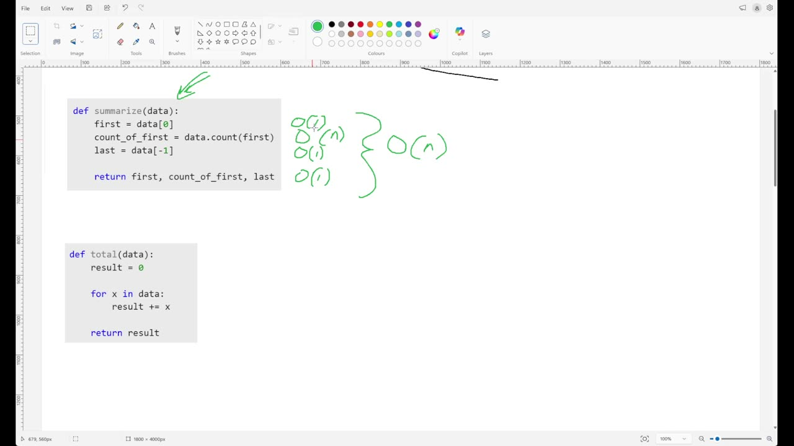

`[00:03:46]` next example. So largely this example is the same, quite simple, right? This is big O of 1. `[00:03:52]` This is big O of 1. And this thing here that looks something up, adds some things together and `[00:03:59]` puts it in somewhere. This is also big O of 1. But we have two of the for loop as well and for `[00:04:04]` loops are a bit special. So there's sort of two parts to a for loop, but we're just going to ignore `[00:04:10]` the simpler part for now. `[00:04:11]` And maybe it'll come up later. `[00:04:11]` But the more interesting part is, we actually have an example of a for loop, where this is a an example `[00:04:11]` of an example of a for loop, and we have an example, and we have an example of an example of an example of an example, `[00:04:12]` part is that the question is how many times will this for loop go round right how many times will `[00:04:17]` it happen and so uh this is going to pull one value out of data at a time so it is going to `[00:04:24]` go around once per thing that's in data which is by definition like actually this is the definition `[00:04:29]` of n it's n and so now we need to combine these things but it's not as simple as the first case

## [00:04:30]

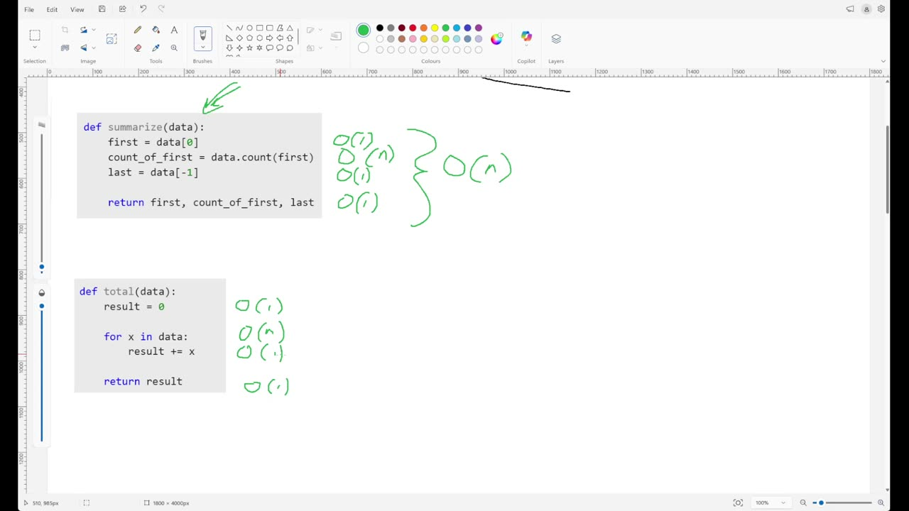

`[00:04:36]` where we can just add them up what we need to do is take this n that's the number of times the loop `[00:04:41]` happens and multiply it by what's inside it right and so we are going to combine these two into a `[00:04:49]` single line that is big o of well i'm going to say it this way first i'm going to say that it's n `[00:04:53]` times one which is big o of n so actually that wasn't very interesting after all `[00:05:00]` and then we could do the we do the step up from up here next `[00:05:05]` so the new things we've learned in this example are first of all for loops are a bit special just `[00:05:12]` you `[00:05:13]` writing down their own cost and then second we have to multiply to combine the for loop by its

## [00:05:15]

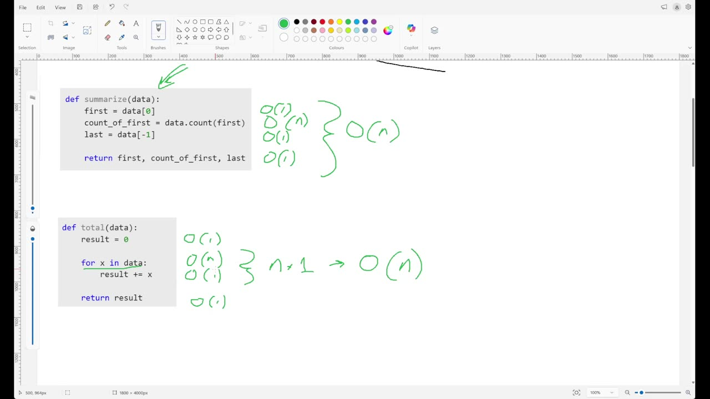

`[00:05:19]` contents that's then yeah we can do the thing for the first one which is our earlier lesson `[00:05:25]` which is now we want to combine all those things and now those things are in a line right one two `[00:05:31]` three right and so that's one plus uh like we don't this is not a separate thing anymore `[00:05:39]` right so we've got one plus maybe a little over here `[00:05:43]` and we've got one plus n plus one which is n plus two which is big o of n `[00:05:50]` okay and that was our second example and we learned how to handle loops `[00:05:55]` now what if somebody gets kind of annoying at us and uses more than one loop right so let's go

## [00:06:00]

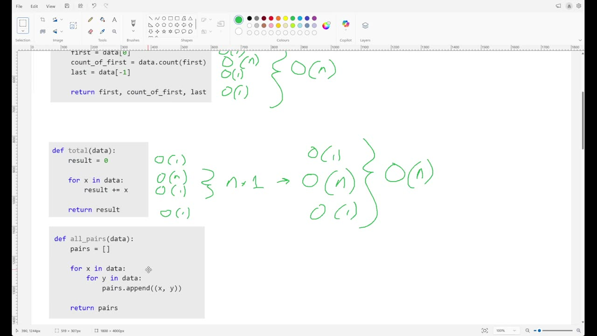

`[00:06:05]` through this again this line makes a list which is one and it puts it you know it assigns it to `[00:06:10]` a variable so that's all in total big o of one this loop is going to be the first one which is `[00:06:14]` is going to go around n times. This loop is going to go around n times, at least it would `[00:06:20]` if it was on its own. And okay, what is the cost of this stuff? Well, first, we have to `[00:06:25]` take x and y and make a tuple. That's one. And then we have to append to a list. And `[00:06:31]` appending to a list is sort of surprisingly fast. It's big O of one. And then return is `[00:06:39]` big O of one. But I can't just add all this up, because there are different levels. So

## [00:06:45]

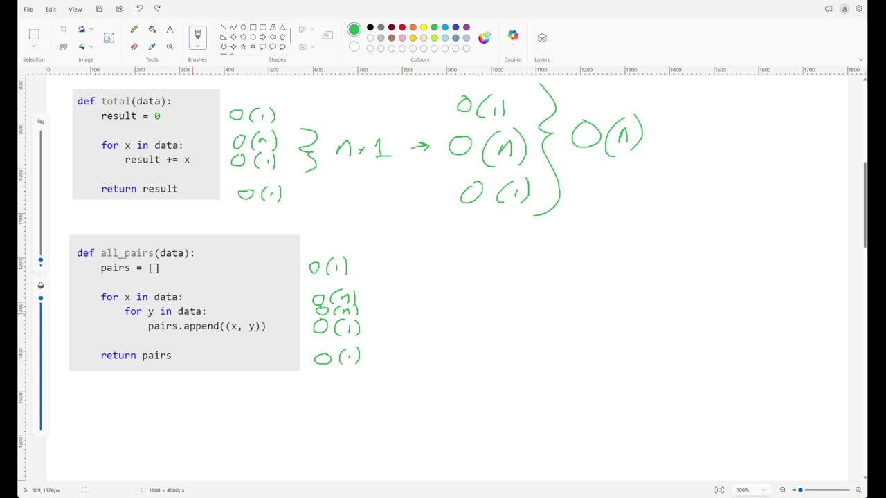

`[00:06:45]` first, I have to combine these two. This is really easy, of course, because one times `[00:06:50]` n is n. So I have done almost nothing so far. And then I have to combine all three of these. `[00:06:58]` And so that is this n here, times this n here. Right? And so this finally, we've got something `[00:07:06]` a little more spicy. My two is almost good. `[00:07:11]` Big O of n squared. Right? And so this whole chunk of code here is going to cost us big `[00:07:20]` O of n squared. And then of course, we're going to add that, you know, now going back `[00:07:26]` to the first lesson, we're going to add that to the cost of its sort of siblings, which

## [00:07:30]

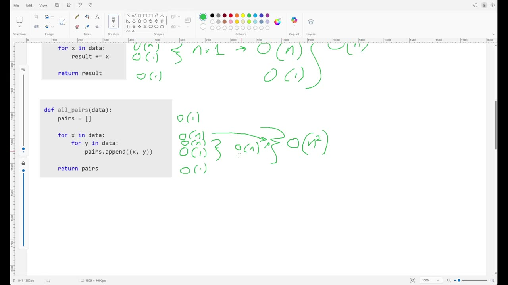

`[00:07:32]` are the one at the beginning and the one at the end. And so this adds up to I keep losing `[00:07:37]` my cursor, what the hell's going on. So this adds up to n squared plus two, which as you `[00:07:45]` know, is big O of n squared. `[00:07:47]` So that was actually the same as the previous lesson, just with a wrinkle, right? The thing `[00:07:53]` that was the same was we just figured out the cost of each part. And then we deal with `[00:07:56]` loops by multiplying the loop by the cost of its contents. And we just did that we just `[00:08:02]` had to do it twice. Okay, what's next? Let's see. So in this little chunk of code, we're `[00:08:13]` going to assume that data has at least three items. Otherwise, this is going to be a problem.

## [00:08:15]

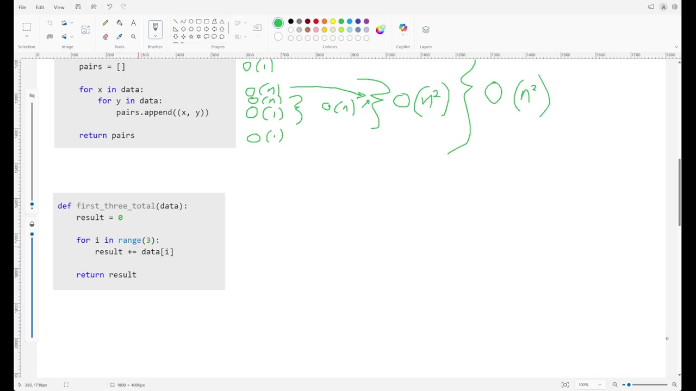

`[00:08:18]` But it might have a lot of items, right? It might be 100 items. Okay, so let's see what `[00:08:22]` happens here. `[00:08:23]` So this line is big O of one, this line is you could call it three, you could call it `[00:08:30]` big O of one, whichever you prefer. I would tend to call it big O of one, but I just want `[00:08:34]` you to see that I admit that it's three, wait, what I mean three, well, range three is going `[00:08:39]` to make up list 012, or sort of a fake list, but whatever. And then it's going to loop `[00:08:43]` over that list. So I is going to be zero, and then I is going to be one, then I is going `[00:08:46]` to be two, and then it's done. `[00:08:49]` And so then what about this next line, this next line in isolation is it looks up an element, `[00:08:55]` and it does a plus equals. So that's, I would argue, three steps, which is big O of one.

## [00:09:00]

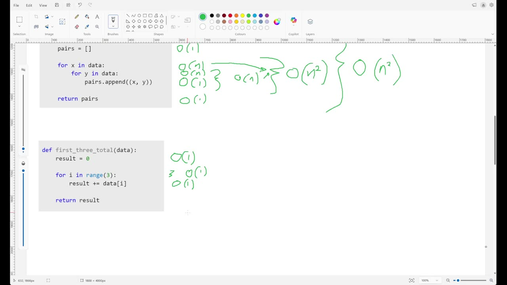

`[00:09:01]` And then this is big O of one down here. Okay, and so what do we have to do next? Well, we `[00:09:05]` have to combine. And we start at the inside and go out. So we're gonna combine these two, `[00:09:10]` right? And one times one is big O of one. And then now everything's on the same level. `[00:09:18]` So we can combine all of these. And one plus one plus one is three, which is one big O. `[00:09:26]` Right? And so the point to notice here is that a loop might not be n, long. And you `[00:09:37]` need to notice that. And aside from that, it's just the previous rule. Just, you know, `[00:09:43]` absorb the contents of loops into your analysis by multiplying. Easy enough. Next example.

## [00:09:45]

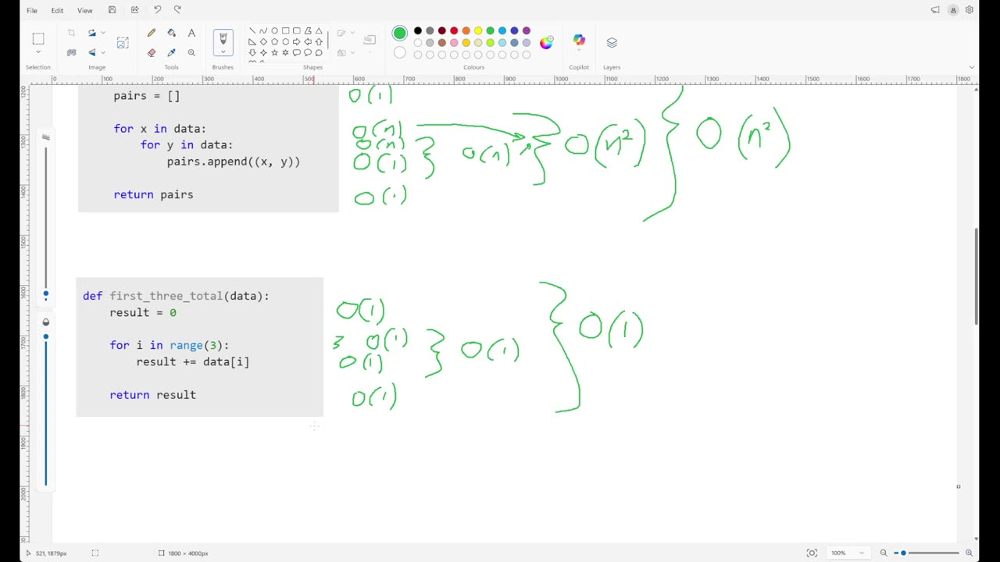

`[00:09:48]` I can't remember this examples for, although it does say, well, let's just see how it goes. `[00:10:00]` Okay, this is big O of one. That's easy. Okay. And then the next example is to combine two, `[00:10:01]` this one is happening three times so that's big o of one this is very cheap big o of one `[00:10:10]` this one this loop is going around data times or sorry like once per thing in data which is n `[00:10:19]` right so this is big o of n this is cheap this is big o of one append you could look that up `[00:10:27]` right that's big o of one return big o of one okay good start now we got to start combining

## [00:10:30]

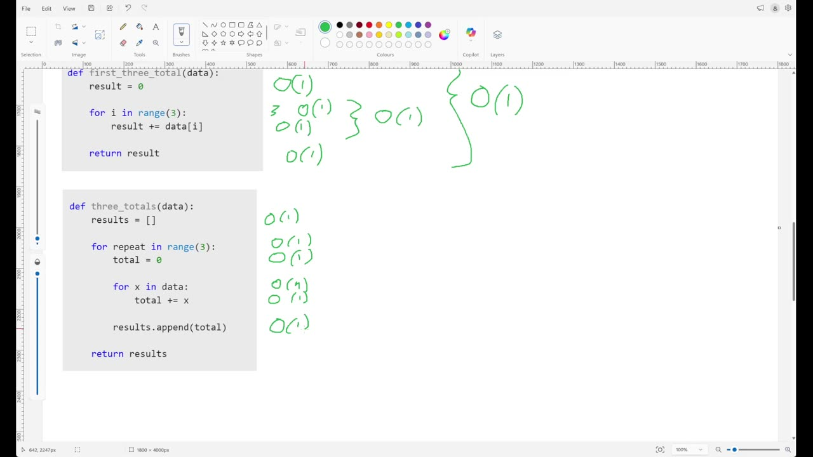

`[00:10:34]` things right so this thing is nested the most so we got to combine these two `[00:10:38]` and that's n times one is big o of n and then we got to combine all of these right and so that's `[00:10:51]` one plus n plus one and that's n plus two and as you know n plus two is big o of n `[00:10:57]` and then we got to combine these up into their their parent loop right into their parent loop `[00:11:04]` and their parent loop as it turns out is `[00:11:08]` just going to make some little dotted lines there to mark things off their parent loop is big o of `[00:11:14]` one again and so we're going to multiply that big o of one of this loop by the big o of n of all of

## [00:11:15]

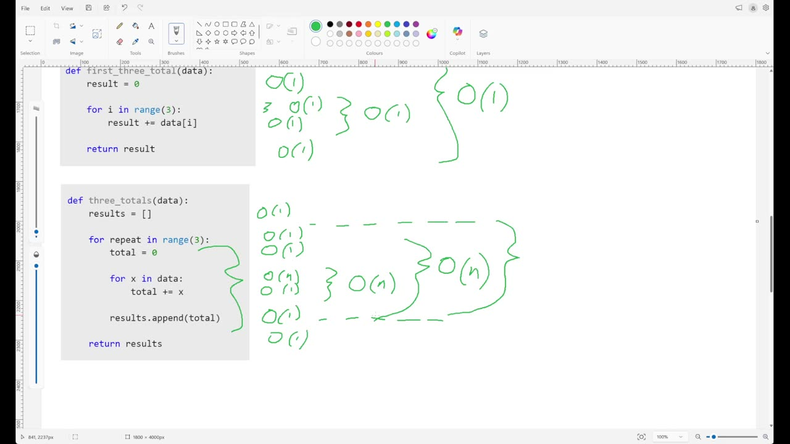

`[00:11:21]` the contents and one plus n sorry one times n one times n is big o of n and then we're going to add `[00:11:30]` in the top layer here big o of n okay let's see next thing this is a one `[00:11:50]` this is an n just pretend i'm writing the big o's my hand's hurting `[00:11:53]` okay what's happening here it does a count which is n and then it does an append which is one

## [00:12:00]

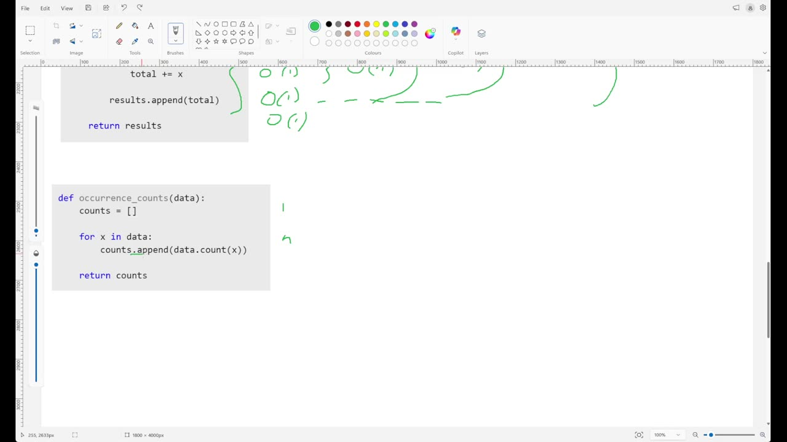

`[00:12:02]` to figure out a single line you just kind of have to do the the process we were already doing `[00:12:07]` it's really just the same idea right this has to do the count and then the append that's n plus one `[00:12:12]` and n plus one is n and then this is one okay and then we have to combine these up into the `[00:12:20]` two up so we're going to multiply the n by its contents and boom suddenly we're at n squared `[00:12:28]` right and then we combine everything else up one plus one plus n squared is n squared `[00:12:34]` okay and the thing to notice here is that even though we only had one loop the thing inside was `[00:12:43]` expensive and so it was only one loop but it did not end up big o of n it ended up being big o of

## [00:12:45]

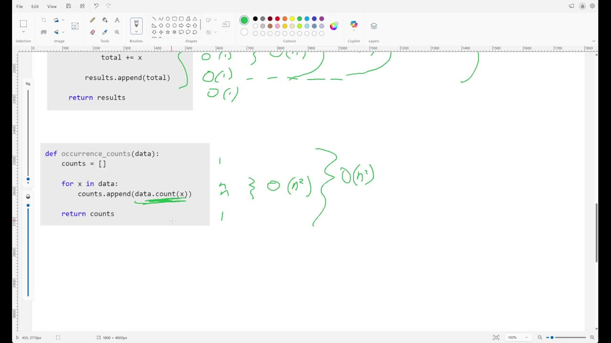

`[00:12:50]` n squared okay and then just a `[00:12:58]` slightly larger i have this in my notes as a separate like in my script as a separate example `[00:13:05]` but this is really kind of the same so i don't know if this counts as separate i don't know `[00:13:08]` one data makes n a multiplication is one and append is one so that's one make a list and `[00:13:18]` assign it one go to looped up to data that's n loop up to data that's n oh this part we already `[00:13:22]` did already right all this stuff is this stuff right here

## [00:13:30]

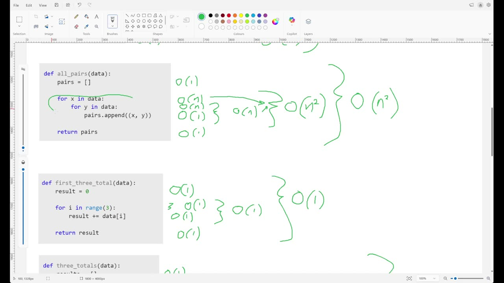

`[00:13:31]` that was n squared so we can just kind of cheat ahead here you don't want to do that on exam `[00:13:42]` you want to spell it out for me uh and this is one okay so we have to do this one and this one `[00:13:51]` before we can do the top level right so i just sort of found this from before `[00:13:57]` what about this one here this one here is well this is one multiply that by n `[00:14:05]` that's big `[00:14:06]` n. Okay, and now we've got all things at the top level, right? We've got this thing, this thing, `[00:14:12]` this thing, this thing, this thing, each of those is now one kind of measurement. They're

## [00:14:15]

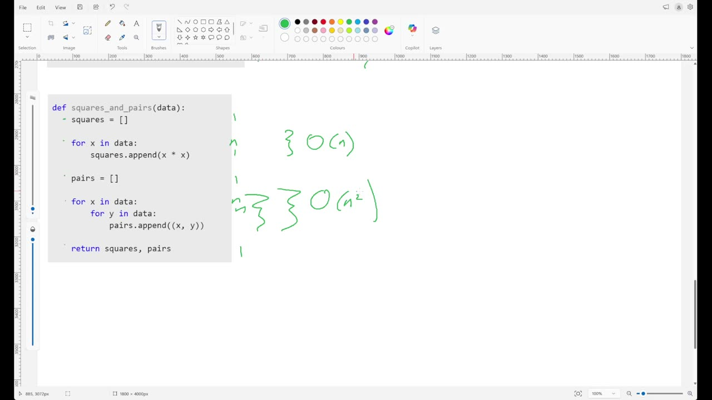

`[00:14:18]` all the same, though. So this is one plus n plus one plus n squared plus one. And so you could, `[00:14:23]` of course, write n squared plus n plus three, but that's goofy, don't do that. That's big O `[00:14:29]` of n squared. Okay, and in my notes, I've got one more example. Oh, I'm also out of `[00:14:38]` out of page NMS paint, although I could just expand the canvas, but I don't have to. Okay, `[00:14:44]` what do we got here? One, one, one, n, one, one, one, n, n, one. This is very similar to the last `[00:14:58]` example. We can now do all the contents of this for loop. And that's one plus this n here plus one.

## [00:15:00]

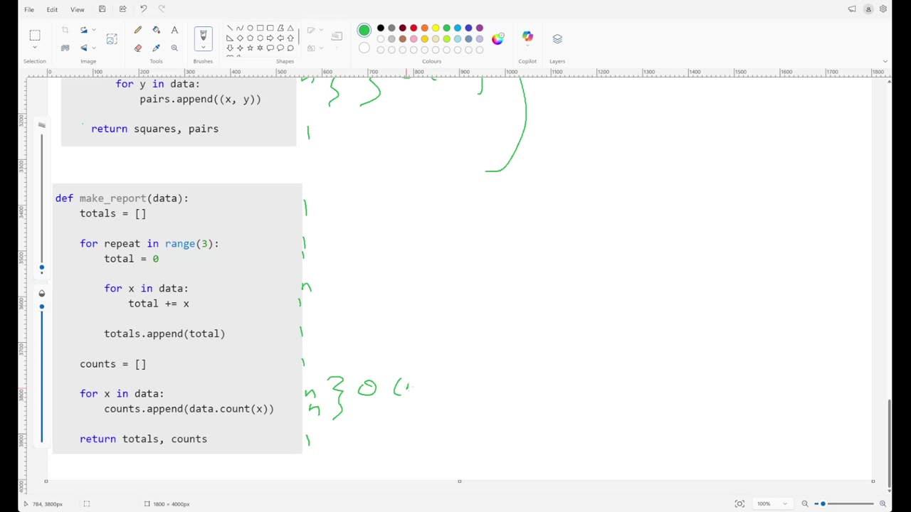

`[00:15:26]` And then we're inside a for loop. So we can multiply our costs there, you know, our costs `[00:15:30]` on the inside by our number of times the loop runs. And so now, all of this has been collapsed `[00:15:41]` up to there. And much quicker, this thing got collapsed up. So now we just have 12345 top level

## [00:15:45]

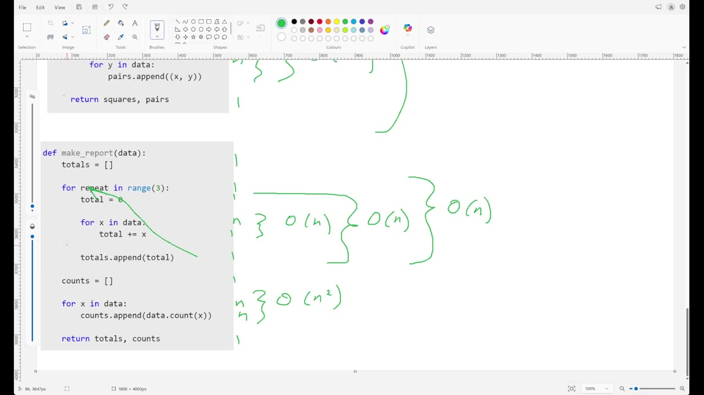

`[00:15:49]` costs. That's this one, and this n, and this one, and this n squared and this one. And it's just a `[00:15:58]` like our previous example here. This whole thing adds up to big O of n squared. So this is not all `[00:16:12]` there is to asymptotic analysis, but it's all there is to asymptotic analysis this week. And `[00:16:19]` I don't think, not sure if there'll be anything more for the midterm, but not much. Little or `[00:16:26]` none. Okay, and so let's see, I like using my primitive tools, just your paint and notepad and

## [00:16:30]

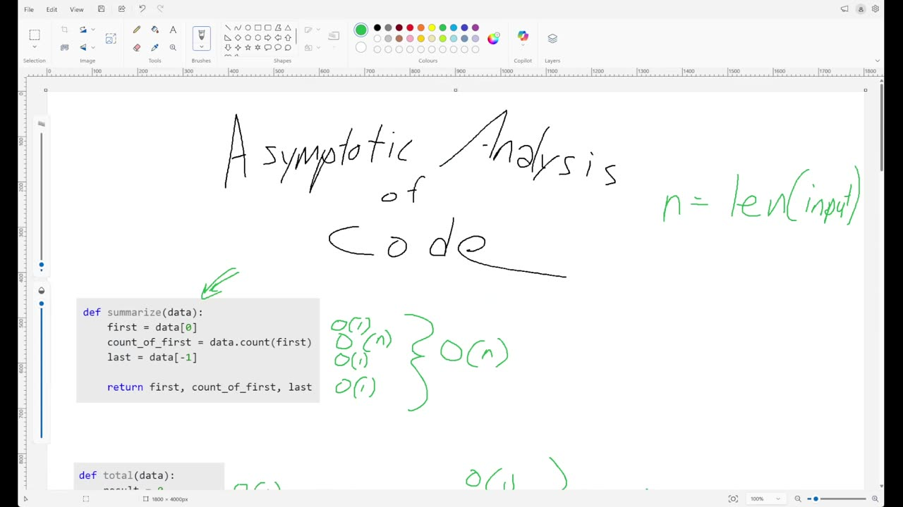

`[00:16:38]` screenshot. `[00:16:42]` So this is the stuff that we, farts. Let's just do this so you can see that it's overriding `[00:16:51]` everything. This is the stuff that we did, right? You need to know how to assign big O cost to lines. `[00:16:59]` And sometimes you're going to have to add up things on a line and simplify. `[00:17:05]` If things are done in serial order, one, two, three, four, then you add them up and then `[00:17:09]` you simplify down to just big O. Loops, you have to handle a little special, `[00:17:12]` you still write the big O for the line, but then you multiply.

## [00:17:15]

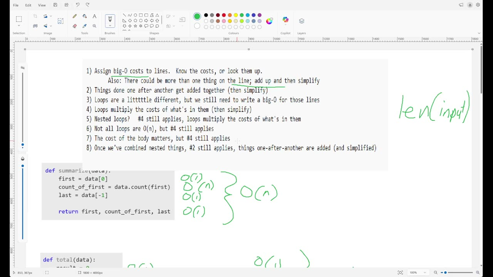

`[00:17:16]` And then we went through some like particular examples. We went through a nested loop. We went `[00:17:18]` through a loop where the loop was constant, went through a loop where the body was expensive, `[00:17:26]` blah, blah, blah. And these numbers, by the way, do not correspond to `[00:17:31]` like my examples down there. They're just a separate set of numbers. `[00:17:34]` Okay. And so that's the process of doing this thing with pseudocode is that you `[00:17:39]` assign cost to lines and then you combine correctly until you have only one value remaining and you, `[00:17:45]` you combine and simplify, combine and simplify. Okay. I think that's it.
