# Transcript: 202630_w04_ratesofgrowth.mp4

- Source: `C:\Users\hiros\BCIT-study-material\Algorithms\202630_w04_ratesofgrowth.mp4`
- Duration: 00:18:47
- Segments: 205, screenshots: 26
- Whisper model: `large-v3` (auto-generated; may contain recognition errors)

## [00:00:00]

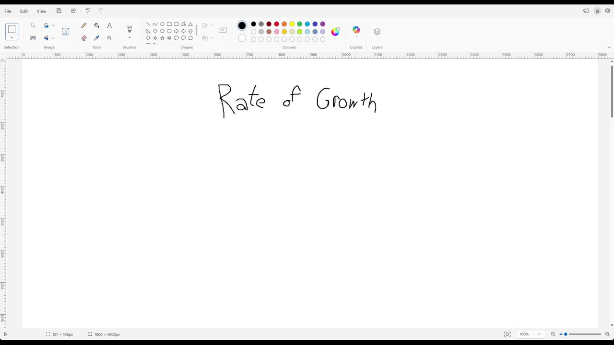

`[00:00:01]` Previously, we spent some time learning how to actually time Python code, which allows us to `[00:00:06]` answer the question, how long does this particular piece of code take to run? Actually, what it `[00:00:11]` really asks is how long did this particular piece of code take to run on this data, this time, `[00:00:18]` on this computer, in this context, et cetera, et cetera. So in this video, we're going to ask a `[00:00:23]` different question, which is as the input sizes changes, how does that affect the amount of work `[00:00:30]` that needs to be done? How does that affect the running time? So we're going to be talking about `[00:00:34]` rate of growth. So I've got a little bit of code here

## [00:00:45]

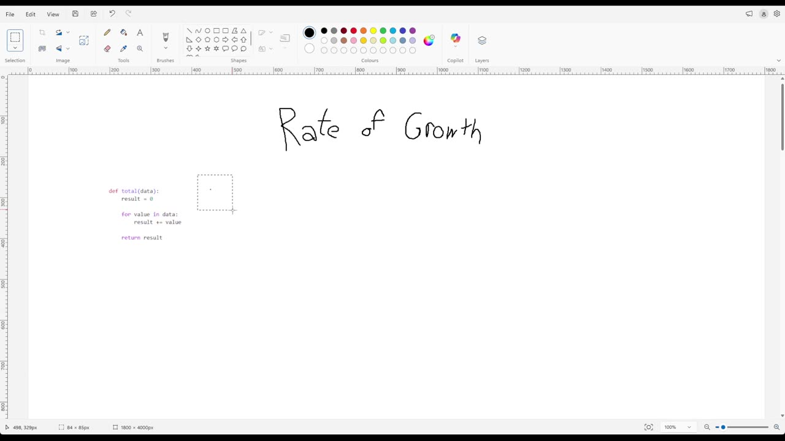

`[00:00:47]` and let's suppose that we assume for some reason, maybe a good reason, `[00:00:52]` that the main cost of this code is this line right here. And so basically, however much `[00:00:58]` we spend on this line, that's going to be basically how much we spend total. And so `[00:01:04]` the number of times we run that line is dependent on how many times we go around this loop. `[00:01:10]` And there are a lot of programs that do this differently. So we're going to do that in a `[00:01:10]` And that depends on how many elements are in this list data. `[00:01:17]` And that depends on how many elements `[00:01:19]` are in the input data, right? `[00:01:22]` And so if the size of data, `[00:01:25]` which we're gonna call N is 10, `[00:01:28]` then clearly we run this line here 10 times

## [00:01:30]

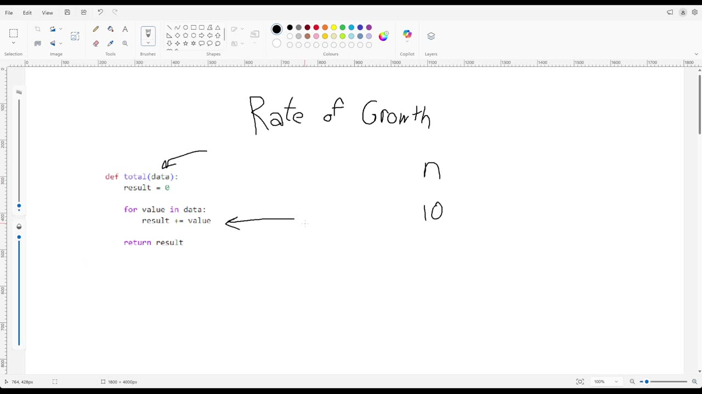

`[00:01:34]` and the total cost is 10. `[00:01:36]` And if N is a thousand, `[00:01:39]` then the total number of times we run that line `[00:01:42]` is a thousand or did I say 10,000, whatever. `[00:01:45]` And that's gonna be the total cost. `[00:01:47]` Okay, that was easy enough. `[00:01:51]` But there's obviously sort of already a possible objection, `[00:01:55]` which is it probably doesn't cost exactly one. `[00:01:59]` You know what, let's actually just make it harder overall `[00:02:05]` and make it really certain `[00:02:14]` that it's doing more than one step there on that line.

## [00:02:15]

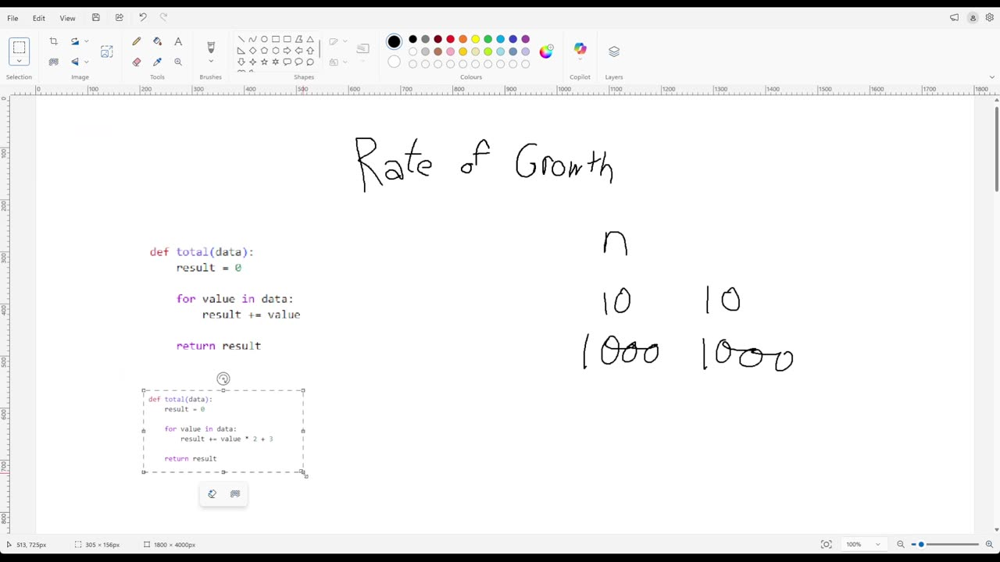

`[00:02:18]` Right, so the line has gotten uglier `[00:02:22]` and now it has to do several steps `[00:02:23]` and how much those steps cost, I don't know. `[00:02:27]` Like I really actually don't know. `[00:02:28]` We could sort of imagine that somebody told us `[00:02:31]` the multiplication costs two microseconds `[00:02:34]` and the addition costs one microsecond `[00:02:36]` and the assignment costs, I don't know, six microseconds. `[00:02:41]` That all adds up to nine microseconds. `[00:02:43]` And so if again, that's the dominant cost, `[00:02:48]` then that's gonna be here, I've got this is for this, `[00:02:53]` I'll clean this all this up in a second. `[00:02:54]` But if n is 10, `[00:02:57]` then we're gonna have to run that line 10 times `[00:02:59]` at nine microseconds each or whatever.

## [00:03:00]

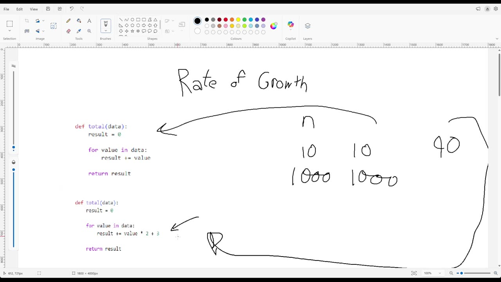

`[00:03:01]` I'm just making these numbers up `[00:03:03]` and it's gonna take 90, blah, blah, blah, right? `[00:03:10]` And the thing that you, wait, I'll save that for a second. `[00:03:18]` Okay, let's see. `[00:03:20]` I'll just rearrange this a bit. `[00:03:22]` That's like that. `[00:03:32]` Okay, and we might have something else like this. `[00:03:34]` Where we're actually gonna run the loop twice. `[00:03:42]` And you can see that each time we go around the loop, `[00:03:44]` it's gonna be n, sorry, to go around the loop n times,

## [00:03:45]

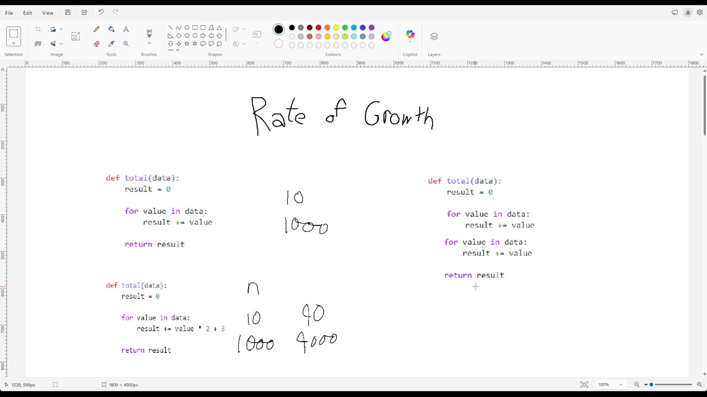

`[00:03:50]` it's gonna cost us n. `[00:03:54]` And then to go around this one, `[00:03:54]` it's gonna cost us another n. `[00:03:56]` And that's gonna add up to two n. `[00:03:58]` And so if n is 10, then we're gonna spend 20. `[00:04:03]` And if n is 100, we're gonna spend 200. `[00:04:06]` And if n is 1000, I mean, right, like obviously. `[00:04:09]` Oh, this went missing. `[00:04:18]` And so at the risk of spelling out the obvious, `[00:04:21]` I'm just gonna throw all that in a table here. `[00:04:28]` And again, the sort of super obvious thing

## [00:04:30]

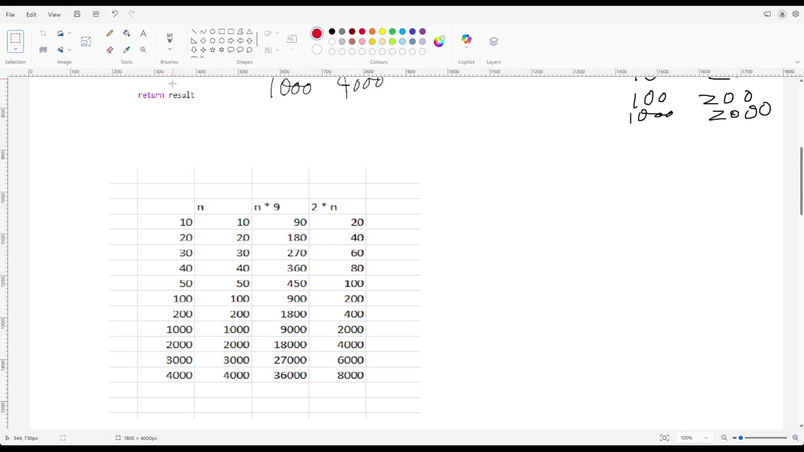

`[00:04:30]` you wanna notice here is that, okay, right? `[00:04:34]` These times are bigger than these ones. `[00:04:37]` And these times are in between. `[00:04:39]` And so they're all different, right? `[00:04:40]` But something that I'll share is that when I double n, `[00:04:45]` this doubles and this doubles and this doubles, right? `[00:04:51]` When I quadruple n, this quadruples. `[00:04:54]` And you know, you can do the math if you want to. `[00:04:57]` These also quadruple, right? `[00:04:59]` Oh, and actually one more example. `[00:05:02]` Suppose that I am not, you know, earlier I said, `[00:05:09]` oh, like the only cost is here, right? `[00:05:12]` But what if I also wanna pay for this and this?

## [00:05:15]

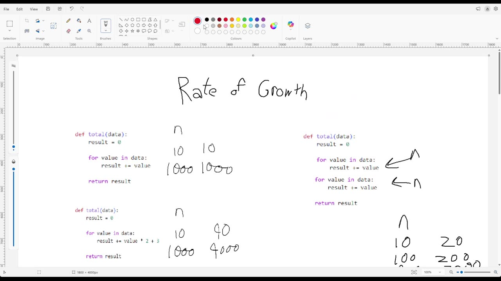

`[00:05:15]` And those clearly happen once each, right? `[00:05:17]` So what if I also want to pay for this and this? `[00:05:20]` And those clearly happen once each, right? `[00:05:22]` So what if I also want to pay for this and this? `[00:05:23]` And those clearly happen once each, right? `[00:05:25]` And so actually this one should be n plus two. `[00:05:31]` Yeah. `[00:05:33]` So let me just put those in my table. `[00:05:39]` Just kind of glue these in here. `[00:05:42]` And you might object that when I double here, `[00:05:45]` this doesn't double. `[00:05:46]` And okay, that's kind of true, `[00:05:49]` but it kind of does double, right? `[00:05:51]` It kind of does double and it kind of, `[00:05:55]` and the further down you go, the more it's basically doubled. `[00:05:58]` And the further down you go, the more it's basically doubled. `[00:05:59]` So you double n when you double n.

## [00:06:00]

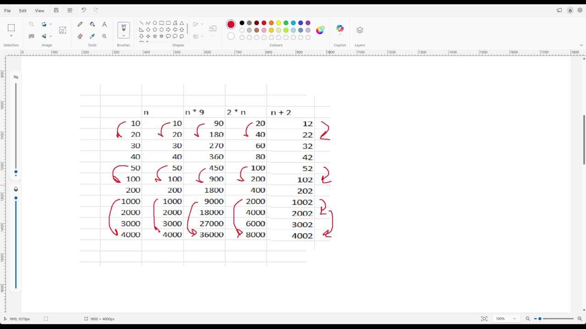

`[00:06:00]` And when you quadruple n, it basically quadruples. `[00:06:05]` And you can imagine that if we went even further `[00:06:07]` down this table, it would get even closer to being, `[00:06:10]` you know, it would never quite get there, `[00:06:11]` but it would just get closer and closer to being `[00:06:13]` when you double n, n plus two doubles. `[00:06:18]` And in fact, if you plotted all these onto a plot, `[00:06:22]` you know, you would get either a line like that, `[00:06:29]` or you'd get a line like that, `[00:06:31]` or maybe you'd get a line like this. `[00:06:33]` like this that's a very approximate version of the fourth of the fourth set here but they would `[00:06:38]` all be lines and that's why we're going to group these into a group and i know i know how shocked

## [00:06:45]

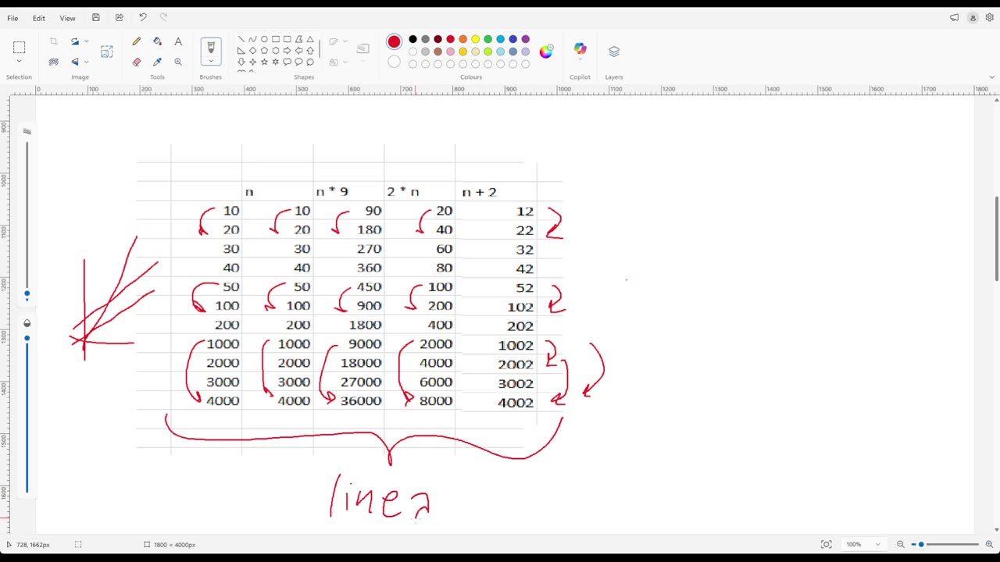

`[00:06:46]` you are we're going to call these linear because they are linear equations so let's look at a `[00:06:52]` different example i gotta shrink all this out of the way let me just clean this up okay so let's `[00:07:03]` do something a little different this is our new code here and we have the same kind of question `[00:07:13]` again which is if the size of data is n then how many times do i do something right and so if data `[00:07:27]` has three elements in it then this one goes around three times but each time it does this one goes

## [00:07:30]

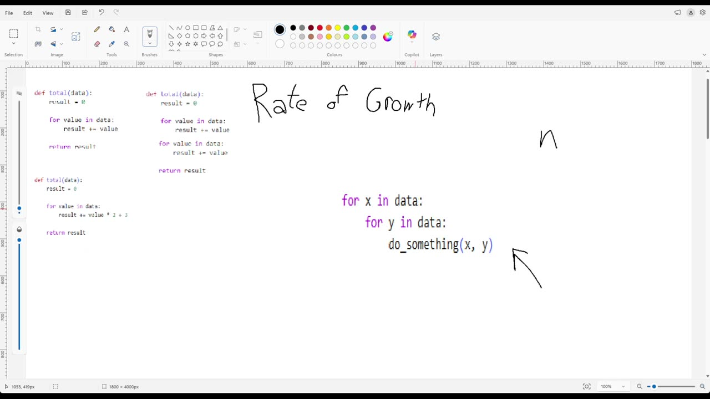

`[00:07:34]` around three times right so we get you know zero zero zero one zero two we get uh one zero one one `[00:07:41]` one two and we get two zero two one and two `[00:07:45]` two right and so if n is three then our you know our our total amount of work done is nine but of `[00:07:57]` course if n was a larger number like 10 we would do the inner loop 10 times every time we did one `[00:08:03]` of these and we repeat that 10 times which will give us 100 and so on and hopefully you can see `[00:08:14]` that the consequence here is that this is basically not basically the number of times we're

## [00:08:15]

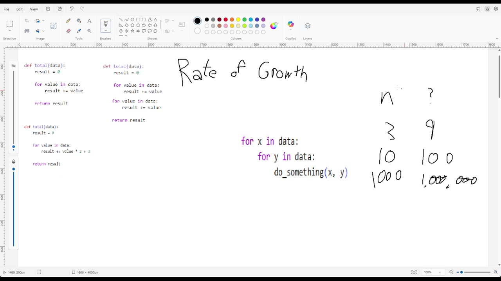

`[00:08:21]` doing the inner loop twice okay so one of the things that we need to get there right is we want `[00:08:25]` to make sure we're doing something and i mean you know do something is n squared and what if we do `[00:08:37]` the loop twice the inner loop twice well now it's gonna be you know a hundred go rounds of the `[00:08:47]` outside sorry i don't know why i said 100 let's do the three row first right so it's three of this `[00:08:52]` plus three, right? So that is pretty clearly N times two N. Oh, sorry. Let's do that in the

## [00:09:00]

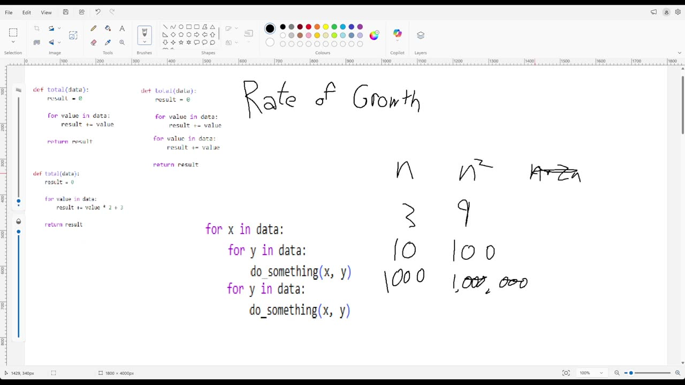

`[00:09:01]` reason. Sorry. Let's just back up. N times two N, which is pretty clearly two N squared, right? `[00:09:09]` And so it's just twice the previous numbers, blah, blah, two million. And, you know, obviously I `[00:09:21]` could also, I don't know, let's just say that we do this again at the end or something. So how many `[00:09:31]` more did I add? Well, I added, you know, if data has size three, then this happens three times, `[00:09:41]` and then this happens three times, and then this happens once. So that's two N plus one.

## [00:09:45]

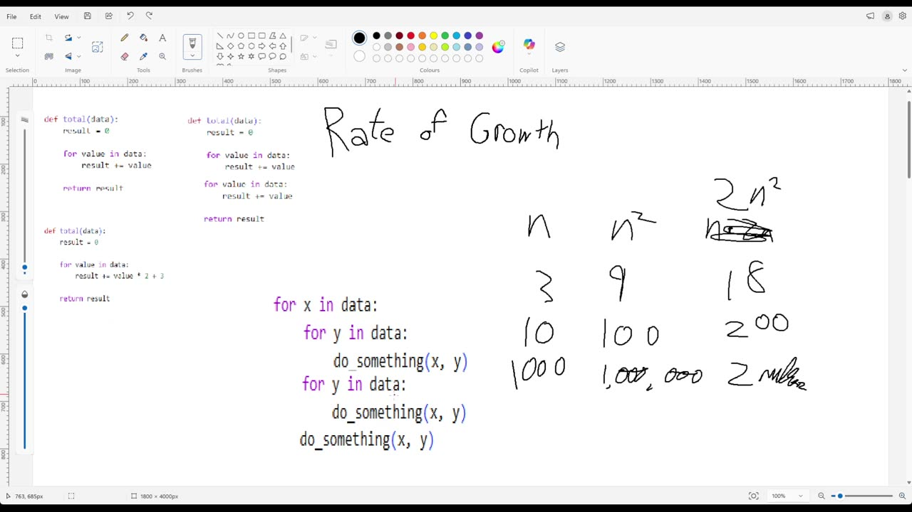

`[00:09:46]` Then all of that gets multiplied by this. So that's six N plus three or whatever. And so more `[00:09:54]` generally, what is that? That is, let's see, I need to scooch all this over a little bit. `[00:10:00]` Two N squared plus N. `[00:10:03]` Right? And so in this case, that's the same as that plus N. It's the same as this plus N. `[00:10:13]` Let's see. It is, blah, right? And so I think I should add some more columns to my table.

## [00:10:30]

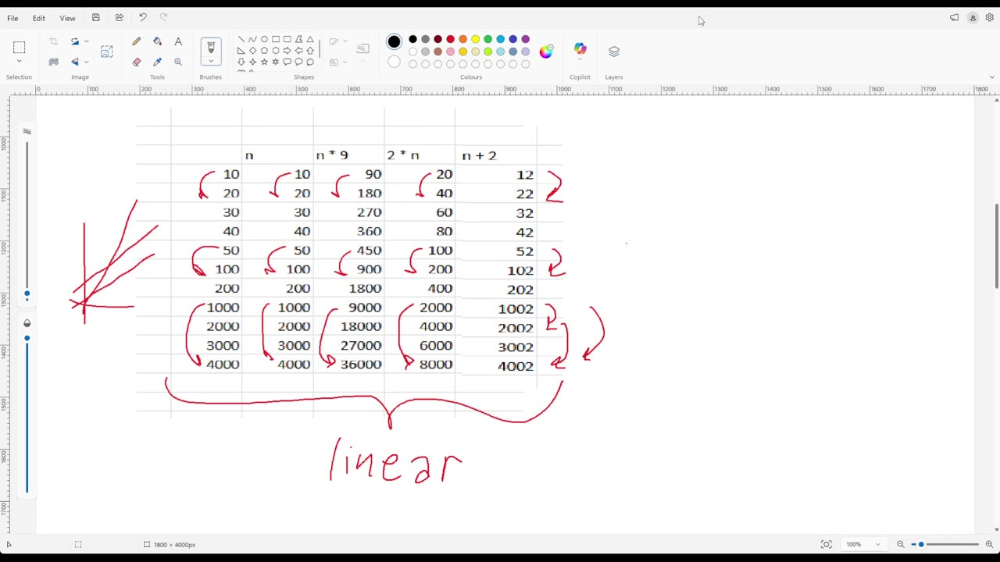

`[00:10:31]` Let's see. Bloop. Got to size that to fit. So it looks good. Really good. Looks really good. `[00:10:40]` I am artiste. Okay. `[00:10:41]` So what do we see now? Right? So when N doubles, this isn't doubling. This isn't doubling. But `[00:10:50]` they are, well, this one is times four. This one is times four. And this one is kind of roughly `[00:10:54]` times four. Right? And this one is times four. And this one is times four. And this one is, `[00:11:00]` you know, kind of roughly times four. And times four, and times four, times four, times four. `[00:11:09]` I mean, roughly. But well, some of them are exact. `[00:11:11]` I'm approximate, right? And this one here is times 16. And this one here is times 16.

## [00:11:15]

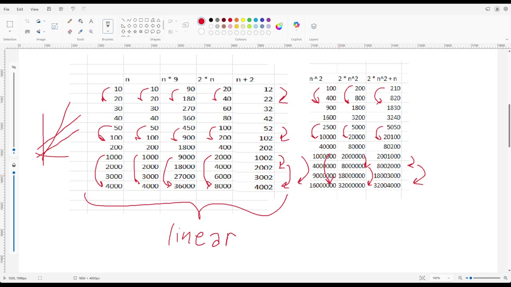

`[00:11:18]` And this one here is times 16. And so again, the point is that they all have the same behavior. `[00:11:24]` And so just as over on the left, I chose the simplest one to represent the whole family. `[00:11:29]` I'm going to choose the simplest one to represent the whole family. And you know what I'm going to `[00:11:35]` write here, right? Quadratic. I'm going to, you know so well that I'm just going to write it badly. `[00:11:39]` Ha ha ha. I'm just going to move this over to the left here for no reason. Okay, so one more thing `[00:11:55]` to do here. What if I add another loop? Just pretend that's properly indented. Okay, thanks.

## [00:12:00]

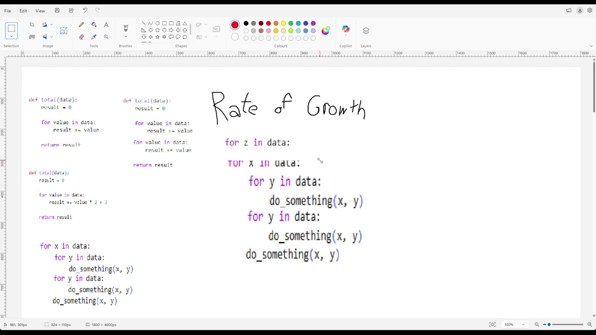

`[00:12:11]` So if I add another loop, I hope it's pretty obvious that what's going to happen is I'm going `[00:12:15]` to have the same answer as here, except times n, right? So that one was 2n squared plus n. `[00:12:26]` This time I'm going to have, `[00:12:27]` 2n cubed plus n squared, right? You know what? I'm not going to do n squared. Ha. I'm just going to `[00:12:37]` move this out here. I don't know. It doesn't matter, right? And so, okay, `[00:12:41]` I can update my table again. Just making a few little fumbles here. Okay, what do we see this

## [00:12:45]

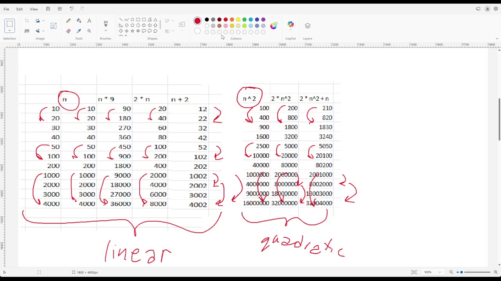

`[00:12:55]` time? We see that, um, what's that factor? Well, that's around four, I guess. Hmm. `[00:13:08]` But as I said, I'm going to add another loop. So if I add another loop, I'm going to add another loop. `[00:13:09]` It turns out, wait, that actually is four. I did this wrong. One sec. Sorry, that's better. `[00:13:17]` So here, this is approximately times eight. And let's see what else we're supposed to check. This `[00:13:23]` one is approximately times eight. And, you know, approximately times eight. And, well, `[00:13:28]` you can't tell, but, right? And so where this was two became two became four became eight. Let's see.

## [00:13:30]

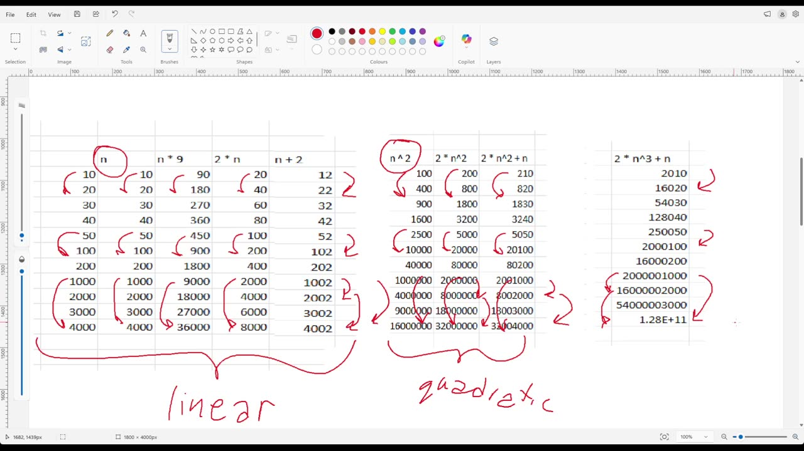

`[00:13:40]` Wow. My missing, my writing is even messier than usual. Two, two, four, eight. And then the big `[00:13:48]` jump down here is four. This is four. This is four squared, which is 16. This is four cubed. Even `[00:13:57]` though you can't tell, you could like figure it out. Um, over here, this one is times 64, because `[00:14:07]` that is four times. `[00:14:10]` Four times four. And maybe you can guess that what's going on here is that this is approximately

## [00:14:15]

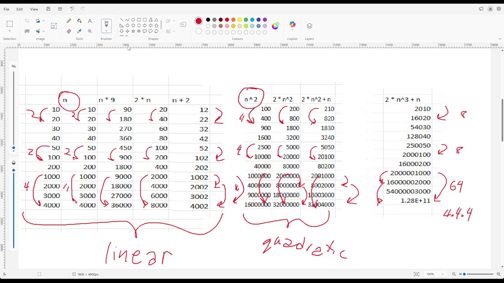

`[00:14:19]` equal to N cubed. I mean, it's, it's doubled and there's like a little bit of extra stuff thrown `[00:14:25]` in, but just as the patterns, sorry, I mean, I said that wrong. It's not that it's approximately `[00:14:31]` equal to N cubed. Sure. Yeah. No, whatever. What I mean is that the pattern of growth, `[00:14:35]` remember that we're talking about rate of growth, right? The, `[00:14:39]` the pattern of growth, the rate of growth, the rate of growth, the rate of growth, the rate of growth, `[00:14:40]` is the same pattern of growth that you would see if I just put in N cubed. Okay. And so I probably `[00:14:48]` should have done that, but I think I'm boring you. So I want to stop just repeating myself. `[00:14:52]` So this, do you know the word for this here? I'll give you a new word. This is not officially `[00:14:56]` testable yet, but it probably will be eventually, but not, not, not right now. Anyways, this is

## [00:15:00]

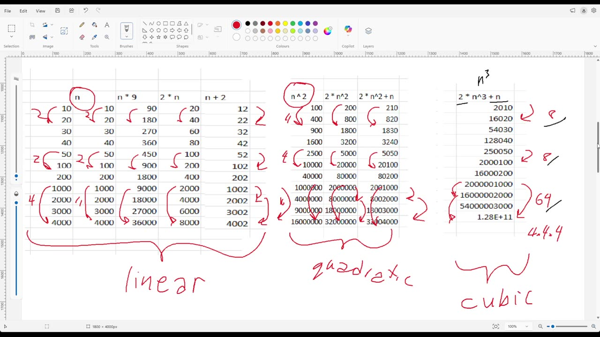

`[00:15:02]` cubic, right? And so then, as you know, all of these are polynomial, except that we kind of `[00:15:12]` pretend that linear isn't. `[00:15:13]` Because we're liars, right? Uh, ha ha ha lies, but you know, it's what people say. Okay. Oh, `[00:15:23]` and I guess there's some, there's one other thing we could do. I should have done this at the `[00:15:27]` beginning. Ha ha ha. Let's do this now. There's okay. Yeah, we got that now. Here, let's get rid `[00:15:36]` of this. Make this larger. No, sorry. I'm sick and my brain is a mess. So I'm, whoa, what just

## [00:15:45]

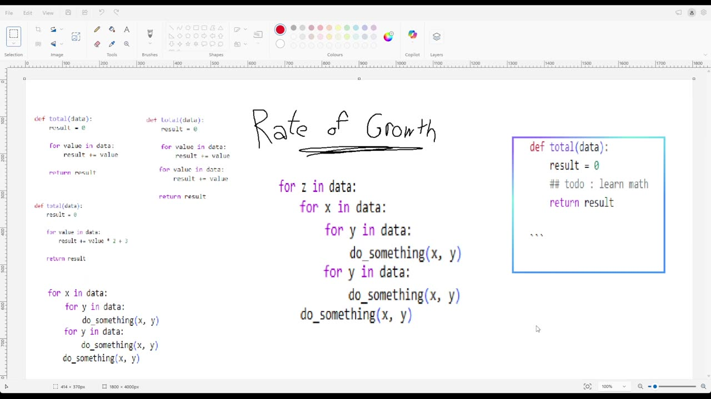

`[00:15:46]` happened? Oh, I triggered, `[00:15:49]` some AI feature. Like I said, I'm sick. My brain is a mess. I did not need that right now. Okay. `[00:15:52]` Sorry. So, uh, we have code like this. It doesn't matter what size data is. It's just going to do `[00:16:00]` this and then this, right? And so in that, if N is 10, the cost is one or two or something. I don't `[00:16:08]` know. And if N is a thousand, then the cost is still one. I don't know. Maybe it's two. Let's `[00:16:14]` say two. And if N is 300, the cost is two. Like it doesn't matter. `[00:16:20]` Right. And so this of course is, we're just going to summarize this as being constant. Um, yes.

## [00:16:30]

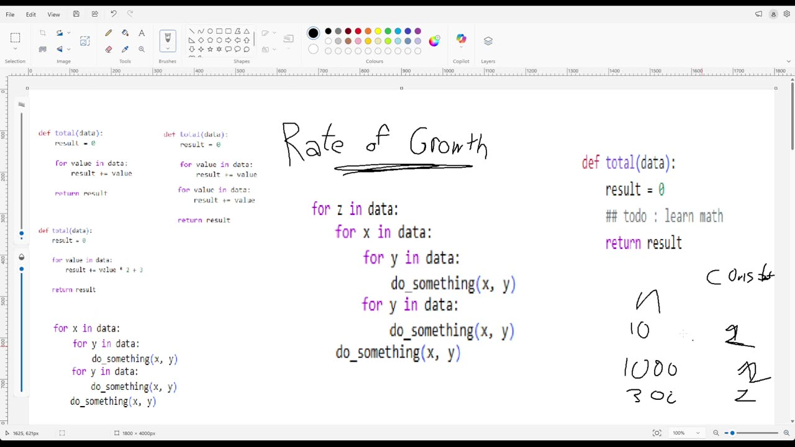

`[00:16:31]` Okay. So what do we have here? What we have is that we've got several different growth patterns, `[00:16:39]` right? We've got a constant growth pattern and we've got linear and we've got quadratic and `[00:16:52]` we've got, uh, cubic and we've got those and there's other polymers. `[00:16:59]` And so we've got a constant growth pattern and we've got linear and we've got quadratic and we've `[00:17:05]` got other polymers. And so we've got linear and we've got quadratic and we've got other polymers. `[00:17:06]` And so the only step remaining is to tell you the kind of, you know, does this qualify as a jump `[00:17:12]` scare? We're going to write these with this big O notation. Big O is not how we came up with the

## [00:17:15]

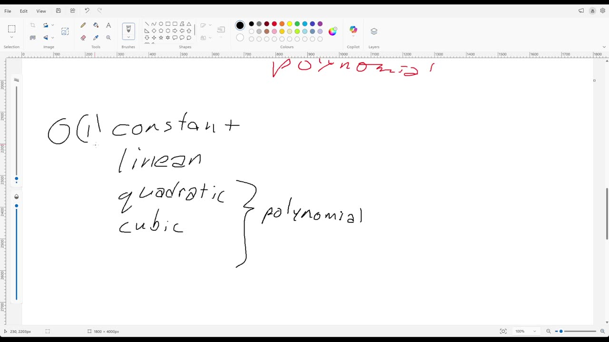

`[00:17:20]` answer. Big O is just how we write down these answers. These answers where we kind of lumped `[00:17:26]` a bunch of stuff together through a bunch of details, because all we wanted to do was describe `[00:17:31]` the pattern of growth, right? So you've seen this before. And so we've got a constant growth pattern `[00:17:52]` before. You've seen this in a prior semester, I hope. Maybe I mentioned it earlier in class. I `[00:17:56]` can't remember. But this is this thing that we use to describe how expensive algorithms are,

## [00:18:00]

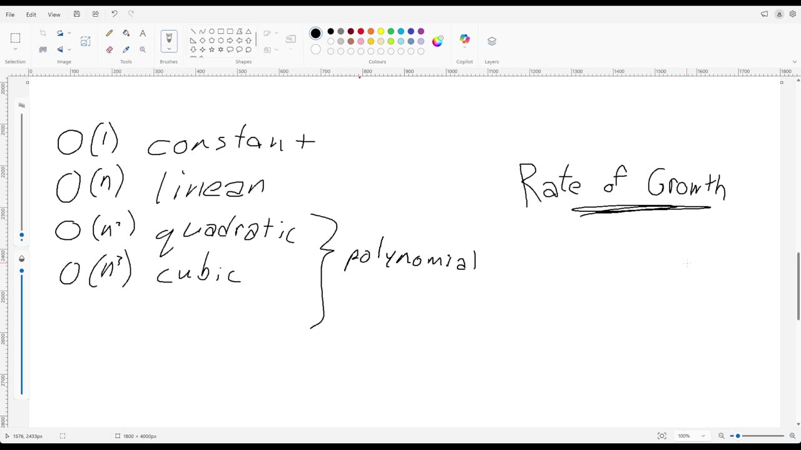

`[00:18:03]` not the actual time they take, because that depends on all sorts of things we can't control, `[00:18:08]` like what computer or whatever. We want to instead talk about how the algorithm gets slower `[00:18:15]` when the data gets larger or the rate of growth of the cost. `[00:18:22]` I don't know if any of that was useful. I look forward to your feedback about which parts `[00:18:26]` helped. Maybe none of it. But that was your introduction video to the connection between `[00:18:32]` what we've been doing with different kinds of equations and why we don't actually do a lot `[00:18:40]` of timing of algorithms and how this connects up to big O and all that stuff. There you go.

## [00:18:45]

