# Transcript: 202630_w04_ratesofgrowth_log.mp4

- Source: `C:\Users\hiros\BCIT-study-material\Algorithms\202630_w04_ratesofgrowth_log.mp4`
- Duration: 00:08:40
- Segments: 69, screenshots: 12
- Whisper model: `large-v3` (auto-generated; may contain recognition errors)

## [00:00:00]

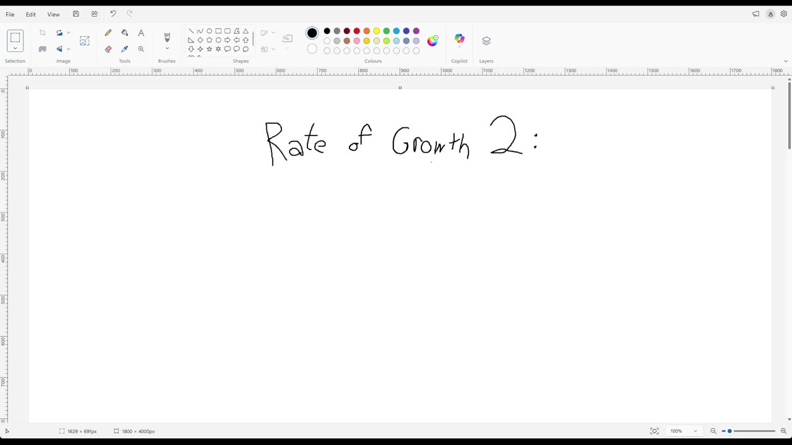

`[00:00:00]` Previously, we looked at code and we asked, how does the amount of work grow as the input gets `[00:00:04]` larger? Let's ask the same question about binary search. So obviously I've left out some of the `[00:00:15]` code and we're not going to super dwell on the details right now. So we learned in the previous `[00:00:21]` video that a little plus one at the beginning or whatever, we can kind of ignore that stuff. `[00:00:27]` And so really the question I want to ask is, how many times does it do, `[00:00:34]` like however long this thing takes, how many times does it have to do that, right? `[00:00:39]` And so obviously it has to go around and around and around this thing. `[00:00:43]` And the size of the gap between high and low is going to be a major factor, right?

## [00:00:45]

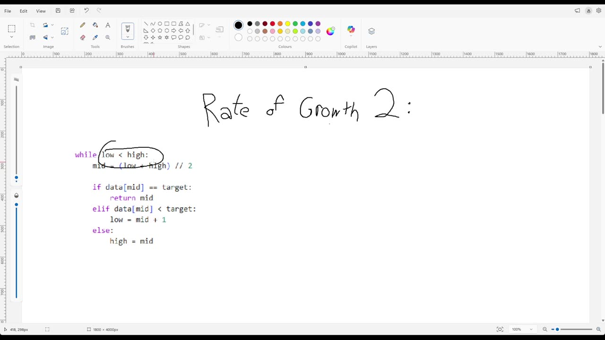

`[00:00:52]` And so let's suppose that there are eight places it could be looking. `[00:00:57]` Between high and low. And so after one go around, it could of course find it and return. `[00:01:04]` But if it doesn't find it and return, then it'll have either three or four left and suppose we're `[00:01:08]` having a bad day and so there's four left. And then it could find it and suppose we're having `[00:01:13]` a bad day and so there's two left. And then it could find it or not and it's got to split it `[00:01:18]` and one side is size zero now, but one side still has one. And then it could look there and not find `[00:01:23]` it. So it could take up to five steps, right? `[00:01:27]` And so if n is eight, then maybe the number of steps might be five. It might be better than that

## [00:01:30]

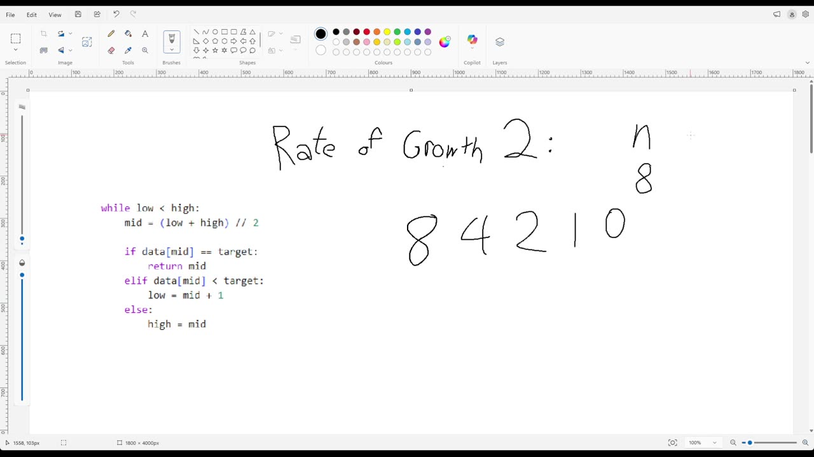

`[00:01:35]` if we're lucky, but if we're really unlucky, it might be five, right? But what happens if n is 16? `[00:01:45]` Well, it goes around the loop once and then if it doesn't find it and we end up on the large side `[00:01:53]` and we get unlucky, it's eight. And then, oh, hang on, wait a second. Then it's going to cut in half, `[00:01:58]` to four, and then cut in half, to two, and then cut in half, to one, and then cut in half, to zero. `[00:02:02]` And so obviously I didn't need to write all those out again. I can just reuse the previous section.

## [00:02:15]

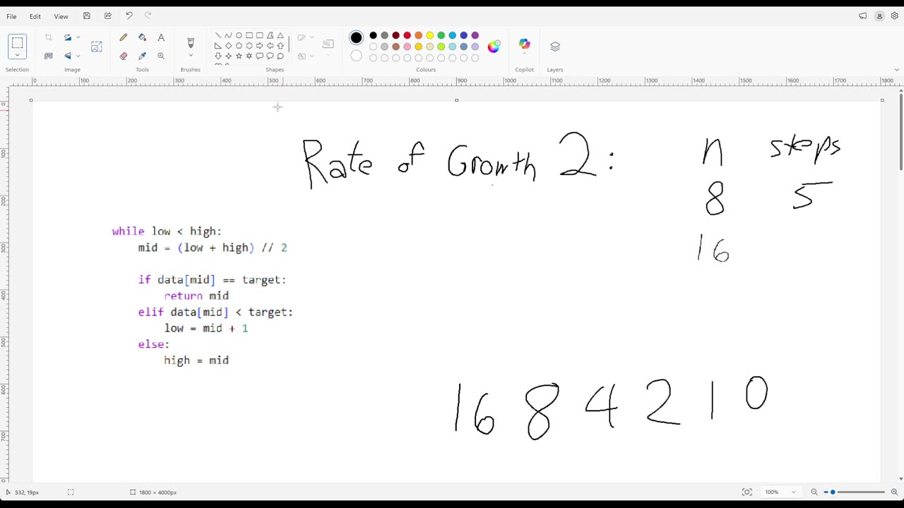

`[00:02:16]` And so if n equals 16, it takes six steps, right? And you're going to be astonished to learn `[00:02:21]` that if n is 32 in the first step, it might do better than this, but the worst it's going to do `[00:02:29]` is end up at 16 and then it's going to be six more steps. And so obviously it's going to be `[00:02:33]` seven steps. And again, this table is just going to continue on in this fashion, right? `[00:02:45]` And you might ask, what happens if we're not on one of those tidy numbers? Well, again, `[00:02:50]` we can get lucky, so it could be a lot faster. It could just be one. It could always just be one `[00:02:53]` step. But suppose we have a hundred and then it cuts in half and then we have 50 and then it cuts

## [00:03:00]

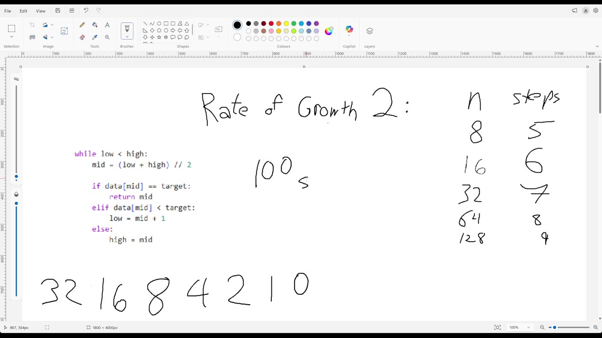

`[00:03:01]` in half, blah, blah, blah. Okay, let's see. A hundred is one, two, three, four, five, six, seven, eight, nine. `[00:03:12]` Nine steps, right? And so it turns out that eventually it ended up kind of like ending up `[00:03:22]` on the same track anyway. And so basically the bad situation at a hundred is the same as the `[00:03:28]` bad situation as the kind of next number up. So let's compare this to some patterns we saw before.

## [00:03:45]

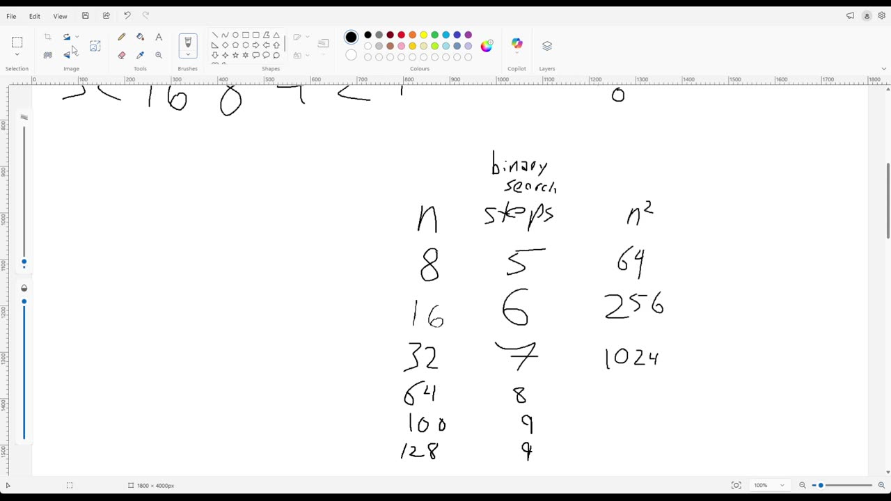

`[00:03:45]` Not sure why I started with n squared, but let's throw some n in there and perhaps some n cubed. `[00:04:02]` Is that right? Something like that. Okay, and what's going on here is that `[00:04:08]` when this is times two, then this is times two, and this is times four, because that's times two `[00:04:20]` squared. And this is times eight, because that's times two cubed. And, you know, so what's going `[00:04:28]` on over here? Well, what's going on over here isn't times anything at all.

## [00:04:30]

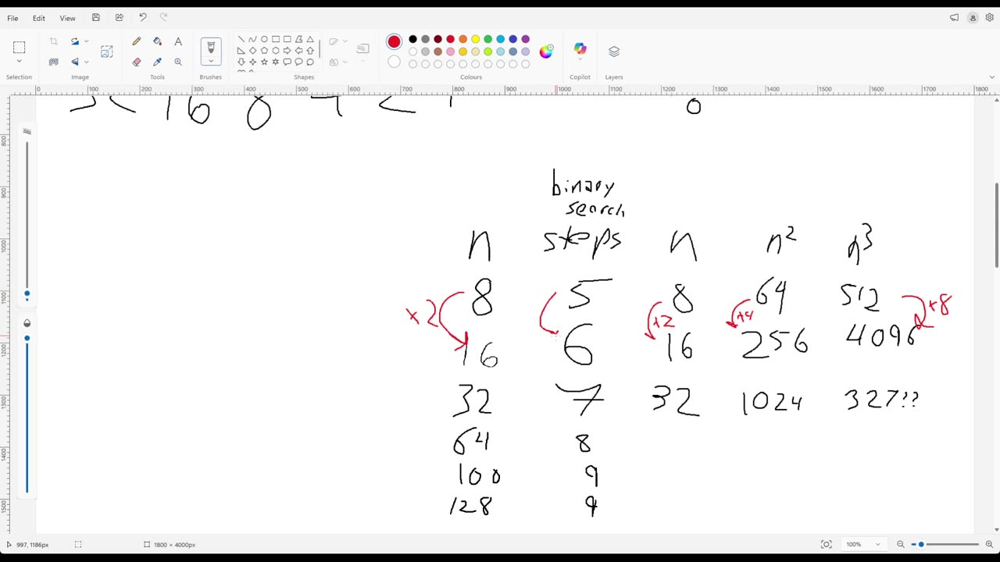

`[00:04:32]` It's plus one, plus one, plus one, plus one. And you can't look at just one of them, right? `[00:04:41]` Like if you remember in the previous video, sometimes they weren't exactly times two. `[00:04:45]` You got to kind of look at the whole pattern and notice that every time we times two over here, `[00:04:49]` we're just doing plus one over here. How many times can we divide by two to get from n down to

## [00:05:15]

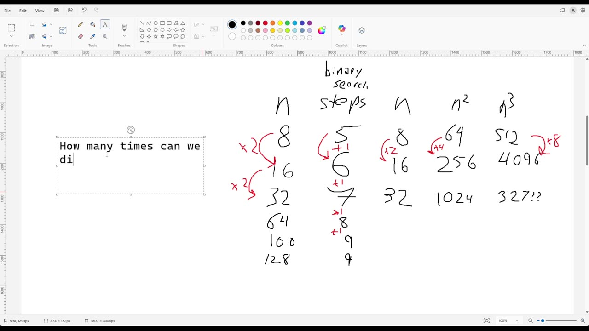

`[00:05:32]` one? And the answer is log base two of n, right? And so this thing here is going to be plus one `[00:05:44]` over here. That is the number of binary search steps. We can just call that log n. And so the `[00:05:56]` big O notation here is no big surprise, right? This is just going to be big O of n. This is

## [00:06:00]

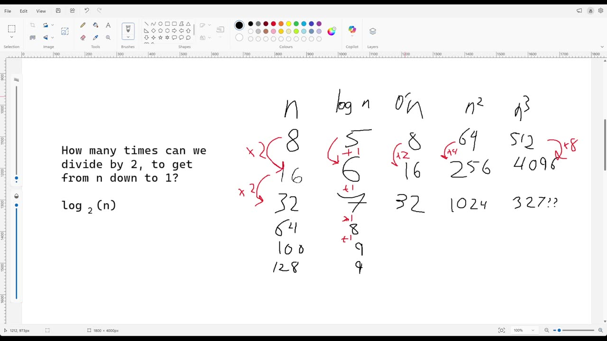

`[00:06:01]` going to be big O of n squared. It's going to be big O of n cubed. Oh my god, the writing over `[00:06:06]` there is unusually bad. And of course, this is big O of log n. And that's kind of the point here, `[00:06:18]` right? And we can, of course, as you know, `[00:06:22]` call this logarithmic, right? And so here, faster than linear, but slower than, you know, `[00:06:34]` we didn't put constant here, right? But we could add big O of one over here. One, one, one, one, `[00:06:41]` right? Or it could be seven, seven, seven, seven, seven, or whatever. And so the important thing to

## [00:06:45]

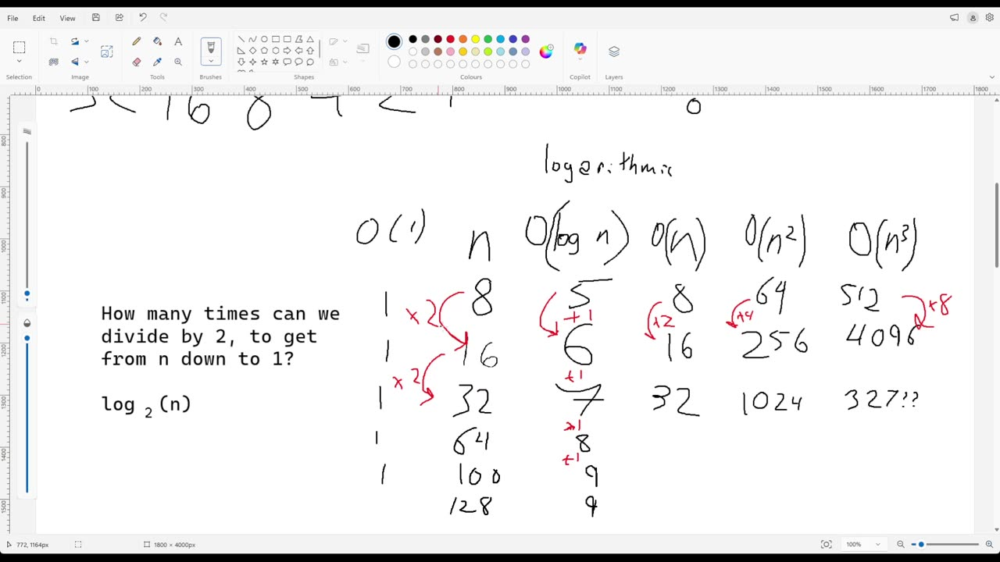

`[00:06:49]` know is not the notation. The notation is easy, right? Like what could be easier than just writing `[00:06:52]` an O and some parentheses, right? And, you know, the approach might be, `[00:06:58]` let's just guess something, but you don't have to just guess. The thing you're trying to figure `[00:07:01]` out is what is the pattern of growth, right? Is the pattern of growth consistent with some `[00:07:08]` equation that's linear? Is it consistent with some equation that's quadratic? Is it consistent `[00:07:13]` with some equation that's logarithmic? And, you know, maybe what that means is that every time `[00:07:18]` you double, you double. Every time you double, you quadruple. Or every time you double, `[00:07:22]` you increase by one, right? And binary search is not the only algorithm with this, `[00:07:28]` growth pattern, but it is like really a poster child for logarithmic growth because in binary

## [00:07:30]

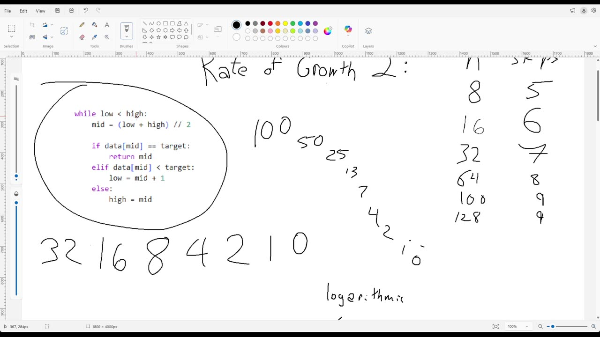

`[00:07:36]` search, every step cuts the size of the problem you're looking at in half. And it has to keep `[00:07:43]` doing that until it hits zero. Oh, and by the way, one small detail here that might, you know, `[00:07:49]` might confuse or surprise you. You might think, oh, the log base two of eight isn't five, `[00:07:53]` it's three, right? And so really this isn't just, `[00:07:58]` log n. Really, this is log base two of n plus two. But as you already know, `[00:08:11]` this is going to have the same growth pattern as log n. It's always going to be plus one.

## [00:08:15]

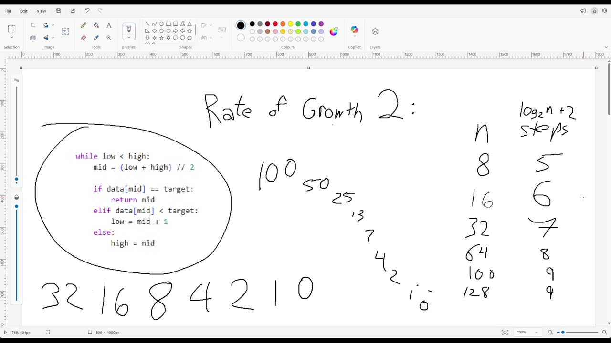

`[00:08:18]` And so therefore we can just call this big O of log n and not worry about the plus two, `[00:08:26]` right? Okay, there you go. So that's the one extra category here. `[00:08:32]` Whoops. `[00:08:33]` We had four or five categories before, and now we've got one more logarithmic.
